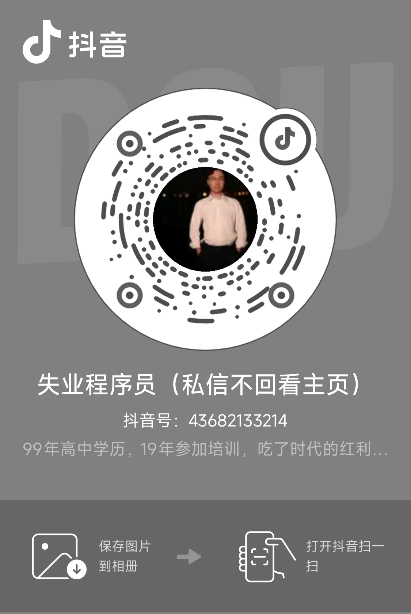

# 免费领取说明

[返回首页](README.md) · [查看总目录](CATALOG.md)

## 如何领取

先在总目录中选择项目，再通过下方二维码联系本人，发送项目编号与名称。资料按项目发放，不提供全库合集下载入口。

消息示例：领取项目 005，供应商准入与绩效评价管理系统，想了解源码、运行环境和演示视频。

| 抖音 | 微信 |
|:---:|:---:|
|  |  |
| 失业程序员 · 抖音号 43682133214 | 小新 · 备注项目编号 |

## 领取前确认

- 项目名称相似时，请以编号和实际版本为准。
- 可以询问源码、功能文档、运行说明、SQL 和演示视频的具体清单；不同项目的材料完整度不同。
- 免费分享资料不代表包含免费定制开发、远程部署或长期技术支持。
- 领取和使用前请阅读项目包内授权；第三方代码、图片及其他材料遵守各自的许可。
- 请勿提供身份证、学号、真实业务数据库或其他与领取无关的个人信息。

## 识别官方入口

本仓库公布的抖音号与微信二维码为本案例库联系入口。不要仅凭别人使用相同头像、昵称或转发截图就认定其得到授权。

项目资料可向本人免费询问领取。若有人以「独家原创」「官方代理」名义售卖，可先通过上述入口核实；付费服务与项目资料本身应明确区分。
