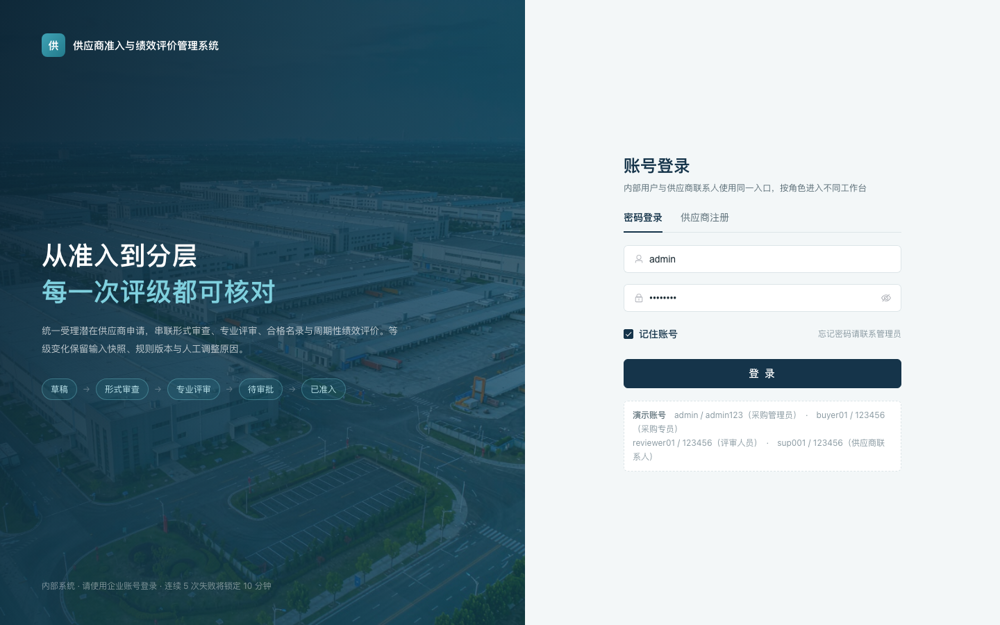
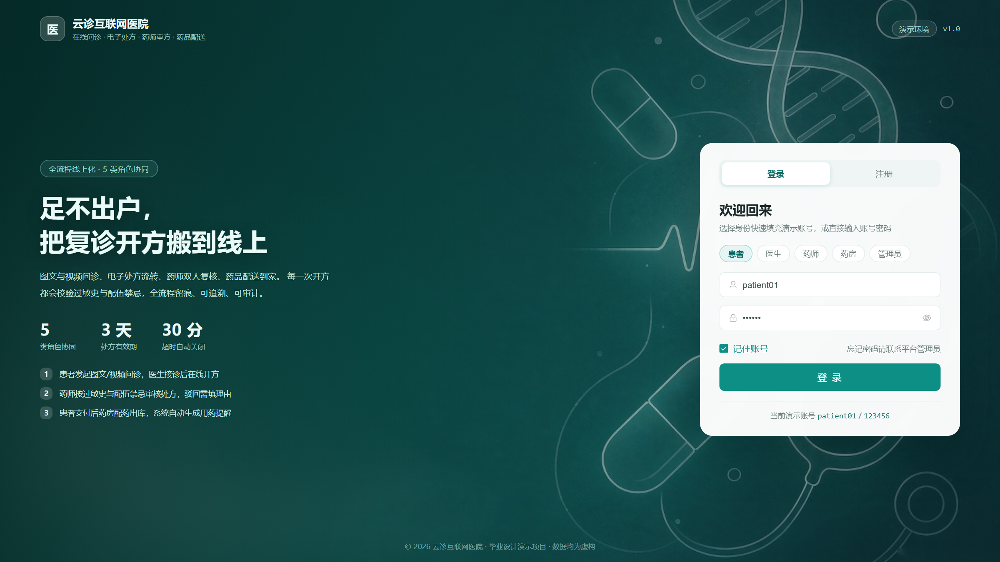
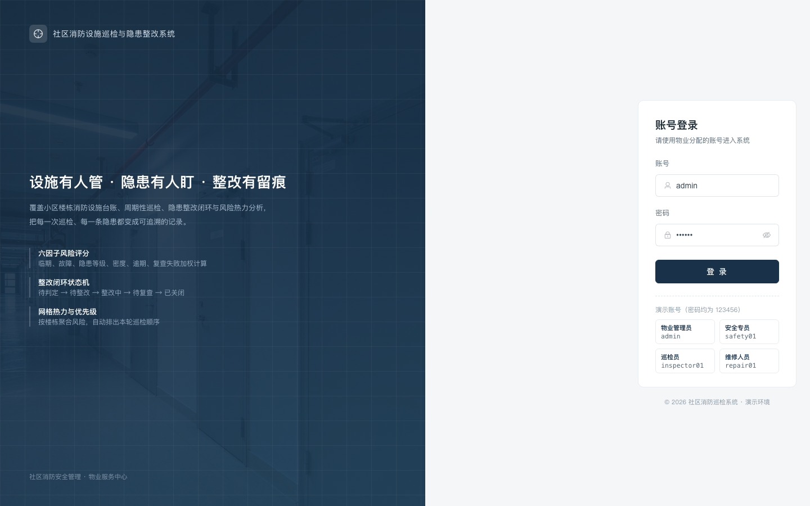
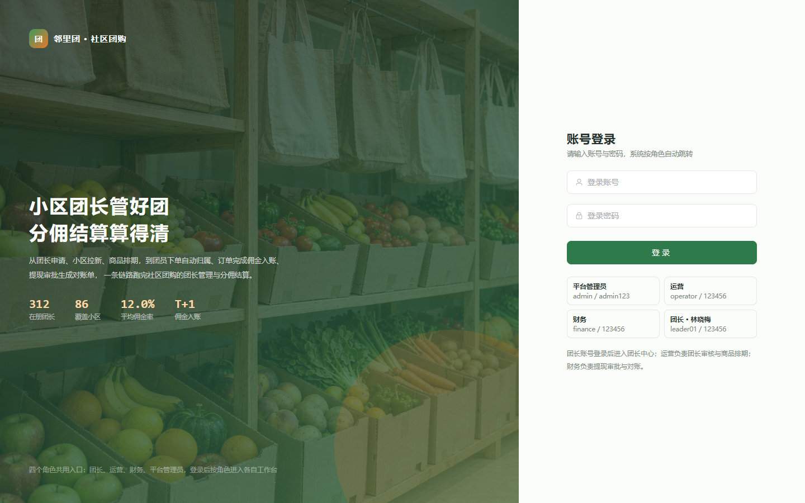

<div align="center">

# 失业程序员 · 项目案例库

**379 个项目的功能简介、技术方案与界面预览，先看明白，再按编号领取学习资料。**

[浏览全部项目](CATALOG.md) · [领取方式](GET-PROJECT.md) · [常见问题](FAQ.md) · [使用说明](NOTICE.md)

</div>

---

## 这个仓库是什么

这是一个**项目索引仓库**。每个条目给出一段项目简介、所属技术方向、功能要点和真实界面截图，让你在没有源码的情况下也能判断：这个项目做什么业务、用了什么技术栈、界面是什么风格、值不值得进一步了解。

选好之后，凭**项目编号**通过文末的联系方式领取对应的完整资料。

> 仓库里放的是**介绍和预览**，不是源码。源码、SQL、功能文档、演示视频按项目单独提供。

## 内容规模

| 项目条目 | 界面预览 | 技术组合 | 详情页 |
|---:|---:|---:|---:|
| 379 | 122 张 | 14 种 | 14 页 |

## 仓库里有什么，没有什么

| 已公开 | 按需领取 |
|---|---|
| 项目名称与编号 | 完整源码（前端 + 后端） |
| 技术方向与框架版本 | 数据库建表脚本与种子数据 |
| 业务背景与功能要点 | 功能需求文档 / 系统设计文档 |
| 界面截图预览 | 演示录屏视频 |
| 分页索引与检索表 | 论文相关材料（需确认授权与脱敏） |

## 项目分组

按编号段分为三组，覆盖的场景和成熟度不同：

| 编号段 | 分组 | 数量 | 典型项目 |
|---|---|---:|---|
| `005` – `073` | 业务管理项目 | 64 | 供应商准入、消防巡检、实习周报、客诉工单 |
| `NEW-001` – `NEW-061` | 专题项目 | 59 | 在线问诊、社区团购、私教课程、旅拍交付 |
| `A-001` – `A-256` | 综合项目 | 256 | 校园服务、电商交易、医疗健康、数据分析 |

业务场景覆盖企业管理、校园教育、医疗健康、电商零售、社区生活、文旅体育、农业食品、物流仓储等方向。**相近题目可能属于不同版本**，领取时请同时发送编号和名称。

## 技术栈分布

| 技术组合 | 项目数 | 说明 |
|---|---:|---|
| Spring Boot + Vue | 290 | 主流方案，前后端分离，MySQL 数据库 |
| Spring Boot（未细分前端） | 37 | 以管理后台为主，部分为小程序双端 |
| Flask / Django / Python + Vue | 19 | Python 后端，多为数据分析、推荐类项目 |
| 其他（纯 Vue / Java / SSM） | 25 | 见各项目详情页标注 |
| 详见项目说明 | 8 | 详情页注明具体版本 |

## 界面预览

以下截图来自项目包内的实际运行界面，完整预览见各项目详情页。

| 业务管理项目 | 专题项目 |
|:--:|:--:|
|  |  |
| **005** · 供应商准入与绩效评价管理系统 | **NEW-001** · 互联网医院在线问诊与处方流转 |
|  |  |
| **010** · 社区消防设施巡检与隐患整改系统 | **NEW-022** · 社区团购团长管理与分佣结算 |

更多界面见[总目录](CATALOG.md)，每个有截图的项目都会在详情页展示。

## 怎么找到你需要的项目

1. 打开 [**项目总目录 CATALOG.md**](CATALOG.md)。
2. 用浏览器查找（`Ctrl + F` / `Cmd + F`）搜索关键词，比如「宠物」「选课」「推荐」「小程序」。
3. 点进详情页，看项目简介、功能要点和界面截图。
4. 记下**项目编号 + 项目名称**，按下面的方式联系领取。

也可以直接看结构化数据 [PROJECTS.csv](PROJECTS.csv)，用 Excel 筛选技术方向。

---

## 免费领取

**项目学习资料按需免费领取，无需向第三方购买。**

领取步骤：

1. 在[总目录](CATALOG.md)确认项目编号与名称；
2. 扫描下方二维码联系（抖音看主页，微信直接说明来意）；
3. 发送格式：`领取项目 + 编号 + 项目名称`，例如：

   ```
   领取项目 005，供应商准入与绩效评价管理系统
   ```

4. 说明你需要的材料（源码 / 文档 / SQL / 演示视频），我会告知该项目实际具备哪些。

<div align="center">

### 扫码联系

|  |  |
|:--:|:--:|
| **抖音：失业程序员**<br>抖音号 `43682133214` | **微信：小新**<br>添加时请备注项目编号 |

</div>

无法识别二维码时，可在抖音直接搜索抖音号 **43682133214**。联系方式变化时以本仓库更新为准。

## 领取前请先确认

- 项目名称相似时，以**编号和实际版本**为准，不要只看标题。
- 不同项目的材料完整度不同，可以逐项询问清单。
- 免费分享资料**不包含**免费定制开发、远程部署或长期技术支持；相关服务如有提供会单独说明。
- 请勿提供身份证、学号、真实业务数据库等与领取无关的个人信息。

## 关于材料与使用范围

本仓库为项目展示与文档索引，源码通过上述渠道按需提供。免费领取不等于获得任意转售、再分发或冒充原创的许可；具体使用范围以项目包内授权及第三方许可证为准。

公开内容以简介、功能摘录和界面预览为主。完整论文、源码、SQL、配置、账户数据与批量交付包不随本展示仓库发布；涉及个人信息或第三方权利的材料，应在确认授权与脱敏后提供。

项目用于学习和技术交流，文档中的功能目标不等于全部实现已经验证，也不构成生产环境适用性保证。论文相关材料仅用于研究方法和写作结构参考，请独立完成自己的学习与研究。

## 目录

| 页面 | 内容 |
|---|---|
| [CATALOG.md](CATALOG.md) | 379 个项目全量索引 |
| [catalog/](catalog/README.md) | 分页详情：简介、功能要点、截图 |
| [PROJECTS.csv](PROJECTS.csv) | 结构化数据，可筛选排序 |
| [GET-PROJECT.md](GET-PROJECT.md) | 领取流程与识别官方入口 |
| [FAQ.md](FAQ.md) | 常见问题 |
| [NOTICE.md](NOTICE.md) | 使用与权利说明 |

<div align="center">

**[回到顶部](#失业程序员--项目案例库)**

</div>
