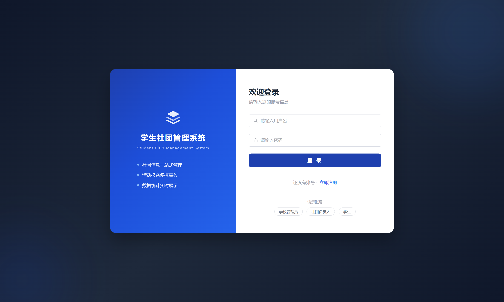

# 综合项目 · 第 4 页

[返回总目录](../CATALOG.md) · [免费领取说明](../GET-PROJECT.md)

> 功能摘录来自项目附带文档，描述的是案例范围与设计目标；具体实现、运行环境和可领取材料以对应版本为准。

| 项目编号 | 项目名称 |
|---|---|
| A-091 | [基于SpringBoot+Vue的在线课程学习平台设计与实现](#p-a-091) |
| A-092 | [基于SpringBoot+Vue的在线陪诊预约系统的设计与实现](#p-a-092) |
| A-093 | [基于SpringBoot+Vue的在线音乐网站设计与实现](#p-a-093) |
| A-094 | [基于SpringBoot+Vue的基于spring boot高校学生课程选择管理系统](#p-a-094) |
| A-095 | [基于SpringBoot+Vue的基于SpringBoot+vue.js养老管理系统](#p-a-095) |
| A-096 | [基于SpringBoot+Vue的基于SpringBoot+Vue高考志愿填报系统](#p-a-096) |
| A-097 | [基于SpringBoot+Vue的基于SpringBoot制造企业保密管理体系构建](#p-a-097) |
| A-098 | [基于SpringBoot+Vue的基于springboot海博锐斯羽毛球俱乐部管理信息系统分析与设计](#p-a-098) |
| A-099 | [基于SpringBoot+Vue的基于springboot电子宠物社区设计与实现](#p-a-099) |
| A-100 | [基于SpringBoot+Vue的基于springboot菜谱点评系统](#p-a-100) |
| A-101 | [基于SpringBoot+Vue的堤防工程文档管理系统](#p-a-101) |
| A-102 | [基于SpringBoot+Vue的多囊卵巢综合征知识服务平台设计与实现](#p-a-102) |
| A-103 | [基于SpringBoot+Vue的多角色协同图像标注平台设计与实现](#p-a-103) |
| A-104 | [基于SpringBoot+Vue的大学生心理健康测评与分析系统的设计与实现](#p-a-104) |
| A-105 | [基于SpringBoot+Vue的天天小吃美食网站设计与开发](#p-a-105) |
| A-106 | [基于SpringBoot+Vue的天气大屏](#p-a-106) |
| A-107 | [基于SpringBoot+Vue的学习系统的设计与实现](#p-a-107) |
| A-108 | [基于SpringBoot+Vue的学生作业管理和抄袭检测系统](#p-a-108) |
| A-109 | [基于SpringBoot+Vue的学生宿舍管理系统](#p-a-109) |
| A-110 | [基于SpringBoot+Vue的学生宿舍管理系统的安全设计与实现](#p-a-110) |
| A-111 | [基于SpringBoot+Vue的学生社团管理系统的设计与实现](#p-a-111) |
| A-112 | [基于SpringBoot+Vue的学生选课系统设计与实现](#p-a-112) |
| A-113 | [基于SpringBoot+Vue的宁大科院毕业生信息跟踪与服务平台的设计与实现](#p-a-113) |
| A-114 | [基于SpringBoot+Vue的实时通信系统](#p-a-114) |
| A-115 | [基于SpringBoot+Vue的实验室管理系统的设计与实现](#p-a-115) |
| A-116 | [基于SpringBoot+Vue的宠物之家管理系统设计与实现](#p-a-116) |
| A-117 | [基于SpringBoot+Vue的宠物寄养平台的设计与实现](#p-a-117) |
| A-118 | [基于SpringBoot+Vue的宠物用品在线订购系统的设计与实现](#p-a-118) |
| A-119 | [基于SpringBoot+Vue的宠物领养管理系统](#p-a-119) |
| A-120 | [基于SpringBoot+Vue的宠物领养管理系统（二）](#p-a-120) |

## A-091 · 基于SpringBoot+Vue的在线课程学习平台设计与实现

**技术方向：** SpringBoot / Vue  
**材料概况：** 功能说明 / 演示视频（按需领取） / 论文相关材料（领取前确认授权与脱敏）

### 项目简介

围绕“基于SpringBoot+Vue的在线课程学习平台设计与实现”组织的项目案例，可用于了解相关业务场景与系统设计。领取前请按编号确认具体版本和材料清单。

### 演示视频

原项目包含演示视频。联系时发送「领取项目 A-091」，可一并询问对应视频。

**免费领取：** 按[领取说明](../GET-PROJECT.md)联系，发送「领取项目 A-091」。

[返回总目录](../CATALOG.md)

---

## A-092 · 基于SpringBoot+Vue的在线陪诊预约系统的设计与实现

**技术方向：** SpringBoot / Vue  
**材料概况：** 功能说明 / 演示视频（按需领取） / 论文相关材料（领取前确认授权与脱敏）

### 项目简介

围绕“基于SpringBoot+Vue的在线陪诊预约系统的设计与实现”组织的项目案例，可用于了解相关业务场景与系统设计。领取前请按编号确认具体版本和材料清单。

### 演示视频

原项目包含演示视频。联系时发送「领取项目 A-092」，可一并询问对应视频。

**免费领取：** 按[领取说明](../GET-PROJECT.md)联系，发送「领取项目 A-092」。

[返回总目录](../CATALOG.md)

---

## A-093 · 基于SpringBoot+Vue的在线音乐网站设计与实现

**技术方向：** SpringBoot / Vue  
**材料概况：** 功能说明 / 演示视频（按需领取） / 论文相关材料（领取前确认授权与脱敏）

### 项目简介

围绕“基于SpringBoot+Vue的在线音乐网站设计与实现”组织的项目案例，可用于了解相关业务场景与系统设计。领取前请按编号确认具体版本和材料清单。

### 演示视频

原项目包含演示视频。联系时发送「领取项目 A-093」，可一并询问对应视频。

**免费领取：** 按[领取说明](../GET-PROJECT.md)联系，发送「领取项目 A-093」。

[返回总目录](../CATALOG.md)

---

## A-094 · 基于SpringBoot+Vue的基于spring boot高校学生课程选择管理系统

**技术方向：** SpringBoot / Vue  
**材料概况：** 功能说明 / 演示视频（按需领取） / 论文相关材料（领取前确认授权与脱敏）

### 项目简介

围绕“基于SpringBoot+Vue的基于spring boot高校学生课程选择管理系统”组织的项目案例，可用于了解相关业务场景与系统设计。领取前请按编号确认具体版本和材料清单。

### 演示视频

原项目包含演示视频。联系时发送「领取项目 A-094」，可一并询问对应视频。

**免费领取：** 按[领取说明](../GET-PROJECT.md)联系，发送「领取项目 A-094」。

[返回总目录](../CATALOG.md)

---

## A-095 · 基于SpringBoot+Vue的基于SpringBoot+vue.js养老管理系统

**技术方向：** SpringBoot / Vue  
**材料概况：** 功能说明 / 演示视频（按需领取） / 论文相关材料（领取前确认授权与脱敏）

### 项目简介

围绕“基于SpringBoot+Vue的基于SpringBoot+vue.js养老管理系统”组织的项目案例，可用于了解相关业务场景与系统设计。领取前请按编号确认具体版本和材料清单。

### 演示视频

原项目包含演示视频。联系时发送「领取项目 A-095」，可一并询问对应视频。

**免费领取：** 按[领取说明](../GET-PROJECT.md)联系，发送「领取项目 A-095」。

[返回总目录](../CATALOG.md)

---

## A-096 · 基于SpringBoot+Vue的基于SpringBoot+Vue高考志愿填报系统

**技术方向：** SpringBoot / Vue  
**材料概况：** 功能说明 / 演示视频（按需领取） / 论文相关材料（领取前确认授权与脱敏）

### 项目简介

围绕“基于SpringBoot+Vue的基于SpringBoot+Vue高考志愿填报系统”组织的项目案例，可用于了解相关业务场景与系统设计。领取前请按编号确认具体版本和材料清单。

### 演示视频

原项目包含演示视频。联系时发送「领取项目 A-096」，可一并询问对应视频。

**免费领取：** 按[领取说明](../GET-PROJECT.md)联系，发送「领取项目 A-096」。

[返回总目录](../CATALOG.md)

---

## A-097 · 基于SpringBoot+Vue的基于SpringBoot制造企业保密管理体系构建

**技术方向：** SpringBoot / Vue  
**材料概况：** 功能说明 / 演示视频（按需领取） / 论文相关材料（领取前确认授权与脱敏）

### 项目简介

围绕“基于SpringBoot+Vue的基于SpringBoot制造企业保密管理体系构建”组织的项目案例，可用于了解相关业务场景与系统设计。领取前请按编号确认具体版本和材料清单。

### 演示视频

原项目包含演示视频。联系时发送「领取项目 A-097」，可一并询问对应视频。

**免费领取：** 按[领取说明](../GET-PROJECT.md)联系，发送「领取项目 A-097」。

[返回总目录](../CATALOG.md)

---

## A-098 · 基于SpringBoot+Vue的基于springboot海博锐斯羽毛球俱乐部管理信息系统分析与设计

**技术方向：** SpringBoot / Vue  
**材料概况：** 功能说明 / 演示视频（按需领取） / 论文相关材料（领取前确认授权与脱敏）

### 项目简介

围绕“基于SpringBoot+Vue的基于springboot海博锐斯羽毛球俱乐部管理信息系统分析与设计”组织的项目案例，可用于了解相关业务场景与系统设计。领取前请按编号确认具体版本和材料清单。

### 演示视频

原项目包含演示视频。联系时发送「领取项目 A-098」，可一并询问对应视频。

**免费领取：** 按[领取说明](../GET-PROJECT.md)联系，发送「领取项目 A-098」。

[返回总目录](../CATALOG.md)

---

## A-099 · 基于SpringBoot+Vue的基于springboot电子宠物社区设计与实现

**技术方向：** SpringBoot / Vue  
**材料概况：** 功能说明 / 演示视频（按需领取） / 论文相关材料（领取前确认授权与脱敏）

### 项目简介

围绕“基于SpringBoot+Vue的基于springboot电子宠物社区设计与实现”组织的项目案例，可用于了解相关业务场景与系统设计。领取前请按编号确认具体版本和材料清单。

### 演示视频

原项目包含演示视频。联系时发送「领取项目 A-099」，可一并询问对应视频。

**免费领取：** 按[领取说明](../GET-PROJECT.md)联系，发送「领取项目 A-099」。

[返回总目录](../CATALOG.md)

---

## A-100 · 基于SpringBoot+Vue的基于springboot菜谱点评系统

**技术方向：** SpringBoot / Vue  
**材料概况：** 功能说明 / 论文相关材料（领取前确认授权与脱敏）

### 项目简介

围绕“基于SpringBoot+Vue的基于springboot菜谱点评系统”组织的项目案例，可用于了解相关业务场景与系统设计。领取前请按编号确认具体版本和材料清单。

**免费领取：** 按[领取说明](../GET-PROJECT.md)联系，发送「领取项目 A-100」。

[返回总目录](../CATALOG.md)

---

## A-101 · 基于SpringBoot+Vue的堤防工程文档管理系统

**技术方向：** SpringBoot / Vue  
**材料概况：** 功能说明 / 演示视频（按需领取） / 论文相关材料（领取前确认授权与脱敏）

### 项目简介

围绕“基于SpringBoot+Vue的堤防工程文档管理系统”组织的项目案例，可用于了解相关业务场景与系统设计。领取前请按编号确认具体版本和材料清单。

### 演示视频

原项目包含演示视频。联系时发送「领取项目 A-101」，可一并询问对应视频。

**免费领取：** 按[领取说明](../GET-PROJECT.md)联系，发送「领取项目 A-101」。

[返回总目录](../CATALOG.md)

---

## A-102 · 基于SpringBoot+Vue的多囊卵巢综合征知识服务平台设计与实现

**技术方向：** SpringBoot / Vue  
**材料概况：** 功能说明 / 演示视频（按需领取） / 论文相关材料（领取前确认授权与脱敏）

### 项目简介

围绕“基于SpringBoot+Vue的多囊卵巢综合征知识服务平台设计与实现”组织的项目案例，可用于了解相关业务场景与系统设计。领取前请按编号确认具体版本和材料清单。

### 演示视频

原项目包含演示视频。联系时发送「领取项目 A-102」，可一并询问对应视频。

**免费领取：** 按[领取说明](../GET-PROJECT.md)联系，发送「领取项目 A-102」。

[返回总目录](../CATALOG.md)

---

## A-103 · 基于SpringBoot+Vue的多角色协同图像标注平台设计与实现

**技术方向：** SpringBoot / Vue  
**材料概况：** 功能说明 / 演示视频（按需领取） / 论文相关材料（领取前确认授权与脱敏）

### 项目简介

围绕“基于SpringBoot+Vue的多角色协同图像标注平台设计与实现”组织的项目案例，可用于了解相关业务场景与系统设计。领取前请按编号确认具体版本和材料清单。

### 演示视频

原项目包含演示视频。联系时发送「领取项目 A-103」，可一并询问对应视频。

**免费领取：** 按[领取说明](../GET-PROJECT.md)联系，发送「领取项目 A-103」。

[返回总目录](../CATALOG.md)

---

## A-104 · 基于SpringBoot+Vue的大学生心理健康测评与分析系统的设计与实现

**技术方向：** SpringBoot / Vue  
**材料概况：** 功能说明 / 演示视频（按需领取） / 论文相关材料（领取前确认授权与脱敏）

### 项目简介

围绕“基于SpringBoot+Vue的大学生心理健康测评与分析系统的设计与实现”组织的项目案例，可用于了解相关业务场景与系统设计。领取前请按编号确认具体版本和材料清单。

### 演示视频

原项目包含演示视频。联系时发送「领取项目 A-104」，可一并询问对应视频。

**免费领取：** 按[领取说明](../GET-PROJECT.md)联系，发送「领取项目 A-104」。

[返回总目录](../CATALOG.md)

---

## A-105 · 基于SpringBoot+Vue的天天小吃美食网站设计与开发

**技术方向：** SpringBoot / Vue  
**材料概况：** 功能说明 / 演示视频（按需领取） / 论文相关材料（领取前确认授权与脱敏）

### 项目简介

围绕“基于SpringBoot+Vue的天天小吃美食网站设计与开发”组织的项目案例，可用于了解相关业务场景与系统设计。领取前请按编号确认具体版本和材料清单。

### 功能要点

- 公共功能

- 管理员功能模块

- 用户（消费者）功能模块

- 商家功能模块

### 演示视频

原项目包含演示视频。联系时发送「领取项目 A-105」，可一并询问对应视频。

**免费领取：** 按[领取说明](../GET-PROJECT.md)联系，发送「领取项目 A-105」。

[返回总目录](../CATALOG.md)

---

## A-106 · 基于SpringBoot+Vue的天气大屏

**技术方向：** SpringBoot / Vue  
**材料概况：** 功能说明 / 论文相关材料（领取前确认授权与脱敏）

### 项目简介

围绕“基于SpringBoot+Vue的天气大屏”组织的项目案例，可用于了解相关业务场景与系统设计。领取前请按编号确认具体版本和材料清单。

**免费领取：** 按[领取说明](../GET-PROJECT.md)联系，发送「领取项目 A-106」。

[返回总目录](../CATALOG.md)

---

## A-107 · 基于SpringBoot+Vue的学习系统的设计与实现

**技术方向：** SpringBoot / Vue  
**材料概况：** 功能说明 / 演示视频（按需领取） / 论文相关材料（领取前确认授权与脱敏）

### 项目简介

围绕“基于SpringBoot+Vue的学习系统的设计与实现”组织的项目案例，可用于了解相关业务场景与系统设计。领取前请按编号确认具体版本和材料清单。

### 演示视频

原项目包含演示视频。联系时发送「领取项目 A-107」，可一并询问对应视频。

**免费领取：** 按[领取说明](../GET-PROJECT.md)联系，发送「领取项目 A-107」。

[返回总目录](../CATALOG.md)

---

## A-108 · 基于SpringBoot+Vue的学生作业管理和抄袭检测系统

**技术方向：** SpringBoot / Vue  
**材料概况：** 功能说明 / 演示视频（按需领取） / 论文相关材料（领取前确认授权与脱敏）

### 项目简介

围绕“基于SpringBoot+Vue的学生作业管理和抄袭检测系统”组织的项目案例，可用于了解相关业务场景与系统设计。领取前请按编号确认具体版本和材料清单。

### 演示视频

原项目包含演示视频。联系时发送「领取项目 A-108」，可一并询问对应视频。

**免费领取：** 按[领取说明](../GET-PROJECT.md)联系，发送「领取项目 A-108」。

[返回总目录](../CATALOG.md)

---

## A-109 · 基于SpringBoot+Vue的学生宿舍管理系统

**技术方向：** SpringBoot / Vue  
**材料概况：** 功能说明 / 演示视频（按需领取） / 论文相关材料（领取前确认授权与脱敏）

### 项目简介

围绕“基于SpringBoot+Vue的学生宿舍管理系统”组织的项目案例，可用于了解相关业务场景与系统设计。领取前请按编号确认具体版本和材料清单。

### 演示视频

原项目包含演示视频。联系时发送「领取项目 A-109」，可一并询问对应视频。

**免费领取：** 按[领取说明](../GET-PROJECT.md)联系，发送「领取项目 A-109」。

[返回总目录](../CATALOG.md)

---

## A-110 · 基于SpringBoot+Vue的学生宿舍管理系统的安全设计与实现

**技术方向：** SpringBoot / Vue  
**材料概况：** 功能说明 / 演示视频（按需领取） / 论文相关材料（领取前确认授权与脱敏）

### 项目简介

围绕“基于SpringBoot+Vue的学生宿舍管理系统的安全设计与实现”组织的项目案例，可用于了解相关业务场景与系统设计。领取前请按编号确认具体版本和材料清单。

### 演示视频

原项目包含演示视频。联系时发送「领取项目 A-110」，可一并询问对应视频。

**免费领取：** 按[领取说明](../GET-PROJECT.md)联系，发送「领取项目 A-110」。

[返回总目录](../CATALOG.md)

---

## A-111 · 基于SpringBoot+Vue的学生社团管理系统的设计与实现

**技术方向：** SpringBoot / Vue  
**材料概况：** 功能说明 / 界面预览 / 论文相关材料（领取前确认授权与脱敏）

### 项目简介

围绕“基于SpringBoot+Vue的学生社团管理系统的设计与实现”组织的项目案例，可用于了解相关业务场景与系统设计。领取前请按编号确认具体版本和材料清单。

### 界面预览

预览来自项目包内的界面截图，不代表所有功能均已完成运行验证。

**免费领取：** 按[领取说明](../GET-PROJECT.md)联系，发送「领取项目 A-111」。

[返回总目录](../CATALOG.md)

---

## A-112 · 基于SpringBoot+Vue的学生选课系统设计与实现

**技术方向：** SpringBoot / Vue  
**材料概况：** 功能说明 / 演示视频（按需领取） / 论文相关材料（领取前确认授权与脱敏）

### 项目简介

围绕“基于SpringBoot+Vue的学生选课系统设计与实现”组织的项目案例，可用于了解相关业务场景与系统设计。领取前请按编号确认具体版本和材料清单。

### 演示视频

原项目包含演示视频。联系时发送「领取项目 A-112」，可一并询问对应视频。

**免费领取：** 按[领取说明](../GET-PROJECT.md)联系，发送「领取项目 A-112」。

[返回总目录](../CATALOG.md)

---

## A-113 · 基于SpringBoot+Vue的宁大科院毕业生信息跟踪与服务平台的设计与实现

**技术方向：** SpringBoot / Vue  
**材料概况：** 功能说明 / 演示视频（按需领取） / 论文相关材料（领取前确认授权与脱敏）

### 项目简介

围绕“基于SpringBoot+Vue的宁大科院毕业生信息跟踪与服务平台的设计与实现”组织的项目案例，可用于了解相关业务场景与系统设计。领取前请按编号确认具体版本和材料清单。

### 演示视频

原项目包含演示视频。联系时发送「领取项目 A-113」，可一并询问对应视频。

**免费领取：** 按[领取说明](../GET-PROJECT.md)联系，发送「领取项目 A-113」。

[返回总目录](../CATALOG.md)

---

## A-114 · 基于SpringBoot+Vue的实时通信系统

**技术方向：** SpringBoot / Vue  
**材料概况：** 功能说明 / 演示视频（按需领取） / 论文相关材料（领取前确认授权与脱敏）

### 项目简介

围绕“基于SpringBoot+Vue的实时通信系统”组织的项目案例，可用于了解相关业务场景与系统设计。领取前请按编号确认具体版本和材料清单。

### 演示视频

原项目包含演示视频。联系时发送「领取项目 A-114」，可一并询问对应视频。

**免费领取：** 按[领取说明](../GET-PROJECT.md)联系，发送「领取项目 A-114」。

[返回总目录](../CATALOG.md)

---

## A-115 · 基于SpringBoot+Vue的实验室管理系统的设计与实现

**技术方向：** SpringBoot / Vue  
**材料概况：** 功能说明 / 演示视频（按需领取） / 论文相关材料（领取前确认授权与脱敏）

### 项目简介

围绕“基于SpringBoot+Vue的实验室管理系统的设计与实现”组织的项目案例，可用于了解相关业务场景与系统设计。领取前请按编号确认具体版本和材料清单。

### 演示视频

原项目包含演示视频。联系时发送「领取项目 A-115」，可一并询问对应视频。

**免费领取：** 按[领取说明](../GET-PROJECT.md)联系，发送「领取项目 A-115」。

[返回总目录](../CATALOG.md)

---

## A-116 · 基于SpringBoot+Vue的宠物之家管理系统设计与实现

**技术方向：** SpringBoot / Vue  
**材料概况：** 功能说明 / 论文相关材料（领取前确认授权与脱敏）

### 项目简介

围绕“基于SpringBoot+Vue的宠物之家管理系统设计与实现”组织的项目案例，可用于了解相关业务场景与系统设计。领取前请按编号确认具体版本和材料清单。

**免费领取：** 按[领取说明](../GET-PROJECT.md)联系，发送「领取项目 A-116」。

[返回总目录](../CATALOG.md)

---

## A-117 · 基于SpringBoot+Vue的宠物寄养平台的设计与实现

**技术方向：** SpringBoot / Vue  
**材料概况：** 功能说明 / 演示视频（按需领取） / 论文相关材料（领取前确认授权与脱敏）

### 项目简介

围绕“基于SpringBoot+Vue的宠物寄养平台的设计与实现”组织的项目案例，可用于了解相关业务场景与系统设计。领取前请按编号确认具体版本和材料清单。

### 演示视频

原项目包含演示视频。联系时发送「领取项目 A-117」，可一并询问对应视频。

**免费领取：** 按[领取说明](../GET-PROJECT.md)联系，发送「领取项目 A-117」。

[返回总目录](../CATALOG.md)

---

## A-118 · 基于SpringBoot+Vue的宠物用品在线订购系统的设计与实现

**技术方向：** SpringBoot / Vue  
**材料概况：** 功能说明 / 演示视频（按需领取） / 论文相关材料（领取前确认授权与脱敏）

### 项目简介

围绕“基于SpringBoot+Vue的宠物用品在线订购系统的设计与实现”组织的项目案例，可用于了解相关业务场景与系统设计。领取前请按编号确认具体版本和材料清单。

### 演示视频

原项目包含演示视频。联系时发送「领取项目 A-118」，可一并询问对应视频。

**免费领取：** 按[领取说明](../GET-PROJECT.md)联系，发送「领取项目 A-118」。

[返回总目录](../CATALOG.md)

---

## A-119 · 基于SpringBoot+Vue的宠物领养管理系统

**技术方向：** SpringBoot / Vue  
**材料概况：** 功能说明 / 演示视频（按需领取） / 论文相关材料（领取前确认授权与脱敏）

### 项目简介

围绕“基于SpringBoot+Vue的宠物领养管理系统”组织的项目案例，可用于了解相关业务场景与系统设计。领取前请按编号确认具体版本和材料清单。

### 演示视频

原项目包含演示视频。联系时发送「领取项目 A-119」，可一并询问对应视频。

**免费领取：** 按[领取说明](../GET-PROJECT.md)联系，发送「领取项目 A-119」。

[返回总目录](../CATALOG.md)

---

## A-120 · 基于SpringBoot+Vue的宠物领养管理系统（二）

**技术方向：** SpringBoot / Vue  
**材料概况：** 功能说明 / 演示视频（按需领取） / 论文相关材料（领取前确认授权与脱敏）

### 项目简介

围绕“基于SpringBoot+Vue的宠物领养管理系统（二）”组织的项目案例，可用于了解相关业务场景与系统设计。领取前请按编号确认具体版本和材料清单。

### 演示视频

原项目包含演示视频。联系时发送「领取项目 A-120」，可一并询问对应视频。

**免费领取：** 按[领取说明](../GET-PROJECT.md)联系，发送「领取项目 A-120」。

[返回总目录](../CATALOG.md)

---
