# 业务管理项目 · 第 1 页

[返回总目录](../CATALOG.md) · [免费领取说明](../GET-PROJECT.md)

> 功能摘录来自项目附带文档，描述的是案例范围与设计目标；具体实现、运行环境和可领取材料以对应版本为准。

| 项目编号 | 项目名称 |
|---|---|
| 005 | [供应商准入与绩效评价管理系统](#p-005) |
| 006 | [企业采购询价比价与审批管理系统](#p-006) |
| 007 | [制造企业质量异常与纠正措施管理系统](#p-007) |
| 008 | [食品安全留样与检测管理系统](#p-008) |
| 009 | [农产品批次质量溯源管理系统](#p-009) |
| 010 | [社区消防设施巡检与隐患整改系统](#p-010) |
| 011 | [智慧园区访客预约与通行管理系统](#p-011) |
| 012 | [公共机构能耗抄表与节能分析系统](#p-012) |
| 013 | [城乡垃圾清运调度与台账管理系统](#p-013) |
| 014 | [城市井盖巡检与维修工单管理系统](#p-014) |
| 015 | [河道巡查与水环境问题处置系统](#p-015) |
| 016 | [古树名木养护档案管理系统](#p-016) |
| 017 | [农田灌溉计划与用水统计系统](#p-017) |
| 018 | [温室种植任务与农事记录管理系统](#p-018) |
| 019 | [水产养殖批次与水质监测管理系统](#p-019) |
| 020 | [农机作业派单与服务结算管理系统](#p-020) |
| 021 | [高校勤工助学岗位与考勤管理系统](#p-021) |
| 022 | [高校奖助学金申请与评审管理系统](#p-022) |
| 023 | [学生请销假与晚归统计管理系统](#p-023) |
| 024 | [大学生实习过程与周报管理系统](#p-024) |
| 025 | [职业技能培训报名与证书管理系统](#p-025) |
| 026 | [校内公共场地借用与审批管理系统](#p-026) |
| 027 | [教师教研活动与成果管理系统](#p-027) |
| 028 | [校友活动与捐赠项目管理系统](#p-028) |
| 029 | [社区文化活动与志愿时长管理系统](#p-029) |
| 030 | [公益物资捐赠与发放追踪系统](#p-030) |
| 031 | [残障辅助器具借用与维护管理系统](#p-031) |
| 032 | [养老机构膳食营养与用餐管理系统](#p-032) |
| 034 | [医疗废物收集转运与交接管理系统](#p-034) |
| 035 | [体检预约与报告领取管理系统](#p-035) |

## 005 · 供应商准入与绩效评价管理系统

**技术方向：** Spring Boot / Vue / MySQL  
**材料概况：** 功能说明 / 界面预览 / 演示视频（按需领取）

### 项目简介

系统用于企业供应商生命周期管理，覆盖潜在供应商申请、资质审核、现场评审、合格名录、定期绩效评价、整改、降级和黑名单。系统不做采购交易，重点是准入与评价闭环。

### 功能要点

- 准入申请

- 合格名录与证照

- 绩效评价与退出

### 界面预览

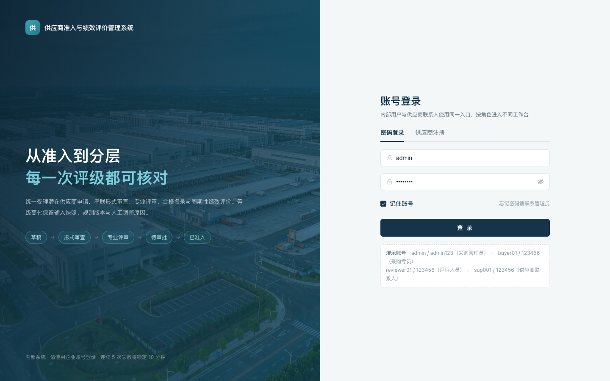

预览来自项目包内的界面截图，不代表所有功能均已完成运行验证。

### 演示视频

原项目包含演示视频。联系时发送「领取项目 005」，可一并询问对应视频。

**免费领取：** 按[领取说明](../GET-PROJECT.md)联系，发送「领取项目 005」。

[返回总目录](../CATALOG.md)

---

## 006 · 企业采购询价比价与审批管理系统

**技术方向：** Spring Boot / Vue / MySQL  
**材料概况：** 功能说明 / 界面预览 / 演示视频（按需领取）

### 项目简介

系统用于企业从部门采购需求到询价、供应商报价、比价、审批、生成采购单和到货验收的流程管理。系统不做完整进销存，重点展示采购决策与审批工作量。

### 功能要点

- 需求与询价

- 比价与定标

- 采购单与验收

### 界面预览

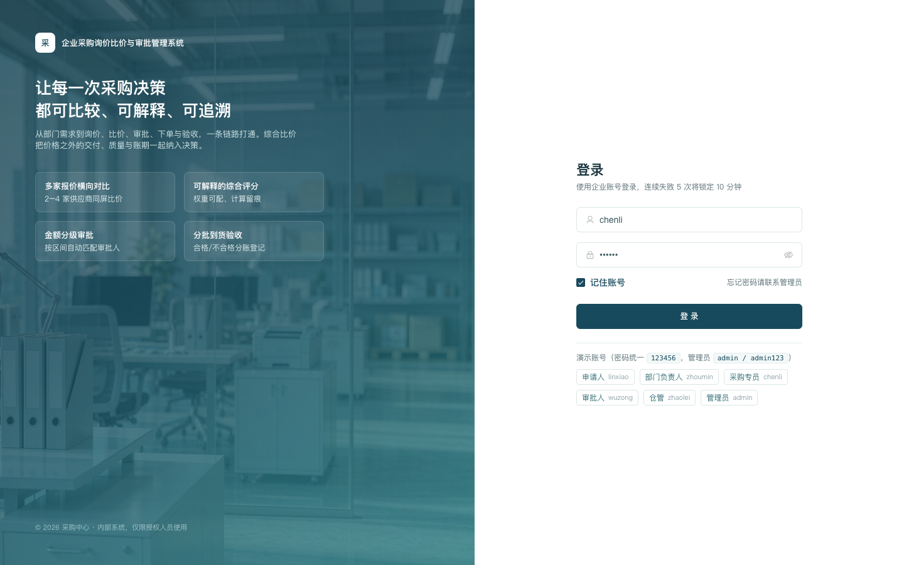

预览来自项目包内的界面截图，不代表所有功能均已完成运行验证。

### 演示视频

原项目包含演示视频。联系时发送「领取项目 006」，可一并询问对应视频。

**免费领取：** 按[领取说明](../GET-PROJECT.md)联系，发送「领取项目 006」。

[返回总目录](../CATALOG.md)

---

## 007 · 制造企业质量异常与纠正措施管理系统

**技术方向：** Spring Boot / Vue / MySQL  
**材料概况：** 功能说明 / 界面预览 / 演示视频（按需领取）

### 项目简介

系统面向制造企业的来料、过程和出货质量异常，实现问题登记、临时遏制、责任分派、原因分析、纠正措施、效果验证和知识归档。不接入生产线硬件，通过人工录入批次与检测数据完成业务。

### 功能要点

- 基础数据与异常登记

- 遏制与原因分析

- 纠正措施与效果验证

### 界面预览

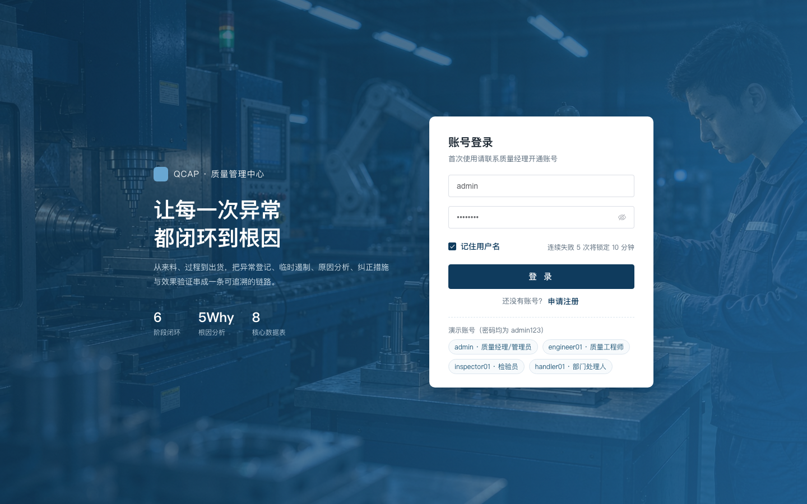

预览来自项目包内的界面截图，不代表所有功能均已完成运行验证。

### 演示视频

原项目包含演示视频。联系时发送「领取项目 007」，可一并询问对应视频。

**免费领取：** 按[领取说明](../GET-PROJECT.md)联系，发送「领取项目 007」。

[返回总目录](../CATALOG.md)

---

## 008 · 食品安全留样与检测管理系统

**技术方向：** Spring Boot / Vue / MySQL  
**材料概况：** 功能说明 / 界面预览 / 演示视频（按需领取）

### 项目简介

系统面向学校食堂、集体配餐或餐饮企业，管理食品批次、留样任务、留样称重、存放位置、保留时限、检测记录、不合格处置和到期销毁。系统不接入温度传感器，温度数据人工录入。

### 功能要点

- 批次与留样任务

- 复核、检测与异常

- 到期与销毁

### 界面预览

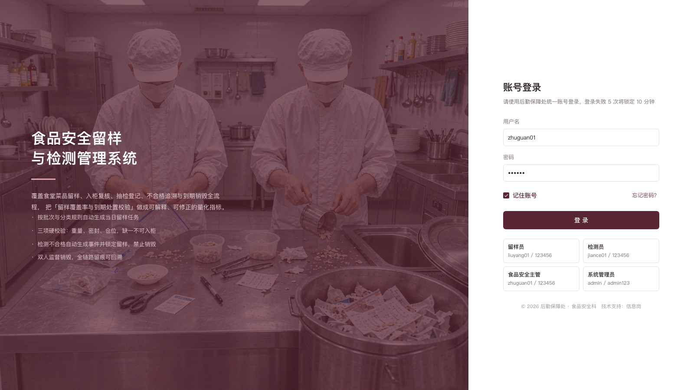

预览来自项目包内的界面截图，不代表所有功能均已完成运行验证。

### 演示视频

原项目包含演示视频。联系时发送「领取项目 008」，可一并询问对应视频。

**免费领取：** 按[领取说明](../GET-PROJECT.md)联系，发送「领取项目 008」。

[返回总目录](../CATALOG.md)

---

## 009 · 农产品批次质量溯源管理系统

**技术方向：** Spring Boot / Vue / MySQL  
**材料概况：** 功能说明 / 界面预览 / 演示视频（按需领取）

### 项目简介

系统以农产品批次为主线，记录种植主体、地块、农事投入、采收、检测、分选包装、出库和流向，为每个批次生成可公开查询的溯源码。系统不做电商交易，重点是信息链条的完整性。

### 功能要点

- 生产与采收档案

- 检测、加工与流向

- 溯源查询与召回

### 界面预览

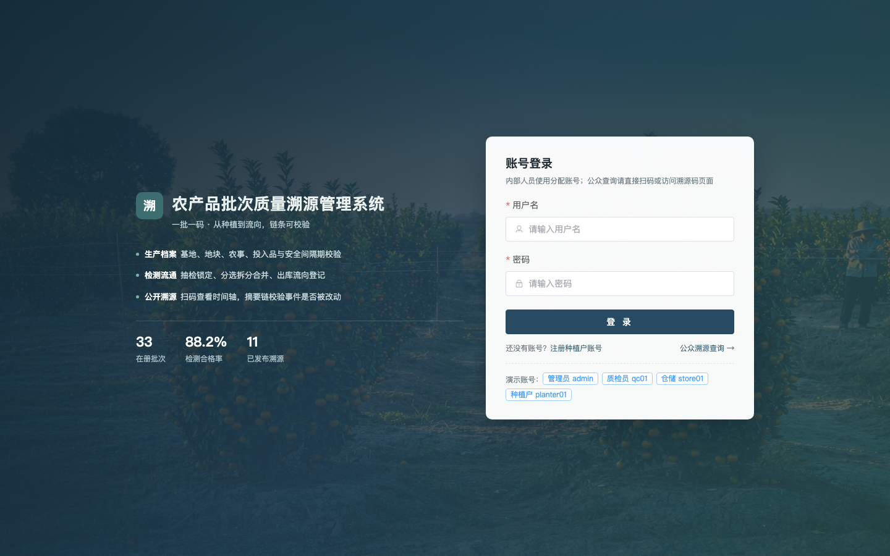

预览来自项目包内的界面截图，不代表所有功能均已完成运行验证。

### 演示视频

原项目包含演示视频。联系时发送「领取项目 009」，可一并询问对应视频。

**免费领取：** 按[领取说明](../GET-PROJECT.md)联系，发送「领取项目 009」。

[返回总目录](../CATALOG.md)

---

## 010 · 社区消防设施巡检与隐患整改系统

**技术方向：** Spring Boot / Vue / MySQL  
**材料概况：** 功能说明 / 界面预览 / 演示视频（按需领取）

### 项目简介

系统面向社区物业和消防安全管理人员，对消火器、消火栓、应急照明、疏散标识和通道等对象建档，实现巡检任务、现场记录、隐患分级、整改、复查和到期更换提醒。

### 功能要点

- 设施台账与计划

- 巡检与隐患

- 整改、复查与更换

### 界面预览

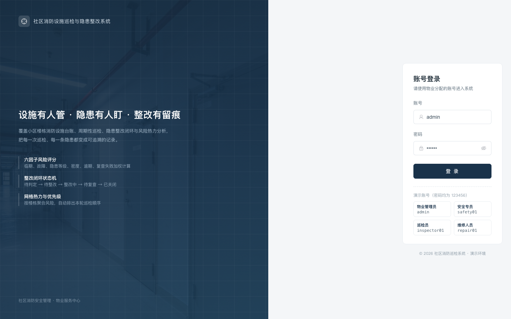

预览来自项目包内的界面截图，不代表所有功能均已完成运行验证。

### 演示视频

原项目包含演示视频。联系时发送「领取项目 010」，可一并询问对应视频。

**免费领取：** 按[领取说明](../GET-PROJECT.md)联系，发送「领取项目 010」。

[返回总目录](../CATALOG.md)

---

## 011 · 智慧园区访客预约与通行管理系统

**技术方向：** Spring Boot / Vue / MySQL  
**材料概况：** 功能说明 / 界面预览 / 演示视频（按需领取）

### 项目简介

系统面向企业园区或办公楼，管理访客申请、被访人审批、车辆登记、到访核验、访客卡借还、离园和异常名单。系统使用动态通行码模拟门岗核验，不直连门禁设备。

### 界面预览

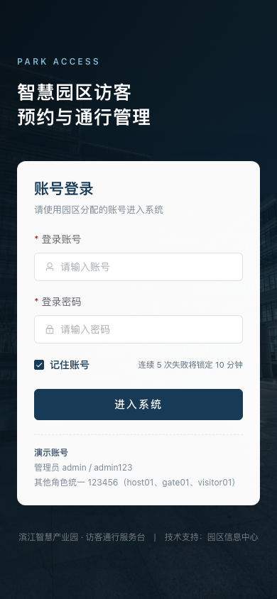

预览来自项目包内的界面截图，不代表所有功能均已完成运行验证。

### 演示视频

原项目包含演示视频。联系时发送「领取项目 011」，可一并询问对应视频。

**免费领取：** 按[领取说明](../GET-PROJECT.md)联系，发送「领取项目 011」。

[返回总目录](../CATALOG.md)

---

## 012 · 公共机构能耗抄表与节能分析系统

**技术方向：** Spring Boot / Vue / MySQL  
**材料概况：** 功能说明 / 界面预览 / 演示视频（按需领取）

### 项目简介

系统面向学校、医院、政务大楼等公共机构，以人工抄表数据为基础，管理建筑、用能单元、计量表、抄表任务、费用、异常、能耗定额和节能措施。不接入真实智能电表，保持毕设可实现性。

### 界面预览

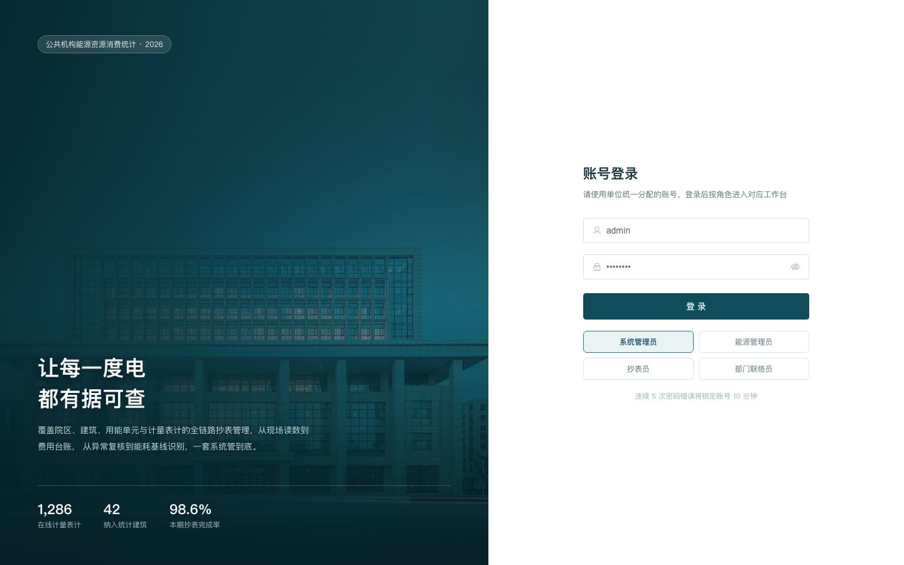

预览来自项目包内的界面截图，不代表所有功能均已完成运行验证。

### 演示视频

原项目包含演示视频。联系时发送「领取项目 012」，可一并询问对应视频。

**免费领取：** 按[领取说明](../GET-PROJECT.md)联系，发送「领取项目 012」。

[返回总目录](../CATALOG.md)

---

## 013 · 城乡垃圾清运调度与台账管理系统

**技术方向：** Spring Boot / Vue / MySQL  
**材料概况：** 功能说明 / 界面预览 / 演示视频（按需领取）

### 项目简介

系统管理垃圾收集点、清运车辆、司机、路线、周期计划、临时报满、派单、称重和异常。使用手工选择车辆和推荐规则完成调度，不开发实时 GPS 路径优化。

### 界面预览

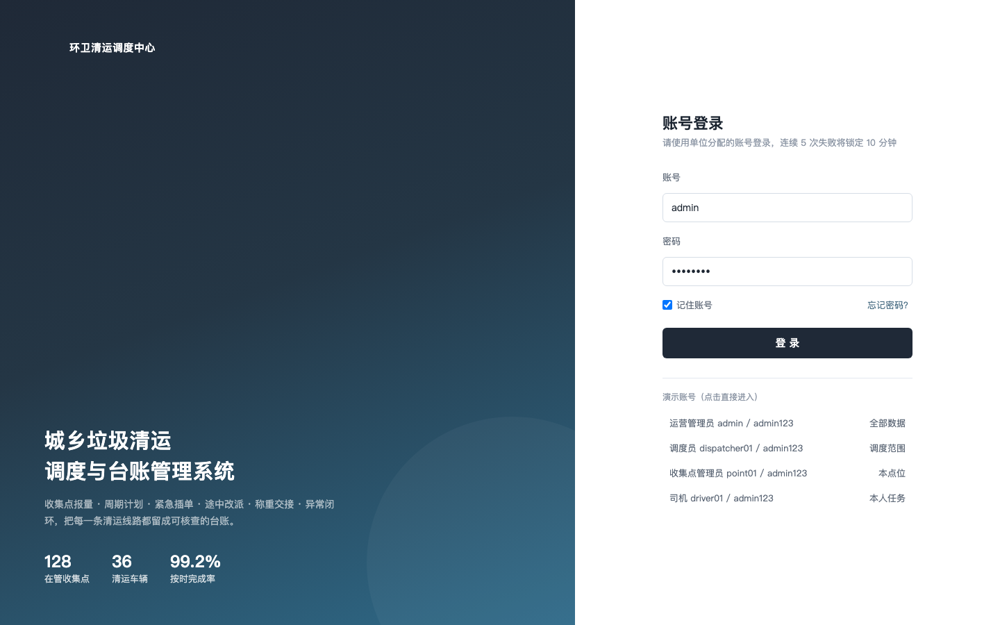

预览来自项目包内的界面截图，不代表所有功能均已完成运行验证。

### 演示视频

原项目包含演示视频。联系时发送「领取项目 013」，可一并询问对应视频。

**免费领取：** 按[领取说明](../GET-PROJECT.md)联系，发送「领取项目 013」。

[返回总目录](../CATALOG.md)

---

## 014 · 城市井盖巡检与维修工单管理系统

**技术方向：** Spring Boot / Vue / MySQL  
**材料概况：** 功能说明 / 界面预览 / 演示视频（按需领取）

### 项目简介

系统用于市政单位管理井盖档案、责任区域、巡检路线、问题上报、维修派单、现场验收和备件领用。地图使用普通坐标点展示，不需智能传感器。

### 界面预览

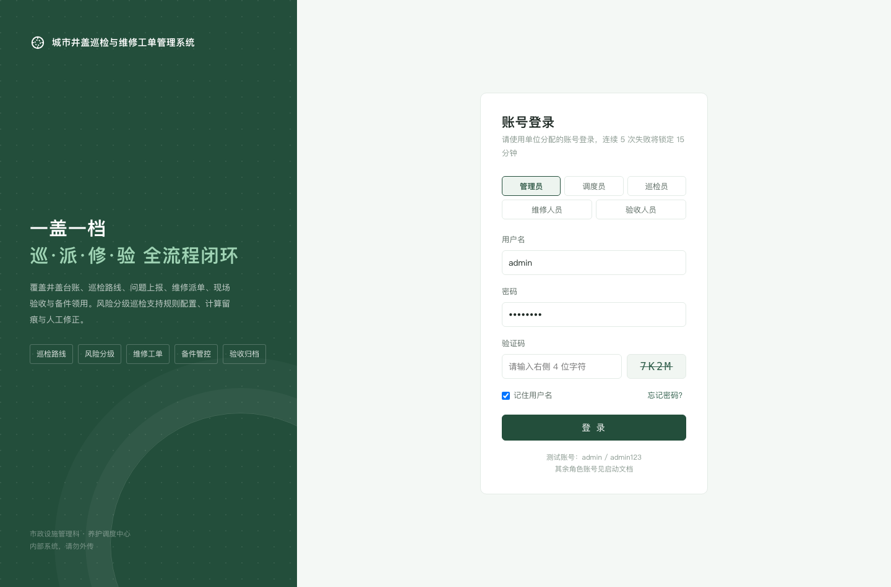

预览来自项目包内的界面截图，不代表所有功能均已完成运行验证。

### 演示视频

原项目包含演示视频。联系时发送「领取项目 014」，可一并询问对应视频。

**免费领取：** 按[领取说明](../GET-PROJECT.md)联系，发送「领取项目 014」。

[返回总目录](../CATALOG.md)

---

## 015 · 河道巡查与水环境问题处置系统

**技术方向：** Spring Boot / Vue / MySQL  
**材料概况：** 功能说明 / 界面预览 / 演示视频（按需领取）

### 项目简介

系统用于基层河道和水环境日常管理，维护河流、河段、巡查点、排口、巡查任务、水质记录、问题派单、整改和复查。不接入实时水质设备，数据由巡查员录入。

### 界面预览

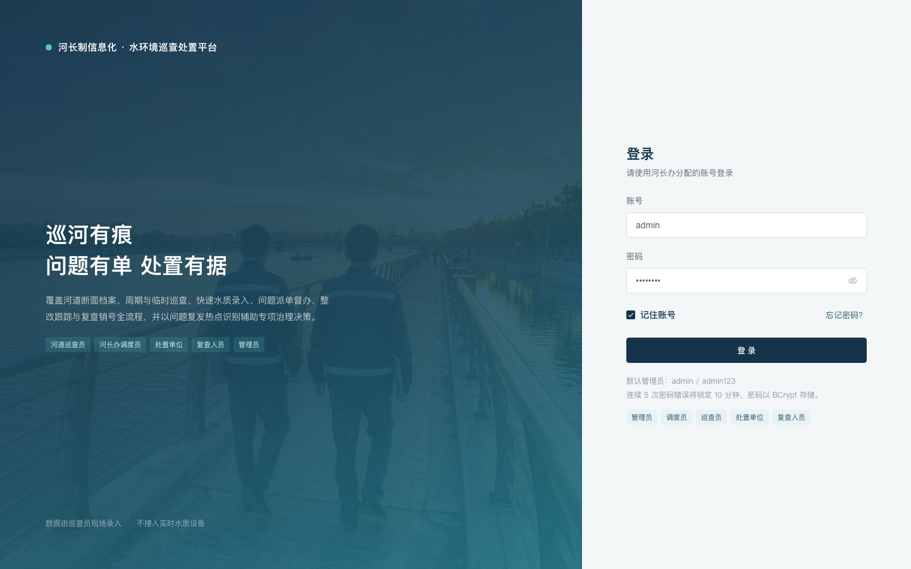

预览来自项目包内的界面截图，不代表所有功能均已完成运行验证。

### 演示视频

原项目包含演示视频。联系时发送「领取项目 015」，可一并询问对应视频。

**免费领取：** 按[领取说明](../GET-PROJECT.md)联系，发送「领取项目 015」。

[返回总目录](../CATALOG.md)

---

## 016 · 古树名木养护档案管理系统

**技术方向：** Spring Boot / Vue / MySQL  
**材料概况：** 功能说明 / 界面预览 / 演示视频（按需领取）

### 项目简介

系统面向园林绿化管理部门，管理古树名木一树一档、保护级别、生长状况、定期巡查、养护方案、病虫害、抢救复壮和年度评估。不引入图像 AI 识别，使用专业人员录入和照片对比。

### 界面预览

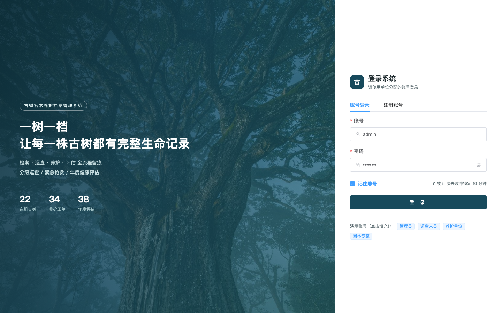

预览来自项目包内的界面截图，不代表所有功能均已完成运行验证。

### 演示视频

原项目包含演示视频。联系时发送「领取项目 016」，可一并询问对应视频。

**免费领取：** 按[领取说明](../GET-PROJECT.md)联系，发送「领取项目 016」。

[返回总目录](../CATALOG.md)

---

## 017 · 农田灌溉计划与用水统计系统

**技术方向：** Spring Boot / Vue / MySQL  
**材料概况：** 功能说明 / 界面预览 / 演示视频（按需领取）

### 项目简介

系统面向灌区、合作社或农场，管理地块、作物、水源、渠道、用水申请、灌溉计划、任务执行、水表记录、费用和节水分析。不控制水泵或阀门，用人工抄表和任务打卡保证可实现。

### 界面预览

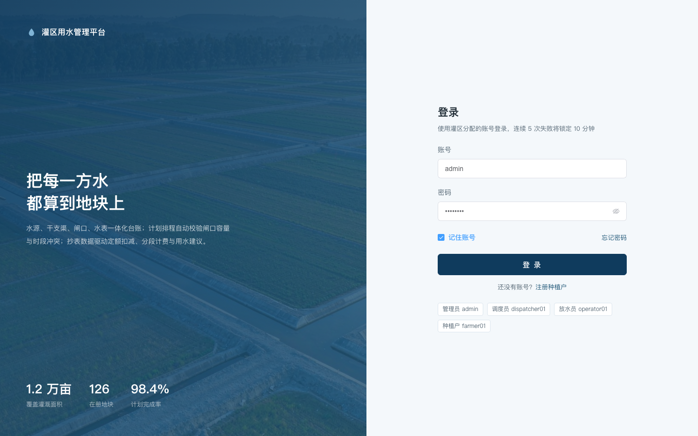

预览来自项目包内的界面截图，不代表所有功能均已完成运行验证。

### 演示视频

原项目包含演示视频。联系时发送「领取项目 017」，可一并询问对应视频。

**免费领取：** 按[领取说明](../GET-PROJECT.md)联系，发送「领取项目 017」。

[返回总目录](../CATALOG.md)

---

## 018 · 温室种植任务与农事记录管理系统

**技术方向：** Spring Boot / Vue / MySQL  
**材料概况：** 功能说明 / 界面预览 / 演示视频（按需领取）

### 项目简介

系统用于农业园区温室的种植批次、作物生育阶段、农事计划、任务派发、投入品领用、环境抄录、病虫害和采收档案管理。环境数据人工录入，不开发 IoT 接入。

### 界面预览

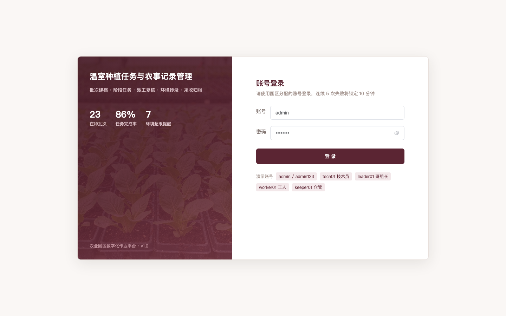

预览来自项目包内的界面截图，不代表所有功能均已完成运行验证。

### 演示视频

原项目包含演示视频。联系时发送「领取项目 018」，可一并询问对应视频。

**免费领取：** 按[领取说明](../GET-PROJECT.md)联系，发送「领取项目 018」。

[返回总目录](../CATALOG.md)

---

## 019 · 水产养殖批次与水质监测管理系统

**技术方向：** Spring Boot / Vue / MySQL  
**材料概况：** 功能说明 / 界面预览 / 演示视频（按需领取）

### 项目简介

系统面向中小型养殖场，管理塘口、养殖批次、苗种投放、投喂、水质手工检测、用药、病害、死亡、分塘和起捕。通过阈值预警保证实用性，不接入水质 IoT 硬件。

### 界面预览

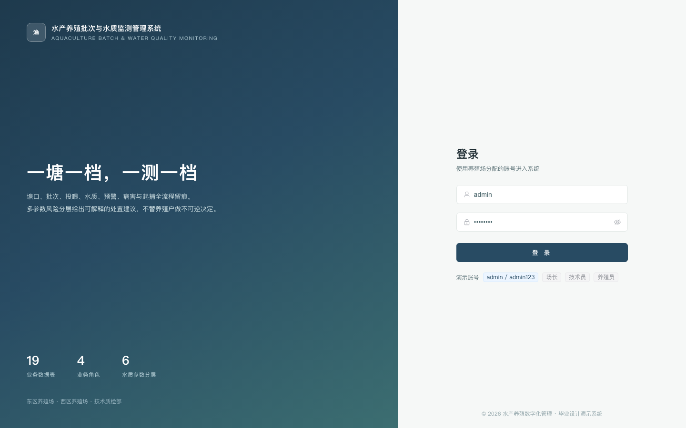

预览来自项目包内的界面截图，不代表所有功能均已完成运行验证。

### 演示视频

原项目包含演示视频。联系时发送「领取项目 019」，可一并询问对应视频。

**免费领取：** 按[领取说明](../GET-PROJECT.md)联系，发送「领取项目 019」。

[返回总目录](../CATALOG.md)

---

## 020 · 农机作业派单与服务结算管理系统

**技术方向：** Spring Boot / Vue / MySQL  
**材料概况：** 功能说明 / 界面预览 / 演示视频（按需领取）

### 项目简介

系统面向农机合作社，管理机具、操作员、农户作业需求、报价、排程派单、作业记录、验收、油耗、维修和内部结算。不接入线上支付和实时轨迹，只记录线下收款状态。

### 界面预览

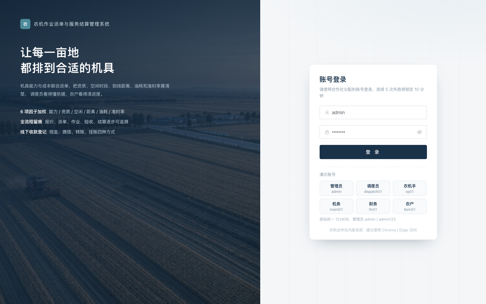

预览来自项目包内的界面截图，不代表所有功能均已完成运行验证。

### 演示视频

原项目包含演示视频。联系时发送「领取项目 020」，可一并询问对应视频。

**免费领取：** 按[领取说明](../GET-PROJECT.md)联系，发送「领取项目 020」。

[返回总目录](../CATALOG.md)

---

## 021 · 高校勤工助学岗位与考勤管理系统

**技术方向：** Spring Boot / Vue / MySQL  
**材料概况：** 功能说明 / 界面预览 / 演示视频（按需领取）

### 项目简介

系统面向高校学生资助部门，实现用工部门申报岗位、经费审批、学生申请、面试录用、排班考勤、工时复核、补贴核算和学期评价。系统只管理补贴台账，不直接向学生转账。

### 界面预览

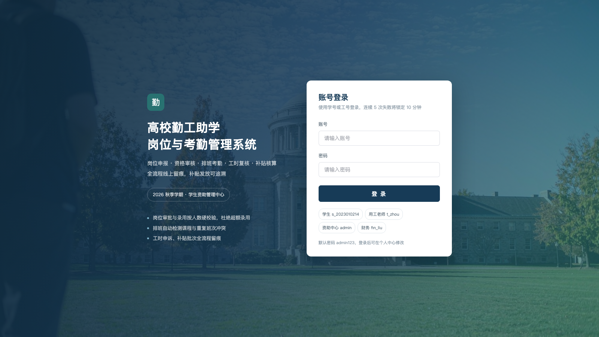

预览来自项目包内的界面截图，不代表所有功能均已完成运行验证。

### 演示视频

原项目包含演示视频。联系时发送「领取项目 021」，可一并询问对应视频。

**免费领取：** 按[领取说明](../GET-PROJECT.md)联系，发送「领取项目 021」。

[返回总目录](../CATALOG.md)

---

## 022 · 高校奖助学金申请与评审管理系统

**技术方向：** Spring Boot / Vue / MySQL  
**材料概况：** 功能说明 / 界面预览 / 演示视频（按需领取）

### 项目简介

系统管理奖学金、助学金、临时困难补助等项目的发布、申请、材料校验、班级民主评议、院系初审、学校复审、公示异议和发放台账。系统不与银行对接，仅记录线下发放结果。

### 界面预览

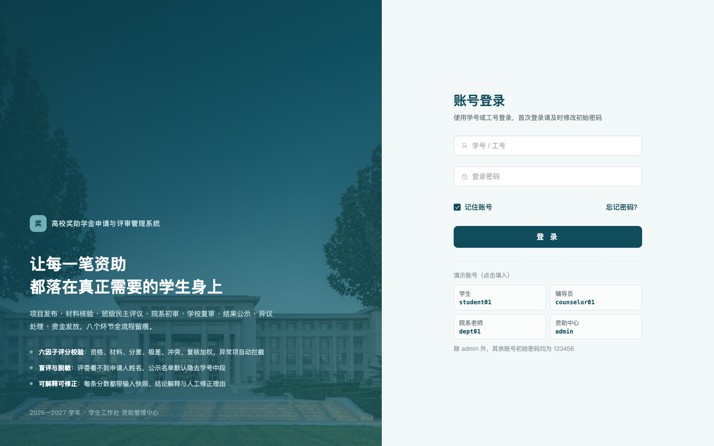

预览来自项目包内的界面截图，不代表所有功能均已完成运行验证。

### 演示视频

原项目包含演示视频。联系时发送「领取项目 022」，可一并询问对应视频。

**免费领取：** 按[领取说明](../GET-PROJECT.md)联系，发送「领取项目 022」。

[返回总目录](../CATALOG.md)

---

## 023 · 学生请销假与晚归统计管理系统

**技术方向：** Spring Boot / Vue / MySQL  
**材料概况：** 功能说明 / 界面预览 / 演示视频（按需领取）

### 项目简介

系统聚焦高校学生请假、外出、返校销假、晚归登记、夜不归核查和异常关怀，不替代完整宿舍管理系统。通过分级审批、返校码和辅导员核销形成安全管理闭环。

### 界面预览

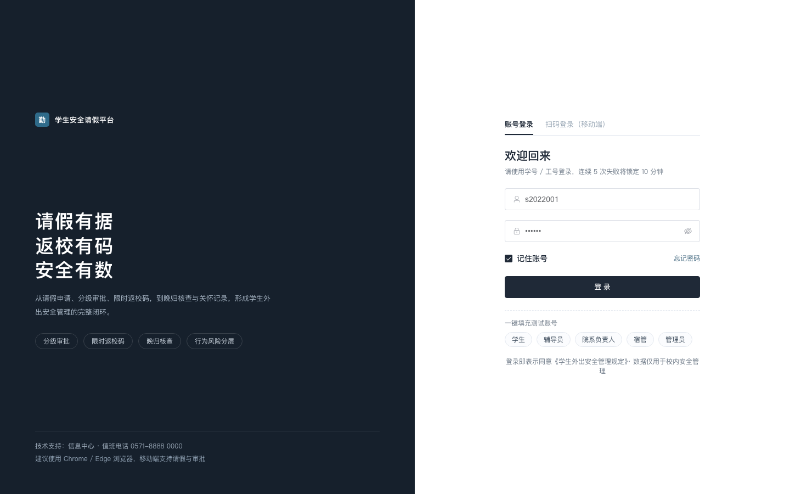

预览来自项目包内的界面截图，不代表所有功能均已完成运行验证。

### 演示视频

原项目包含演示视频。联系时发送「领取项目 023」，可一并询问对应视频。

**免费领取：** 按[领取说明](../GET-PROJECT.md)联系，发送「领取项目 023」。

[返回总目录](../CATALOG.md)

---

## 024 · 大学生实习过程与周报管理系统

**技术方向：** Spring Boot / Vue / MySQL  
**材料概况：** 功能说明 / 界面预览 / 演示视频（按需领取）

### 项目简介

系统面向高校集中实习和自主实习过程管理，覆盖企业与岗位备案、学生申请、协议材料、周报、月度考核、异常上报、双导师评价和实习结项。不与招聘系统重复，重点是实习开始后的过程留痕。

### 界面预览

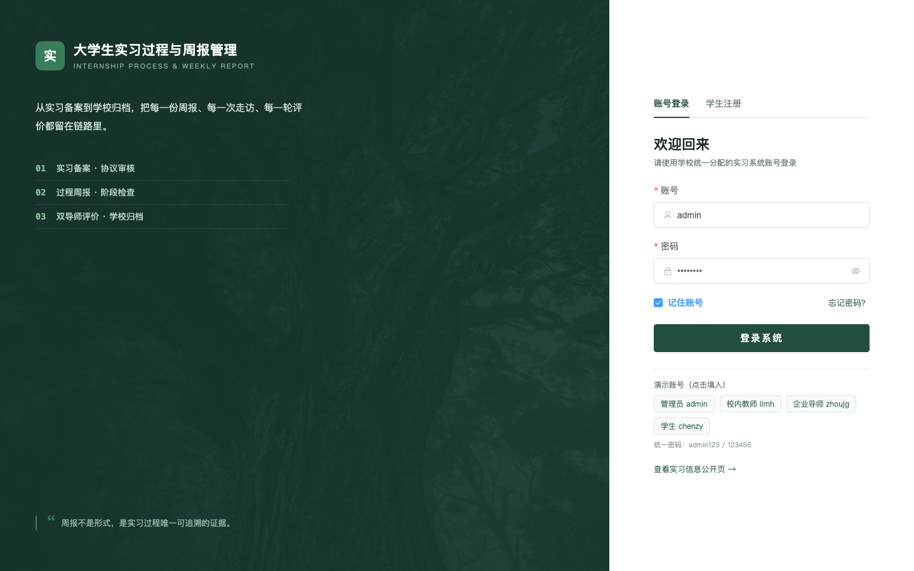

预览来自项目包内的界面截图，不代表所有功能均已完成运行验证。

### 演示视频

原项目包含演示视频。联系时发送「领取项目 024」，可一并询问对应视频。

**免费领取：** 按[领取说明](../GET-PROJECT.md)联系，发送「领取项目 024」。

[返回总目录](../CATALOG.md)

---

## 025 · 职业技能培训报名与证书管理系统

**技术方向：** Spring Boot / Vue / MySQL  
**材料概况：** 功能说明 / 界面预览 / 演示视频（按需领取）

### 项目简介

系统面向职业培训机构，管理职种、课程、培训班、报名资格审核、线下缴费登记、排课、考勤、理论/实操成绩、补考、证书发放和到期提醒。不接入真实考试平台或在线支付。

### 界面预览

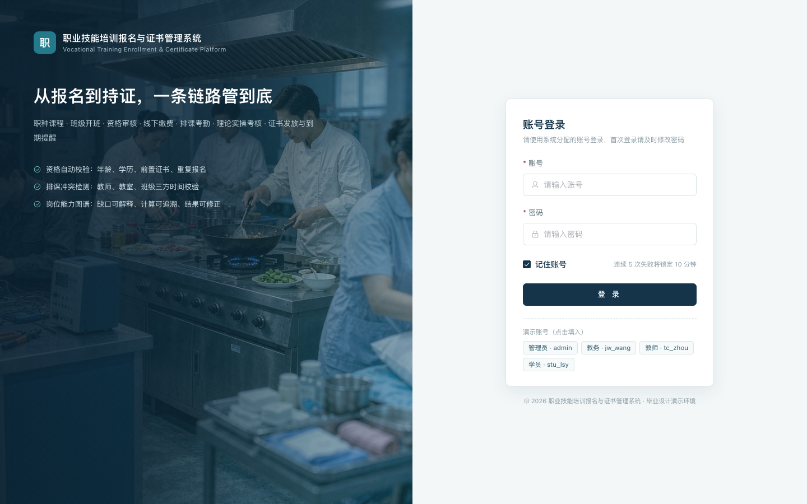

预览来自项目包内的界面截图，不代表所有功能均已完成运行验证。

### 演示视频

原项目包含演示视频。联系时发送「领取项目 025」，可一并询问对应视频。

**免费领取：** 按[领取说明](../GET-PROJECT.md)联系，发送「领取项目 025」。

[返回总目录](../CATALOG.md)

---

## 026 · 校内公共场地借用与审批管理系统

**技术方向：** Spring Boot / Vue / MySQL  
**材料概况：** 功能说明 / 界面预览 / 演示视频（按需领取）

### 项目简介

系统统一管理报告厅、展厅、中庭、操场区域和户外空地等公共场地的借用申请、风险审批、物资需求、布场、交接、巡场和恢复验收。它比单纯会议室预约增加活动规模、安全与场地恢复闭环。

### 界面预览

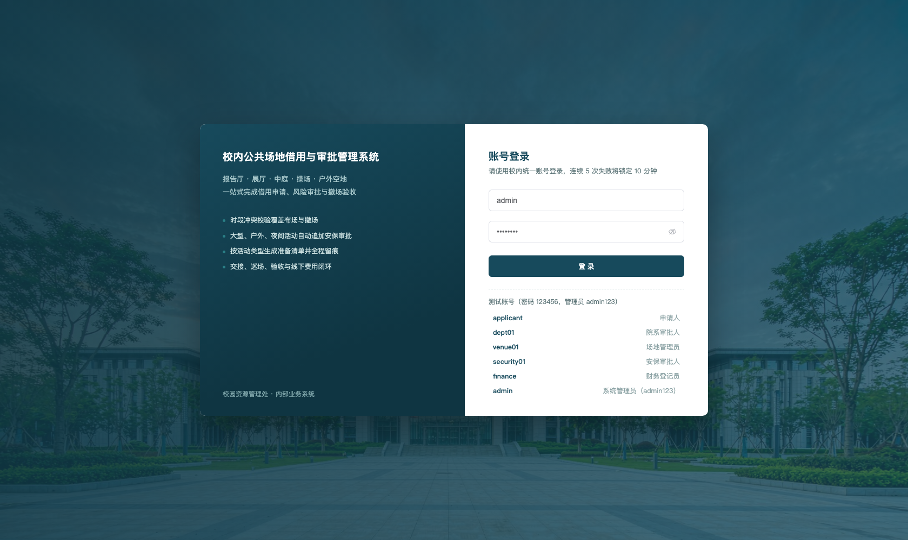

预览来自项目包内的界面截图，不代表所有功能均已完成运行验证。

### 演示视频

原项目包含演示视频。联系时发送「领取项目 026」，可一并询问对应视频。

**免费领取：** 按[领取说明](../GET-PROJECT.md)联系，发送「领取项目 026」。

[返回总目录](../CATALOG.md)

---

## 027 · 教师教研活动与成果管理系统

**技术方向：** Spring Boot / Vue / MySQL  
**材料概况：** 功能说明 / 界面预览 / 演示视频（按需领取）

### 项目简介

系统面向中小学或高校基层教学组织，管理教研组、学期计划、集体备课、听评课、专题研讨、课例改进、资料共享、成果申报和学时统计。不做在线教学，专注教研活动过程。

### 界面预览

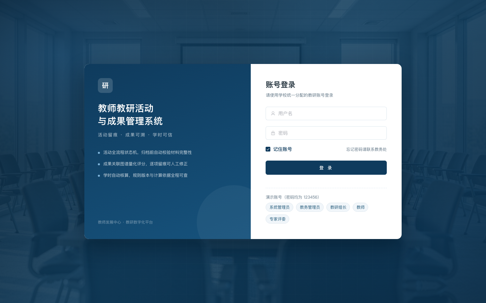

预览来自项目包内的界面截图，不代表所有功能均已完成运行验证。

### 演示视频

原项目包含演示视频。联系时发送「领取项目 027」，可一并询问对应视频。

**免费领取：** 按[领取说明](../GET-PROJECT.md)联系，发送「领取项目 027」。

[返回总目录](../CATALOG.md)

---

## 028 · 校友活动与捐赠项目管理系统

**技术方向：** Spring Boot / Vue / MySQL  
**材料概况：** 功能说明 / 界面预览 / 演示视频（按需领取）

### 项目简介

系统面向高校校友工作部门，管理校友档案、班级/地区组织、活动、报名签到、志愿服务、捐赠项目、线下捐赠登记、凭证与项目进展公开。不接入线上支付，不公开敏感校友资料。

### 界面预览

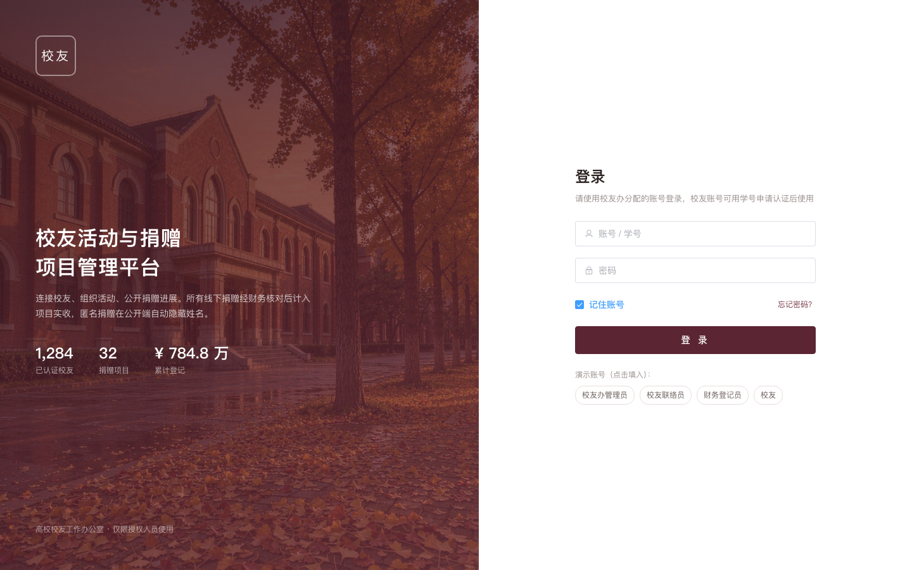

预览来自项目包内的界面截图，不代表所有功能均已完成运行验证。

### 演示视频

原项目包含演示视频。联系时发送「领取项目 028」，可一并询问对应视频。

**免费领取：** 按[领取说明](../GET-PROJECT.md)联系，发送「领取项目 028」。

[返回总目录](../CATALOG.md)

---

## 029 · 社区文化活动与志愿时长管理系统

**技术方向：** Spring Boot / Vue / MySQL  
**材料概况：** 功能说明 / 界面预览 / 演示视频（按需领取）

### 项目简介

系统面向街道和社区文化服务中心，管理文化场地、活动计划、居民报名、候补、志愿岗位、签到签退、服务时长、活动成果和居民反馈。不做普通社交平台，聚焦活动运营与志愿服务闭环。

### 界面预览

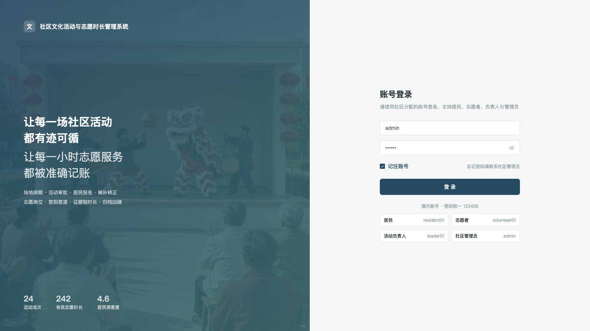

预览来自项目包内的界面截图，不代表所有功能均已完成运行验证。

### 演示视频

原项目包含演示视频。联系时发送「领取项目 029」，可一并询问对应视频。

**免费领取：** 按[领取说明](../GET-PROJECT.md)联系，发送「领取项目 029」。

[返回总目录](../CATALOG.md)

---

## 030 · 公益物资捐赠与发放追踪系统

**技术方向：** Spring Boot / Vue / MySQL  
**材料概况：** 功能说明 / 界面预览 / 演示视频（按需领取）

### 项目简介

系统面向社会组织、公益驿站或社区，管理物资需求、捐赠意向、收货验收、入库批次、质量分级、受助申请、审核、领用、配送和反馈。系统不处理现金捐赠和在线支付，强调物资批次可追溯。

### 界面预览

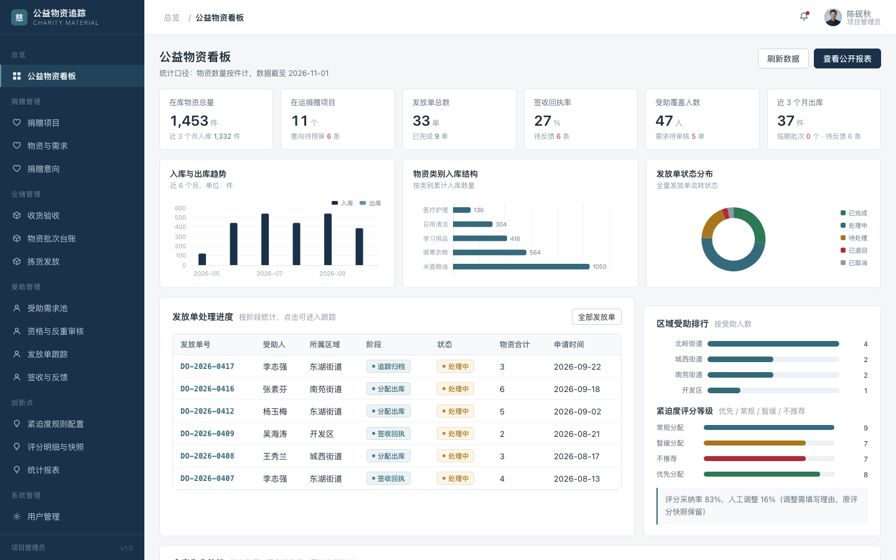

预览来自项目包内的界面截图，不代表所有功能均已完成运行验证。

### 演示视频

原项目包含演示视频。联系时发送「领取项目 030」，可一并询问对应视频。

**免费领取：** 按[领取说明](../GET-PROJECT.md)联系，发送「领取项目 030」。

[返回总目录](../CATALOG.md)

---

## 031 · 残障辅助器具借用与维护管理系统

**技术方向：** Spring Boot / Vue / MySQL  
**材料概况：** 功能说明 / 界面预览 / 演示视频（按需领取）

### 项目简介

系统面向社区康复驿站或公益服务机构，管理轮椅、拐杖、助行器、护理床等器具的台账、消毒、检测、借用申请、领用交接、延期、归还、损坏和维修。系统不作医疗诊断，只管理器具与服务流程。

### 界面预览

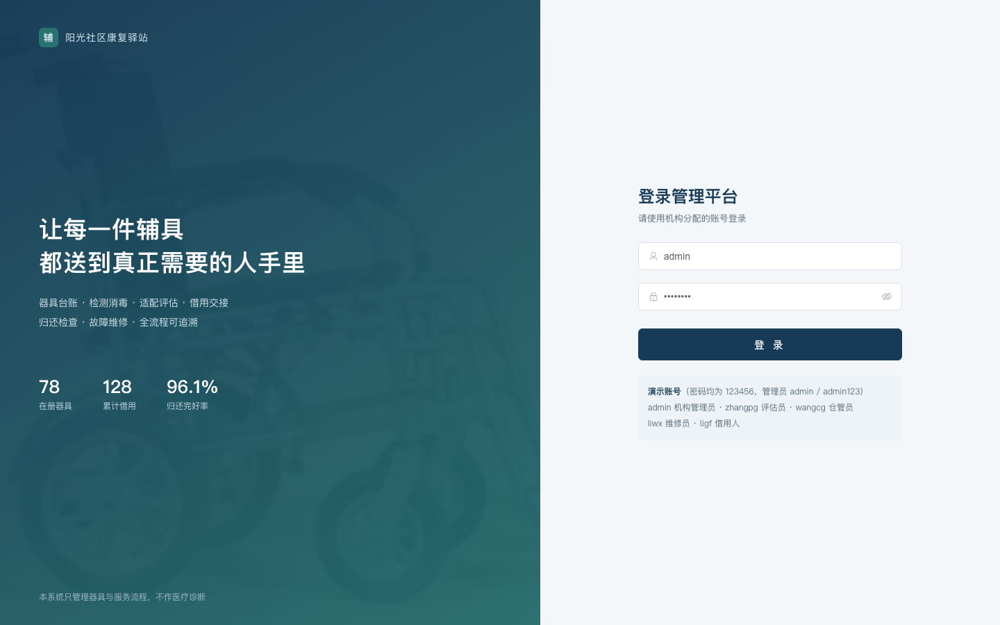

预览来自项目包内的界面截图，不代表所有功能均已完成运行验证。

### 演示视频

原项目包含演示视频。联系时发送「领取项目 031」，可一并询问对应视频。

**免费领取：** 按[领取说明](../GET-PROJECT.md)联系，发送「领取项目 031」。

[返回总目录](../CATALOG.md)

---

## 032 · 养老机构膳食营养与用餐管理系统

**技术方向：** Spring Boot / Vue / MySQL  
**材料概况：** 功能说明 / 界面预览 / 演示视频（按需领取）

### 项目简介

系统面向养老机构食堂与护理部门，管理老人饮食档案、过敏与禁忌、膳食类型、周菜单、订餐变更、备餐、送餐、留样、残食和满意度。系统只用于管理，不自动诊断或生成医疗食谱。

### 界面预览

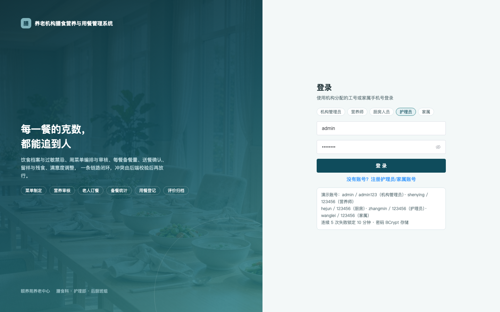

预览来自项目包内的界面截图，不代表所有功能均已完成运行验证。

### 演示视频

原项目包含演示视频。联系时发送「领取项目 032」，可一并询问对应视频。

**免费领取：** 按[领取说明](../GET-PROJECT.md)联系，发送「领取项目 032」。

[返回总目录](../CATALOG.md)

---

## 034 · 医疗废物收集转运与交接管理系统

**技术方向：** Spring Boot / Vue / MySQL  
**材料概况：** 功能说明 / 界面预览 / 演示视频（按需领取）

### 项目简介

系统面向医院后勤与感控管理，对科室交接点、废物分类、包装、称重、临时贮存、院内转运、对外交接、差异、泄漏事件和人员资质进行闭环记录。系统不接入电子秤，由人工录入并上传秤面照片。

### 界面预览

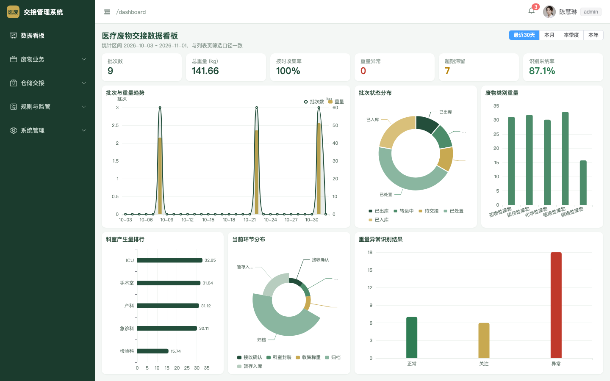

预览来自项目包内的界面截图，不代表所有功能均已完成运行验证。

### 演示视频

原项目包含演示视频。联系时发送「领取项目 034」，可一并询问对应视频。

**免费领取：** 按[领取说明](../GET-PROJECT.md)联系，发送「领取项目 034」。

[返回总目录](../CATALOG.md)

---

## 035 · 体检预约与报告领取管理系统

**技术方向：** Spring Boot / Vue / MySQL  
**材料概况：** 功能说明 / 界面预览 / 演示视频（按需领取）

### 项目简介

系统面向体检中心的套餐展示、个人/团体预约、时段容量、线下缴费登记、到检、项目执行、漏检补检、报告归档、领取和回访。系统不自动解读检查结果，报告作为授权文件管理。

### 界面预览

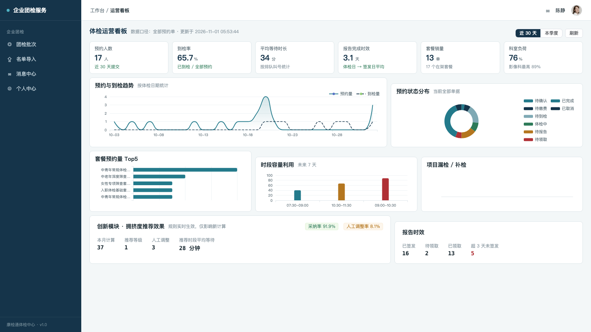

预览来自项目包内的界面截图，不代表所有功能均已完成运行验证。

### 演示视频

原项目包含演示视频。联系时发送「领取项目 035」，可一并询问对应视频。

**免费领取：** 按[领取说明](../GET-PROJECT.md)联系，发送「领取项目 035」。

[返回总目录](../CATALOG.md)

---
