# 业务管理项目 · 第 2 页

[返回总目录](../CATALOG.md) · [免费领取说明](../GET-PROJECT.md)

> 功能摘录来自项目附带文档，描述的是案例范围与设计目标；具体实现、运行环境和可领取材料以对应版本为准。

| 项目编号 | 项目名称 |
|---|---|
| 036 | [居民健康随访任务与风险分层系统](#p-036) |
| 037 | [体育场馆预约与赛事排期管理系统](#p-037) |
| 038 | [户外俱乐部活动报名与安全管理系统](#p-038) |
| 039 | [艺术培训机构排课与课时消耗管理系统](#p-039) |
| 040 | [乐器租赁与维修工单管理系统](#p-040) |
| 041 | [非遗工坊课程预约与作品档案系统](#p-041) |
| 042 | [沉浸式剧场场次预约与门店管理系统](#p-042) |
| 043 | [露营地营位预约与物资租赁管理系统](#p-043) |
| 044 | [民宿房态与保洁协同管理系统](#p-044) |
| 045 | [汽车维修工单与配件领用管理系统](#p-045) |
| 046 | [二手车检测评估与车辆档案管理系统](#p-046) |
| 047 | [快递驿站出入库与滞留预警系统](#p-047) |
| 048 | [物流车辆调度与运单跟踪管理系统](#p-048) |
| 049 | [企业培训计划与学分管理系统](#p-049) |
| 050 | [客诉工单与服务质量分析系统](#p-050) |
| 051 | [校园二手物品交易平台](#p-051) |
| 052 | [在线课程学习与考试系统](#p-052) |
| 053 | [高校智能题库与错题本系统](#p-053) |
| 054 | [毕业论文选题与过程管理系统](#p-054) |
| 055 | [实验室安全准入与考核系统](#p-055) |
| 056 | [学生社团活动与经费管理系统](#p-056) |
| 057 | [校园宿舍报修与卫生检查系统](#p-057) |
| 058 | [家校沟通与作业布置系统](#p-058) |
| 059 | [考研自习室座位预约与学习打卡系统](#p-059) |
| 060 | [编程课程作业提交与互评系统](#p-060) |
| 061 | [生鲜果蔬社区团购系统](#p-061) |
| 062 | [外卖点餐与骑手配送系统](#p-062) |
| 063 | [网上书店与图书销售系统](#p-063) |
| 064 | [母婴用品商城与会员营销系统](#p-064) |
| 065 | [美妆护肤商城与试用装派发系统](#p-065) |

## 036 · 居民健康随访任务与风险分层系统

**技术方向：** Spring Boot / Vue / MySQL  
**材料概况：** 功能说明 / 界面预览 / 演示视频（按需领取）

### 项目简介

系统面向基层健康服务机构，用于管理居民健康档案摘要、重点人群标签、随访计划、任务派发、问卷、指标录入、风险规则分层、异常转介建议和未访跟踪。系统不提供自动诊断，风险分层结果必须由授权人员确认。

### 界面预览

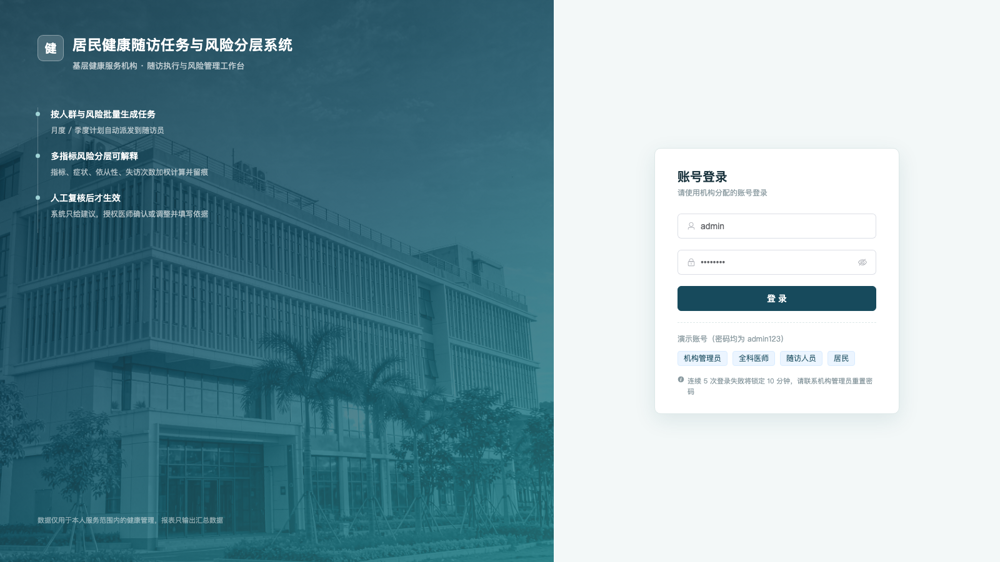

预览来自项目包内的界面截图，不代表所有功能均已完成运行验证。

### 演示视频

原项目包含演示视频。联系时发送「领取项目 036」，可一并询问对应视频。

**免费领取：** 按[领取说明](../GET-PROJECT.md)联系，发送「领取项目 036」。

[返回总目录](../CATALOG.md)

---

## 037 · 体育场馆预约与赛事排期管理系统

**技术方向：** Spring Boot / Vue / MySQL  
**材料概况：** 功能说明 / 界面预览 / 演示视频（按需领取）

### 项目简介

系统面向学校或社区体育场馆，管理场馆、场地、开放时段、个人/团体预约、候补、入场核验、赛事占场、裁判/工作人员、设备借用、场地维护和违约。不接入在线支付，可记录线下费用状态。

### 界面预览

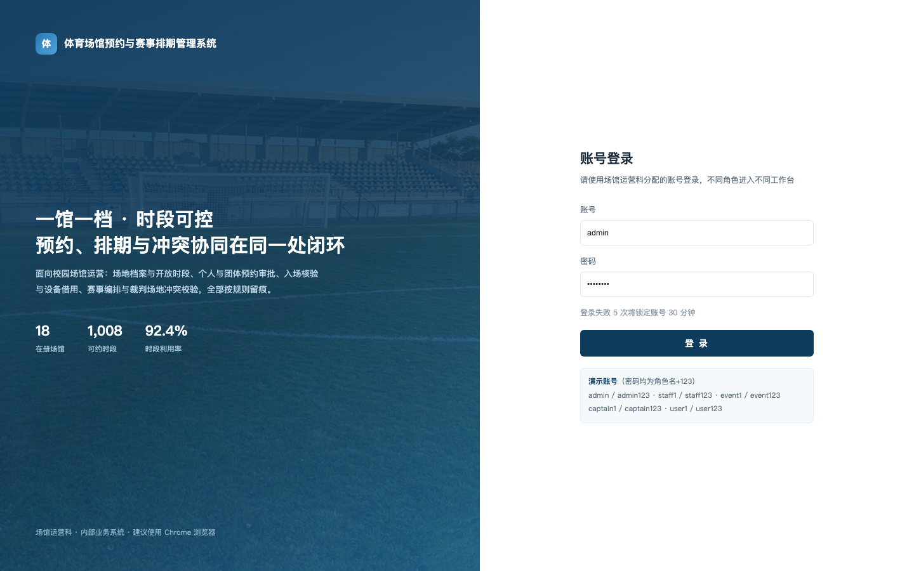

预览来自项目包内的界面截图，不代表所有功能均已完成运行验证。

### 演示视频

原项目包含演示视频。联系时发送「领取项目 037」，可一并询问对应视频。

**免费领取：** 按[领取说明](../GET-PROJECT.md)联系，发送「领取项目 037」。

[返回总目录](../CATALOG.md)

---

## 038 · 户外俱乐部活动报名与安全管理系统

**技术方向：** Spring Boot / Vue / MySQL  
**材料概况：** 功能说明 / 界面预览 / 演示视频（按需领取）

### 项目简介

系统面向徒步、骑行、露营等户外俱乐部，管理会员能力档案、活动方案、风险评估、报名资格、装备清单、编组、签到、节点报平安、异常事件和活动归档。不提供实时救援或导航，用人工报平安和联络人机制实现管理。

### 界面预览

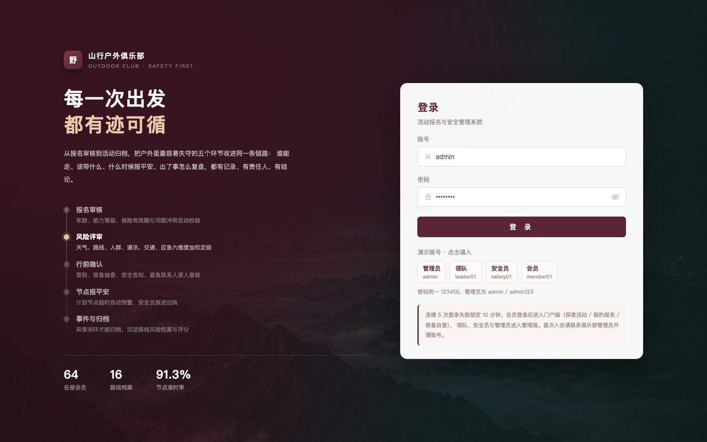

预览来自项目包内的界面截图，不代表所有功能均已完成运行验证。

### 演示视频

原项目包含演示视频。联系时发送「领取项目 038」，可一并询问对应视频。

**免费领取：** 按[领取说明](../GET-PROJECT.md)联系，发送「领取项目 038」。

[返回总目录](../CATALOG.md)

---

## 039 · 艺术培训机构排课与课时消耗管理系统

**技术方向：** Spring Boot / Vue / MySQL  
**材料概况：** 功能说明 / 界面预览 / 演示视频（按需领取）

### 项目简介

系统面向音乐、美术、舞蹈等中小型培训机构，管理课程、教师、教室、学员、课包、线下收费、固定/预约排课、考勤、课时扣减、请假补课、作品档案和续费提醒。不接入在线支付与直播授课。

### 界面预览

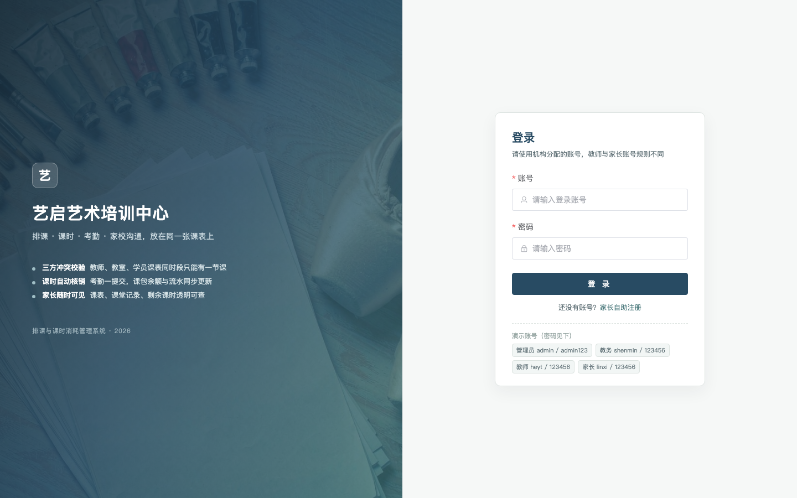

预览来自项目包内的界面截图，不代表所有功能均已完成运行验证。

### 演示视频

原项目包含演示视频。联系时发送「领取项目 039」，可一并询问对应视频。

**免费领取：** 按[领取说明](../GET-PROJECT.md)联系，发送「领取项目 039」。

[返回总目录](../CATALOG.md)

---

## 040 · 乐器租赁与维修工单管理系统

**技术方向：** Spring Boot / Vue / MySQL  
**材料概况：** 功能说明 / 界面预览 / 演示视频（按需领取）

### 项目简介

系统面向乐器门店、培训机构或社团，管理一物一码乐器、配件、租赁预约、线下押金与租金、出库交接、续租、归还验收、损坏赔偿、保养和维修工单。系统不接入线上支付。

### 界面预览

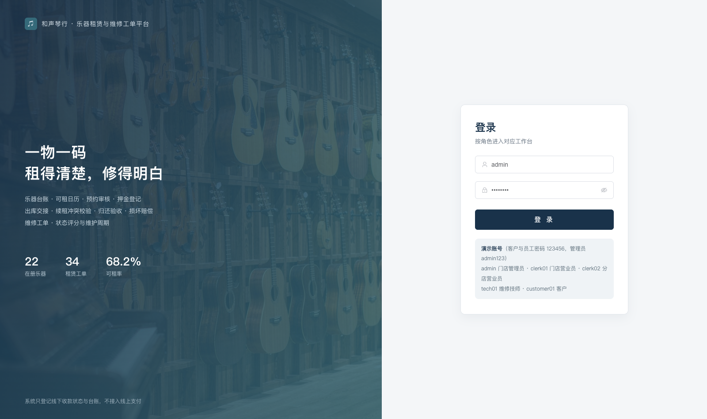

预览来自项目包内的界面截图，不代表所有功能均已完成运行验证。

### 演示视频

原项目包含演示视频。联系时发送「领取项目 040」，可一并询问对应视频。

**免费领取：** 按[领取说明](../GET-PROJECT.md)联系，发送「领取项目 040」。

[返回总目录](../CATALOG.md)

---

## 041 · 非遗工坊课程预约与作品档案系统

**技术方向：** Spring Boot / Vue / MySQL  
**材料概况：** 功能说明 / 界面预览 / 演示视频（按需领取）

### 项目简介

围绕“非遗工坊课程预约与作品档案系统”组织的项目案例，可用于了解相关业务场景与系统设计。领取前请按编号确认具体版本和材料清单。

### 功能要点

- 门户与课程查询

- 课程与排期管理

- 预约与候补管理

- 材料包与备料管理

- 签到与教学记录

- 作品档案管理

- 成果展示管理

- 费用与评价管理

### 界面预览

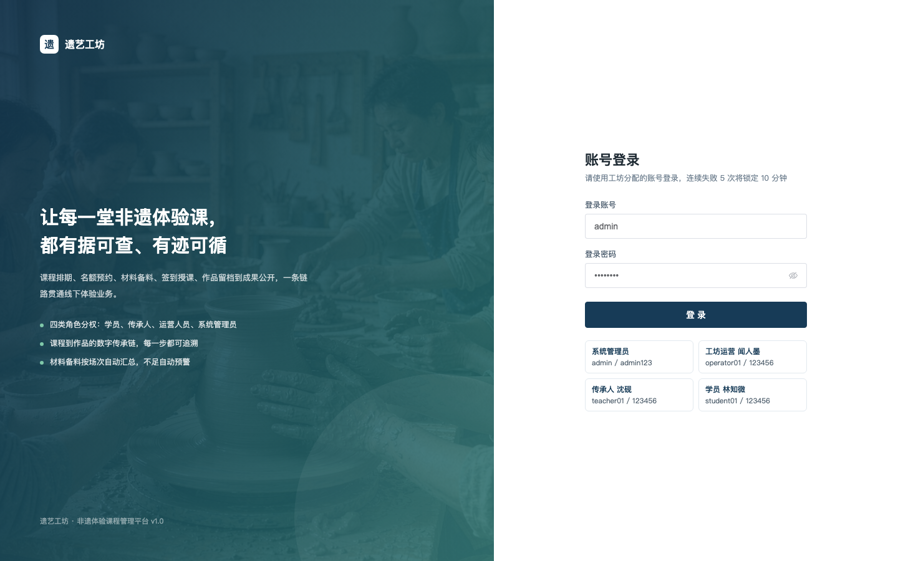

预览来自项目包内的界面截图，不代表所有功能均已完成运行验证。

### 演示视频

原项目包含演示视频。联系时发送「领取项目 041」，可一并询问对应视频。

**免费领取：** 按[领取说明](../GET-PROJECT.md)联系，发送「领取项目 041」。

[返回总目录](../CATALOG.md)

---

## 042 · 沉浸式剧场场次预约与门店管理系统

**技术方向：** Spring Boot / Vue / MySQL  
**材料概况：** 功能说明 / 界面预览 / 演示视频（按需领取）

### 项目简介

围绕“沉浸式剧场场次预约与门店管理系统”组织的项目案例，可用于了解相关业务场景与系统设计。领取前请按编号确认具体版本和材料清单。

### 功能要点

- 主题与门店展示

- 门店空间管理

- 场次排期管理

- 预约与同行人管理

- 演职人员排班

- 入场核验与场次执行

- 道具与耗材管理

- 异常事件管理

### 界面预览

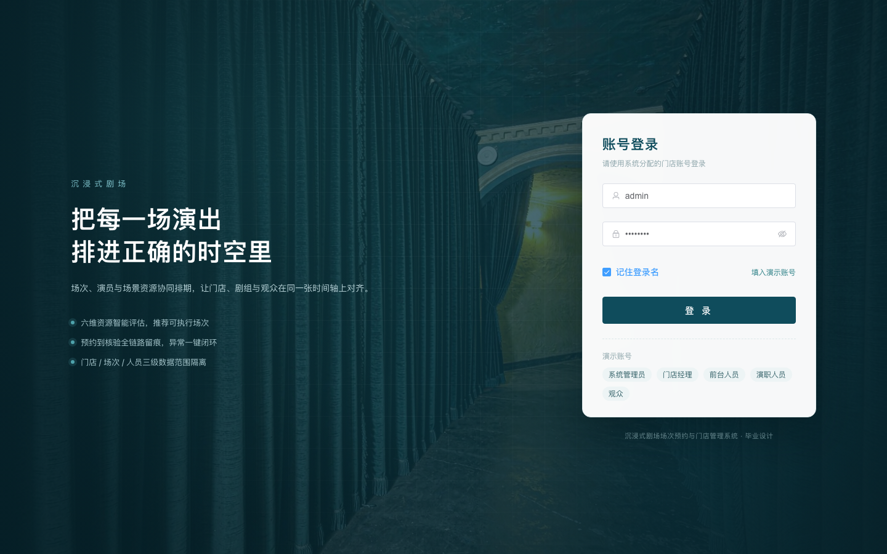

预览来自项目包内的界面截图，不代表所有功能均已完成运行验证。

### 演示视频

原项目包含演示视频。联系时发送「领取项目 042」，可一并询问对应视频。

**免费领取：** 按[领取说明](../GET-PROJECT.md)联系，发送「领取项目 042」。

[返回总目录](../CATALOG.md)

---

## 043 · 露营地营位预约与物资租赁管理系统

**技术方向：** Spring Boot / Vue / MySQL  
**材料概况：** 功能说明 / 界面预览 / 演示视频（按需领取）

### 项目简介

围绕“露营地营位预约与物资租赁管理系统”组织的项目案例，可用于了解相关业务场景与系统设计。领取前请按编号确认具体版本和材料清单。

### 功能要点

- 营地门户与查询

- 营区与营位管理

- 预约管理

- 同行人与车辆管理

- 租赁物资管理

- 入住与安全交接

- 巡检与异常管理

- 退营验收与结算

### 界面预览

预览来自项目包内的界面截图，不代表所有功能均已完成运行验证。

### 演示视频

原项目包含演示视频。联系时发送「领取项目 043」，可一并询问对应视频。

**免费领取：** 按[领取说明](../GET-PROJECT.md)联系，发送「领取项目 043」。

[返回总目录](../CATALOG.md)

---

## 044 · 民宿房态与保洁协同管理系统

**技术方向：** Spring Boot / Vue / MySQL  
**材料概况：** 功能说明 / 界面预览 / 演示视频（按需领取）

### 项目简介

围绕“民宿房态与保洁协同管理系统”组织的项目案例，可用于了解相关业务场景与系统设计。领取前请按编号确认具体版本和材料清单。

### 功能要点

- 门店与房型展示

- 房间与房态管理

- 预订管理

- 入住服务管理

- 保洁任务管理

- 客房检查与用品管理

- 维修与停房管理

- 费用与线下结算

### 界面预览

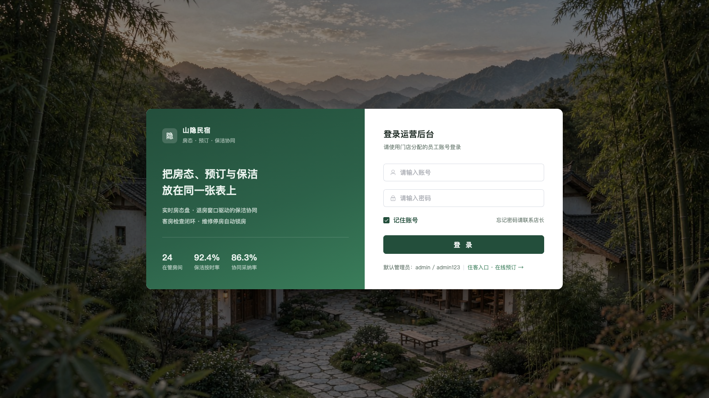

预览来自项目包内的界面截图，不代表所有功能均已完成运行验证。

### 演示视频

原项目包含演示视频。联系时发送「领取项目 044」，可一并询问对应视频。

**免费领取：** 按[领取说明](../GET-PROJECT.md)联系，发送「领取项目 044」。

[返回总目录](../CATALOG.md)

---

## 045 · 汽车维修工单与配件领用管理系统

**技术方向：** Spring Boot / Vue / MySQL  
**材料概况：** 功能说明 / 界面预览 / 演示视频（按需领取）

### 项目简介

围绕“汽车维修工单与配件领用管理系统”组织的项目案例，可用于了解相关业务场景与系统设计。领取前请按编号确认具体版本和材料清单。

### 功能要点

- 客户与车辆档案

- 预约与接车管理

- 检测与维修项目管理

- 报价与客户确认

- 派工与维修进度

- 配件库存与领退

- 质量检验与返工

- 交车与线下结算

### 界面预览

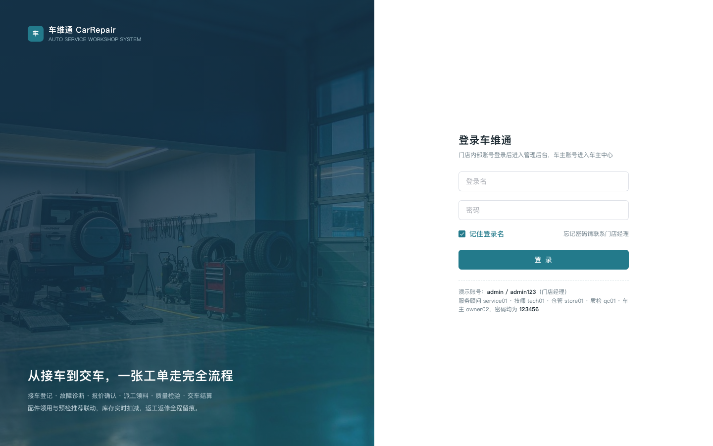

预览来自项目包内的界面截图，不代表所有功能均已完成运行验证。

### 演示视频

原项目包含演示视频。联系时发送「领取项目 045」，可一并询问对应视频。

**免费领取：** 按[领取说明](../GET-PROJECT.md)联系，发送「领取项目 045」。

[返回总目录](../CATALOG.md)

---

## 046 · 二手车检测评估与车辆档案管理系统

**技术方向：** Spring Boot / Vue / MySQL  
**材料概况：** 功能说明 / 界面预览 / 演示视频（按需领取）

### 项目简介

围绕“二手车检测评估与车辆档案管理系统”组织的项目案例，可用于了解相关业务场景与系统设计。领取前请按编号确认具体版本和材料清单。

### 功能要点

- 客户与车辆档案

- 检测预约与任务分配

- 检测模板管理

- 静态车况检测

- 机舱、底盘与动态检测

- 事故与风险判定

- 车辆估值管理

- 检测报告管理

### 界面预览

预览来自项目包内的界面截图，不代表所有功能均已完成运行验证。

### 演示视频

原项目包含演示视频。联系时发送「领取项目 046」，可一并询问对应视频。

**免费领取：** 按[领取说明](../GET-PROJECT.md)联系，发送「领取项目 046」。

[返回总目录](../CATALOG.md)

---

## 047 · 快递驿站出入库与滞留预警系统

**技术方向：** Spring Boot / Vue / MySQL  
**材料概况：** 功能说明 / 界面预览 / 演示视频（按需领取）

### 项目简介

围绕“快递驿站出入库与滞留预警系统”组织的项目案例，可用于了解相关业务场景与系统设计。领取前请按编号确认具体版本和材料清单。

### 功能要点

- 站点与货架管理

- 批次交接管理

- 快件入库与上架

- 取件通知管理

- 取件与代取核验

- 滞留预警管理

- 退件与快递员交接

- 异常件处理

### 界面预览

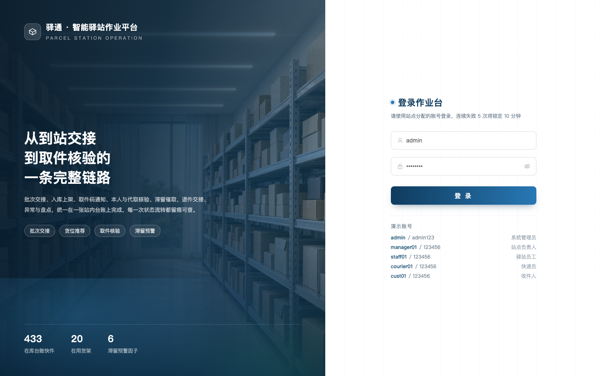

预览来自项目包内的界面截图，不代表所有功能均已完成运行验证。

### 演示视频

原项目包含演示视频。联系时发送「领取项目 047」，可一并询问对应视频。

**免费领取：** 按[领取说明](../GET-PROJECT.md)联系，发送「领取项目 047」。

[返回总目录](../CATALOG.md)

---

## 048 · 物流车辆调度与运单跟踪管理系统

**技术方向：** Spring Boot / Vue / MySQL  
**材料概况：** 功能说明 / 界面预览 / 演示视频（按需领取）

### 项目简介

围绕“物流车辆调度与运单跟踪管理系统”组织的项目案例，可用于了解相关业务场景与系统设计。领取前请按编号确认具体版本和材料清单。

### 功能要点

- 客户与地址档案

- 车辆与驾驶员管理

- 运输需求与运单

- 调度与冲突校验

- 装车与发运管理

- 在途节点跟踪

- 异常事件管理

- 回单与签收管理

### 界面预览

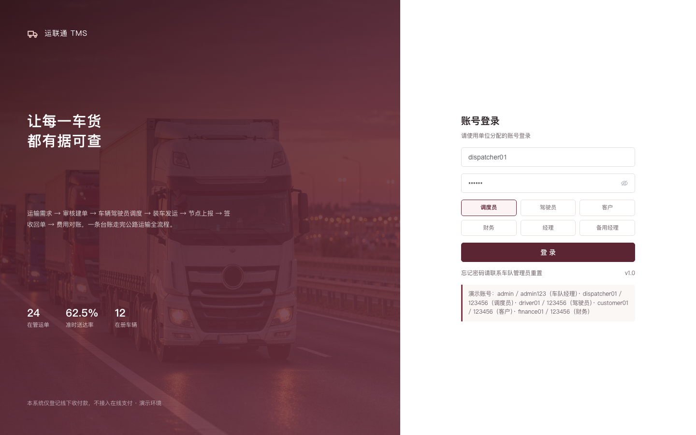

预览来自项目包内的界面截图，不代表所有功能均已完成运行验证。

### 演示视频

原项目包含演示视频。联系时发送「领取项目 048」，可一并询问对应视频。

**免费领取：** 按[领取说明](../GET-PROJECT.md)联系，发送「领取项目 048」。

[返回总目录](../CATALOG.md)

---

## 049 · 企业培训计划与学分管理系统

**技术方向：** Spring Boot / Vue / MySQL  
**材料概况：** 功能说明 / 界面预览 / 演示视频（按需领取）

### 项目简介

围绕“企业培训计划与学分管理系统”组织的项目案例，可用于了解相关业务场景与系统设计。领取前请按编号确认具体版本和材料清单。

### 功能要点

- 组织与员工档案

- 培训需求征集

- 年度培训计划

- 课程与讲师管理

- 培训班次与报名

- 签到与出勤管理

- 考核与成绩管理

- 学分与证书管理

### 界面预览

预览来自项目包内的界面截图，不代表所有功能均已完成运行验证。

### 演示视频

原项目包含演示视频。联系时发送「领取项目 049」，可一并询问对应视频。

**免费领取：** 按[领取说明](../GET-PROJECT.md)联系，发送「领取项目 049」。

[返回总目录](../CATALOG.md)

---

## 050 · 客诉工单与服务质量分析系统

**技术方向：** Spring Boot / Vue / MySQL  
**材料概况：** 功能说明 / 界面预览 / 演示视频（按需领取）

### 项目简介

围绕“客诉工单与服务质量分析系统”组织的项目案例，可用于了解相关业务场景与系统设计。领取前请按编号确认具体版本和材料清单。

### 功能要点

- 客户与服务对象档案

- 投诉受理

- 工单分派与接单

- 处理过程与客户沟通

- 时限预警与升级

- 结果审核与客户确认

- 重开与回访评价

- 整改与知识库

### 界面预览

预览来自项目包内的界面截图，不代表所有功能均已完成运行验证。

### 演示视频

原项目包含演示视频。联系时发送「领取项目 050」，可一并询问对应视频。

**免费领取：** 按[领取说明](../GET-PROJECT.md)联系，发送「领取项目 050」。

[返回总目录](../CATALOG.md)

---

## 051 · 校园二手物品交易平台

**技术方向：** Spring Boot / Vue / MySQL  
**材料概况：** 功能说明 / 界面预览 / 演示视频（按需领取）

### 项目简介

围绕“校园二手物品交易平台”组织的项目案例，可用于了解相关业务场景与系统设计。领取前请按编号确认具体版本和材料清单。

### 界面预览

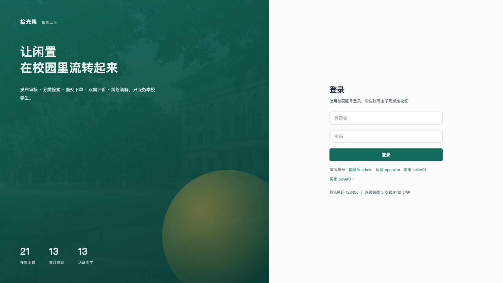

预览来自项目包内的界面截图，不代表所有功能均已完成运行验证。

### 演示视频

原项目包含演示视频。联系时发送「领取项目 051」，可一并询问对应视频。

**免费领取：** 按[领取说明](../GET-PROJECT.md)联系，发送「领取项目 051」。

[返回总目录](../CATALOG.md)

---

## 052 · 在线课程学习与考试系统

**技术方向：** Spring Boot / Vue / MySQL  
**材料概况：** 功能说明 / 界面预览 / 演示视频（按需领取）

### 项目简介

围绕“在线课程学习与考试系统”组织的项目案例，可用于了解相关业务场景与系统设计。领取前请按编号确认具体版本和材料清单。

### 界面预览

预览来自项目包内的界面截图，不代表所有功能均已完成运行验证。

### 演示视频

原项目包含演示视频。联系时发送「领取项目 052」，可一并询问对应视频。

**免费领取：** 按[领取说明](../GET-PROJECT.md)联系，发送「领取项目 052」。

[返回总目录](../CATALOG.md)

---

## 053 · 高校智能题库与错题本系统

**技术方向：** Spring Boot / Vue / MySQL  
**材料概况：** 功能说明 / 界面预览 / 演示视频（按需领取）

### 项目简介

围绕“高校智能题库与错题本系统”组织的项目案例，可用于了解相关业务场景与系统设计。领取前请按编号确认具体版本和材料清单。

### 界面预览

预览来自项目包内的界面截图，不代表所有功能均已完成运行验证。

### 演示视频

原项目包含演示视频。联系时发送「领取项目 053」，可一并询问对应视频。

**免费领取：** 按[领取说明](../GET-PROJECT.md)联系，发送「领取项目 053」。

[返回总目录](../CATALOG.md)

---

## 054 · 毕业论文选题与过程管理系统

**技术方向：** Spring Boot / Vue / MySQL  
**材料概况：** 功能说明 / 界面预览 / 演示视频（按需领取）

### 项目简介

围绕“毕业论文选题与过程管理系统”组织的项目案例，可用于了解相关业务场景与系统设计。领取前请按编号确认具体版本和材料清单。

### 界面预览

预览来自项目包内的界面截图，不代表所有功能均已完成运行验证。

### 演示视频

原项目包含演示视频。联系时发送「领取项目 054」，可一并询问对应视频。

**免费领取：** 按[领取说明](../GET-PROJECT.md)联系，发送「领取项目 054」。

[返回总目录](../CATALOG.md)

---

## 055 · 实验室安全准入与考核系统

**技术方向：** Spring Boot / Vue / MySQL  
**材料概况：** 功能说明 / 界面预览 / 演示视频（按需领取）

### 项目简介

围绕“实验室安全准入与考核系统”组织的项目案例，可用于了解相关业务场景与系统设计。领取前请按编号确认具体版本和材料清单。

### 界面预览

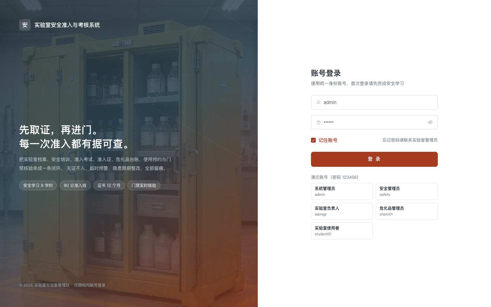

预览来自项目包内的界面截图，不代表所有功能均已完成运行验证。

### 演示视频

原项目包含演示视频。联系时发送「领取项目 055」，可一并询问对应视频。

**免费领取：** 按[领取说明](../GET-PROJECT.md)联系，发送「领取项目 055」。

[返回总目录](../CATALOG.md)

---

## 056 · 学生社团活动与经费管理系统

**技术方向：** Spring Boot / Vue / MySQL  
**材料概况：** 功能说明 / 界面预览 / 演示视频（按需领取）

### 项目简介

围绕“学生社团活动与经费管理系统”组织的项目案例，可用于了解相关业务场景与系统设计。领取前请按编号确认具体版本和材料清单。

### 界面预览

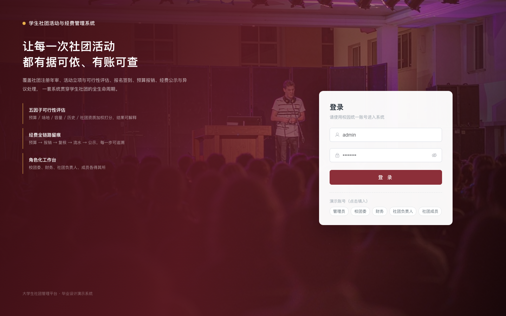

预览来自项目包内的界面截图，不代表所有功能均已完成运行验证。

### 演示视频

原项目包含演示视频。联系时发送「领取项目 056」，可一并询问对应视频。

**免费领取：** 按[领取说明](../GET-PROJECT.md)联系，发送「领取项目 056」。

[返回总目录](../CATALOG.md)

---

## 057 · 校园宿舍报修与卫生检查系统

**技术方向：** Spring Boot / Vue / MySQL  
**材料概况：** 功能说明 / 界面预览 / 演示视频（按需领取）

### 项目简介

围绕“校园宿舍报修与卫生检查系统”组织的项目案例，可用于了解相关业务场景与系统设计。领取前请按编号确认具体版本和材料清单。

### 界面预览

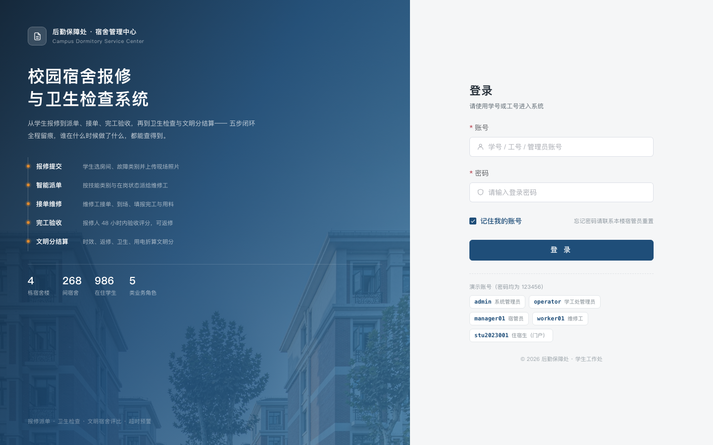

预览来自项目包内的界面截图，不代表所有功能均已完成运行验证。

### 演示视频

原项目包含演示视频。联系时发送「领取项目 057」，可一并询问对应视频。

**免费领取：** 按[领取说明](../GET-PROJECT.md)联系，发送「领取项目 057」。

[返回总目录](../CATALOG.md)

---

## 058 · 家校沟通与作业布置系统

**技术方向：** Spring Boot / Vue / MySQL  
**材料概况：** 功能说明 / 界面预览 / 演示视频（按需领取）

### 项目简介

围绕“家校沟通与作业布置系统”组织的项目案例，可用于了解相关业务场景与系统设计。领取前请按编号确认具体版本和材料清单。

### 界面预览

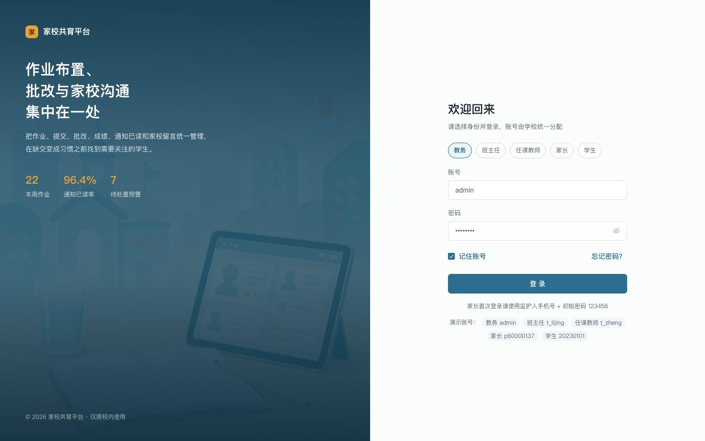

预览来自项目包内的界面截图，不代表所有功能均已完成运行验证。

### 演示视频

原项目包含演示视频。联系时发送「领取项目 058」，可一并询问对应视频。

**免费领取：** 按[领取说明](../GET-PROJECT.md)联系，发送「领取项目 058」。

[返回总目录](../CATALOG.md)

---

## 059 · 考研自习室座位预约与学习打卡系统

**技术方向：** Spring Boot / Vue / MySQL  
**材料概况：** 功能说明 / 界面预览 / 演示视频（按需领取）

### 项目简介

围绕“考研自习室座位预约与学习打卡系统”组织的项目案例，可用于了解相关业务场景与系统设计。领取前请按编号确认具体版本和材料清单。

### 界面预览

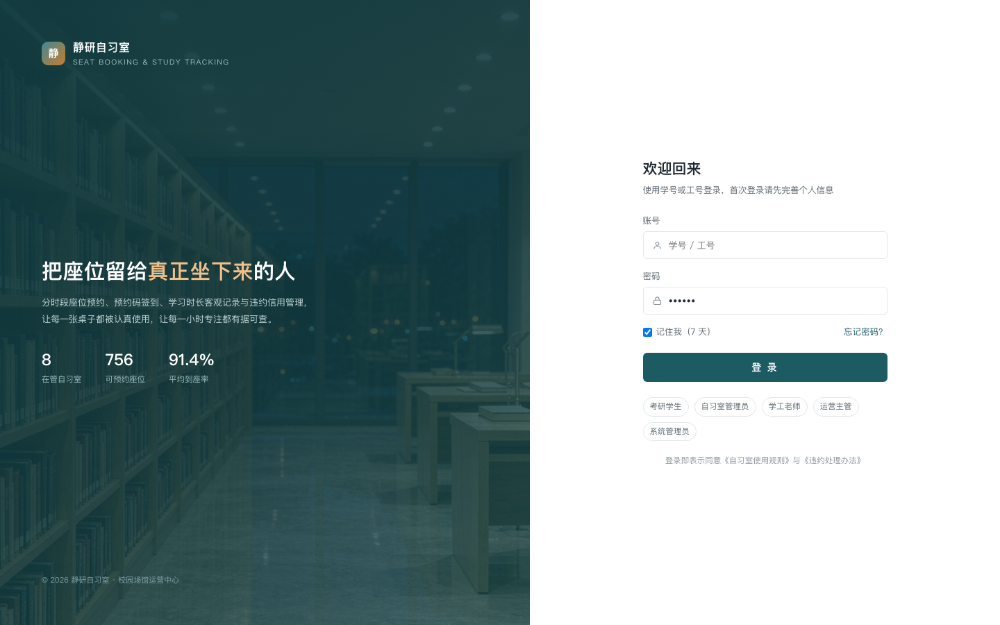

预览来自项目包内的界面截图，不代表所有功能均已完成运行验证。

### 演示视频

原项目包含演示视频。联系时发送「领取项目 059」，可一并询问对应视频。

**免费领取：** 按[领取说明](../GET-PROJECT.md)联系，发送「领取项目 059」。

[返回总目录](../CATALOG.md)

---

## 060 · 编程课程作业提交与互评系统

**技术方向：** Spring Boot / Vue / MySQL  
**材料概况：** 功能说明 / 界面预览 / 演示视频（按需领取）

### 项目简介

围绕“编程课程作业提交与互评系统”组织的项目案例，可用于了解相关业务场景与系统设计。领取前请按编号确认具体版本和材料清单。

### 界面预览

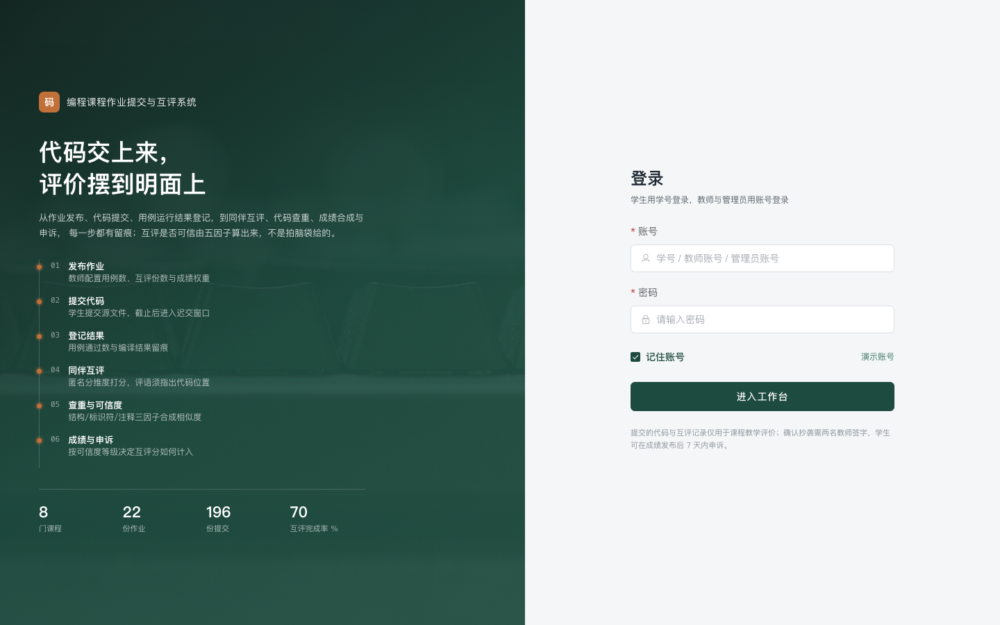

预览来自项目包内的界面截图，不代表所有功能均已完成运行验证。

### 演示视频

原项目包含演示视频。联系时发送「领取项目 060」，可一并询问对应视频。

**免费领取：** 按[领取说明](../GET-PROJECT.md)联系，发送「领取项目 060」。

[返回总目录](../CATALOG.md)

---

## 061 · 生鲜果蔬社区团购系统

**技术方向：** Spring Boot / Vue / MySQL  
**材料概况：** 功能说明 / 界面预览 / 演示视频（按需领取）

### 项目简介

围绕“生鲜果蔬社区团购系统”组织的项目案例，可用于了解相关业务场景与系统设计。领取前请按编号确认具体版本和材料清单。

### 界面预览

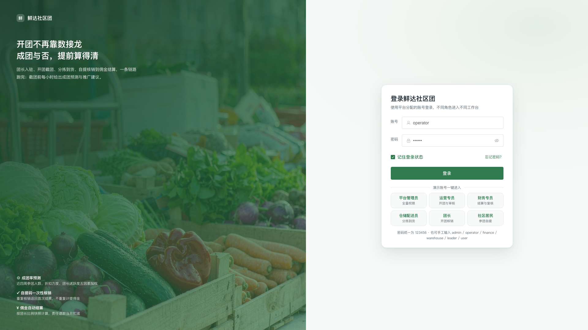

预览来自项目包内的界面截图，不代表所有功能均已完成运行验证。

### 演示视频

原项目包含演示视频。联系时发送「领取项目 061」，可一并询问对应视频。

**免费领取：** 按[领取说明](../GET-PROJECT.md)联系，发送「领取项目 061」。

[返回总目录](../CATALOG.md)

---

## 062 · 外卖点餐与骑手配送系统

**技术方向：** Spring Boot / Vue / MySQL  
**材料概况：** 功能说明 / 界面预览 / 演示视频（按需领取）

### 项目简介

围绕“外卖点餐与骑手配送系统”组织的项目案例，可用于了解相关业务场景与系统设计。领取前请按编号确认具体版本和材料清单。

### 界面预览

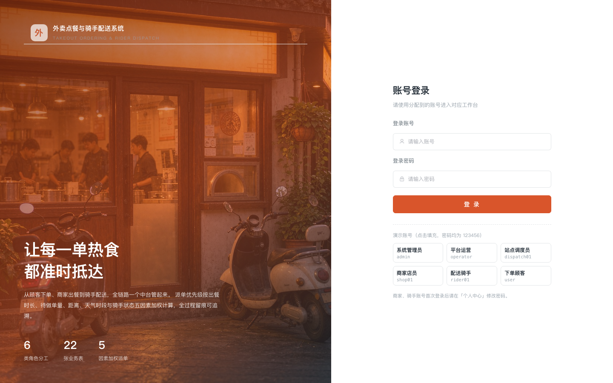

预览来自项目包内的界面截图，不代表所有功能均已完成运行验证。

### 演示视频

原项目包含演示视频。联系时发送「领取项目 062」，可一并询问对应视频。

**免费领取：** 按[领取说明](../GET-PROJECT.md)联系，发送「领取项目 062」。

[返回总目录](../CATALOG.md)

---

## 063 · 网上书店与图书销售系统

**技术方向：** Spring Boot / Vue / MySQL  
**材料概况：** 功能说明 / 界面预览 / 演示视频（按需领取）

### 项目简介

围绕“网上书店与图书销售系统”组织的项目案例，可用于了解相关业务场景与系统设计。领取前请按编号确认具体版本和材料清单。

### 界面预览

预览来自项目包内的界面截图，不代表所有功能均已完成运行验证。

### 演示视频

原项目包含演示视频。联系时发送「领取项目 063」，可一并询问对应视频。

**免费领取：** 按[领取说明](../GET-PROJECT.md)联系，发送「领取项目 063」。

[返回总目录](../CATALOG.md)

---

## 064 · 母婴用品商城与会员营销系统

**技术方向：** Spring Boot / Vue / MySQL  
**材料概况：** 功能说明 / 界面预览 / 演示视频（按需领取）

### 项目简介

围绕“母婴用品商城与会员营销系统”组织的项目案例，可用于了解相关业务场景与系统设计。领取前请按编号确认具体版本和材料清单。

### 界面预览

预览来自项目包内的界面截图，不代表所有功能均已完成运行验证。

### 演示视频

原项目包含演示视频。联系时发送「领取项目 064」，可一并询问对应视频。

**免费领取：** 按[领取说明](../GET-PROJECT.md)联系，发送「领取项目 064」。

[返回总目录](../CATALOG.md)

---

## 065 · 美妆护肤商城与试用装派发系统

**技术方向：** Spring Boot / Vue / MySQL  
**材料概况：** 功能说明 / 界面预览 / 演示视频（按需领取）

### 项目简介

围绕“美妆护肤商城与试用装派发系统”组织的项目案例，可用于了解相关业务场景与系统设计。领取前请按编号确认具体版本和材料清单。

### 界面预览

预览来自项目包内的界面截图，不代表所有功能均已完成运行验证。

### 演示视频

原项目包含演示视频。联系时发送「领取项目 065」，可一并询问对应视频。

**免费领取：** 按[领取说明](../GET-PROJECT.md)联系，发送「领取项目 065」。

[返回总目录](../CATALOG.md)

---
