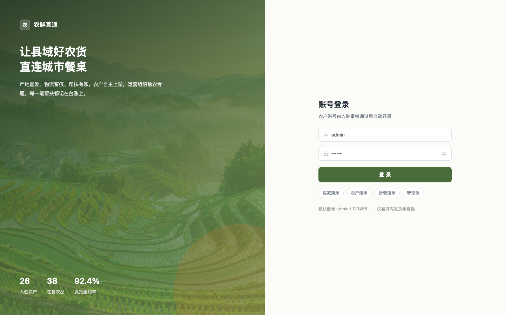
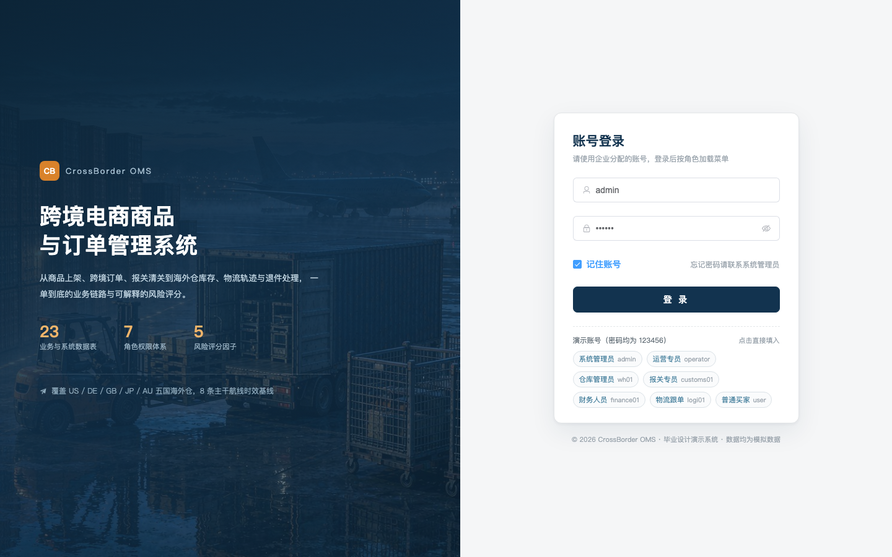
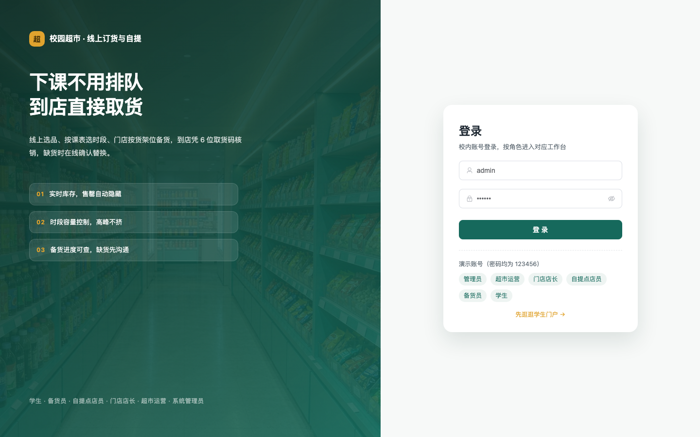
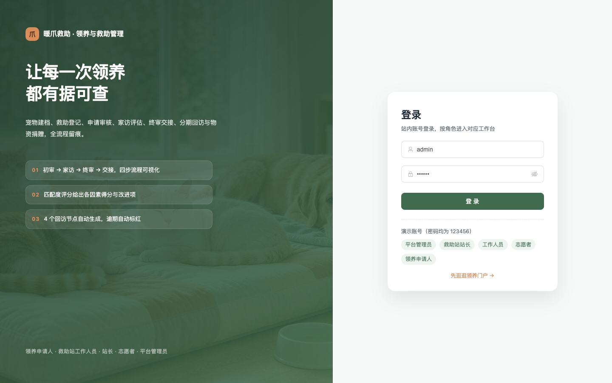

# 业务管理项目 · 第 3 页

[返回总目录](../CATALOG.md) · [免费领取说明](../GET-PROJECT.md)

> 功能摘录来自项目附带文档，描述的是案例范围与设计目标；具体实现、运行环境和可领取材料以对应版本为准。

| 项目编号 | 项目名称 |
|---|---|
| 067 | [农产品直销助农电商平台](#p-067) |
| 068 | [跨境电商商品与订单管理系统](#p-068) |
| 070 | [校园超市线上订货与自提系统](#p-070) |
| 073 | [宠物领养与救助管理系统](#p-073) |

## 067 · 农产品直销助农电商平台

**技术方向：** Spring Boot / Vue / MySQL  
**材料概况：** 功能说明 / 界面预览 / 演示视频（按需领取）

### 项目简介

围绕“农产品直销助农电商平台”组织的项目案例，可用于了解相关业务场景与系统设计。领取前请按编号确认具体版本和材料清单。

### 界面预览

预览来自项目包内的界面截图，不代表所有功能均已完成运行验证。

### 演示视频

原项目包含演示视频。联系时发送「领取项目 067」，可一并询问对应视频。

**免费领取：** 按[领取说明](../GET-PROJECT.md)联系，发送「领取项目 067」。

[返回总目录](../CATALOG.md)

---

## 068 · 跨境电商商品与订单管理系统

**技术方向：** Spring Boot / Vue / MySQL  
**材料概况：** 功能说明 / 界面预览 / 演示视频（按需领取）

### 项目简介

围绕“跨境电商商品与订单管理系统”组织的项目案例，可用于了解相关业务场景与系统设计。领取前请按编号确认具体版本和材料清单。

### 界面预览

预览来自项目包内的界面截图，不代表所有功能均已完成运行验证。

### 演示视频

原项目包含演示视频。联系时发送「领取项目 068」，可一并询问对应视频。

**免费领取：** 按[领取说明](../GET-PROJECT.md)联系，发送「领取项目 068」。

[返回总目录](../CATALOG.md)

---

## 070 · 校园超市线上订货与自提系统

**技术方向：** Spring Boot / Vue / MySQL  
**材料概况：** 功能说明 / 界面预览 / 演示视频（按需领取）

### 项目简介

围绕“校园超市线上订货与自提系统”组织的项目案例，可用于了解相关业务场景与系统设计。领取前请按编号确认具体版本和材料清单。

### 界面预览

预览来自项目包内的界面截图，不代表所有功能均已完成运行验证。

### 演示视频

原项目包含演示视频。联系时发送「领取项目 070」，可一并询问对应视频。

**免费领取：** 按[领取说明](../GET-PROJECT.md)联系，发送「领取项目 070」。

[返回总目录](../CATALOG.md)

---

## 073 · 宠物领养与救助管理系统

**技术方向：** Spring Boot / Vue / MySQL  
**材料概况：** 功能说明 / 界面预览 / 演示视频（按需领取）

### 项目简介

围绕“宠物领养与救助管理系统”组织的项目案例，可用于了解相关业务场景与系统设计。领取前请按编号确认具体版本和材料清单。

### 界面预览

预览来自项目包内的界面截图，不代表所有功能均已完成运行验证。

### 演示视频

原项目包含演示视频。联系时发送「领取项目 073」，可一并询问对应视频。

**免费领取：** 按[领取说明](../GET-PROJECT.md)联系，发送「领取项目 073」。

[返回总目录](../CATALOG.md)

---
