# 专题项目 · 第 1 页

[返回总目录](../CATALOG.md) · [免费领取说明](../GET-PROJECT.md)

> 功能摘录来自项目附带文档，描述的是案例范围与设计目标；具体实现、运行环境和可领取材料以对应版本为准。

| 项目编号 | 项目名称 |
|---|---|
| NEW-001 | [基于SpringBoot+Vue的互联网医院在线问诊与处方流转系统](#p-new-001) |
| NEW-002 | [基于SpringBoot+Vue的社区家庭医生签约与随访管理系统](#p-new-002) |
| NEW-003 | [基于SpringBoot+Vue的康复训练计划与效果评估系统](#p-new-003) |
| NEW-004 | [基于SpringBoot+Vue的中医理疗馆预约与疗程管理系统](#p-new-004) |
| NEW-005 | [基于SpringBoot+Vue的口腔诊所诊疗与复诊提醒系统](#p-new-005) |
| NEW-006 | [基于SpringBoot+Vue的体检报告解读与健康风险预警系统](#p-new-006) |
| NEW-007 | [基于SpringBoot+Vue的疫苗预约与接种追溯系统](#p-new-007) |
| NEW-008 | [基于SpringBoot+Vue的安宁疗护志愿者服务管理系统](#p-new-008) |
| NEW-009 | [基于SpringBoot+Vue的母婴护理月嫂派单与评价系统](#p-new-009) |
| NEW-010 | [基于SpringBoot+Vue的慢病用药提醒与依从性分析系统](#p-new-010) |
| NEW-011 | [基于SpringBoot+Vue的研学旅行课程与安全保障管理系统](#p-new-011) |
| NEW-012 | [基于SpringBoot+Vue的幼儿园家园共育与成长档案系统](#p-new-012) |
| NEW-013 | [基于SpringBoot+Vue的素质教育机构排课与消课系统](#p-new-013) |
| NEW-014 | [基于SpringBoot+Vue的职业资格考证报名与题库训练系统](#p-new-014) |
| NEW-015 | [基于SpringBoot+Vue的校企合作实习管理与过程考核系统](#p-new-015) |
| NEW-016 | [基于SpringBoot+Vue的高校实验室安全准入与危化品管理系统](#p-new-016) |
| NEW-017 | [基于SpringBoot+Vue的中小学课后服务选课与经费管理系统](#p-new-017) |
| NEW-018 | [基于SpringBoot+Vue的在线一对一辅导匹配与课堂质量监控系统](#p-new-018) |
| NEW-019 | [基于SpringBoot+Vue的教师职称评审材料流转与打分系统](#p-new-019) |
| NEW-020 | [基于SpringBoot+Vue的校园心理预警与危机干预系统](#p-new-020) |
| NEW-021 | [基于SpringBoot+Vue的即时零售门店拣货与骑手调度系统](#p-new-021) |
| NEW-022 | [基于SpringBoot+Vue的社区团购团长管理与分佣结算系统](#p-new-022) |
| NEW-023 | [基于SpringBoot+Vue的预制菜订购与冷链配送追溯系统](#p-new-023) |
| NEW-024 | [基于SpringBoot+Vue的二手奢侈品鉴定与寄售交易系统](#p-new-024) |
| NEW-025 | [基于SpringBoot+Vue的潮玩盲盒抽盒与库存盲池管理系统](#p-new-025) |
| NEW-026 | [基于SpringBoot+Vue的直播电商选品与达人合作管理系统](#p-new-026) |
| NEW-027 | [基于SpringBoot+Vue的跨境电商多店铺订单与报关管理系统](#p-new-027) |
| NEW-028 | [基于SpringBoot+Vue的生鲜门店损耗管理与智能补货系统](#p-new-028) |
| NEW-029 | [基于SpringBoot+Vue的会员储值与积分营销系统](#p-new-029) |
| NEW-030 | [基于SpringBoot+Vue的退货换货逆向物流管理系统](#p-new-030) |

## NEW-001 · 基于SpringBoot+Vue的互联网医院在线问诊与处方流转系统

**技术方向：** Spring Boot / Vue / MySQL  
**材料概况：** 功能说明 / 界面预览 / 演示视频（按需领取）

### 项目简介

建设一套覆盖「问诊—开方—审方—支付—配送—随访」的线上诊疗系统：患者可图文或视频问诊，医生在线开具电子处方，药师双人复核后流转到药房或配送，全过程留痕可追溯，并支持复诊续方与用药提醒，降低患者往返成本。

### 功能要点

- 患者端问诊

- 医生工作台

- 药师审方

- 平台管理

- 用药提醒与随访

### 界面预览

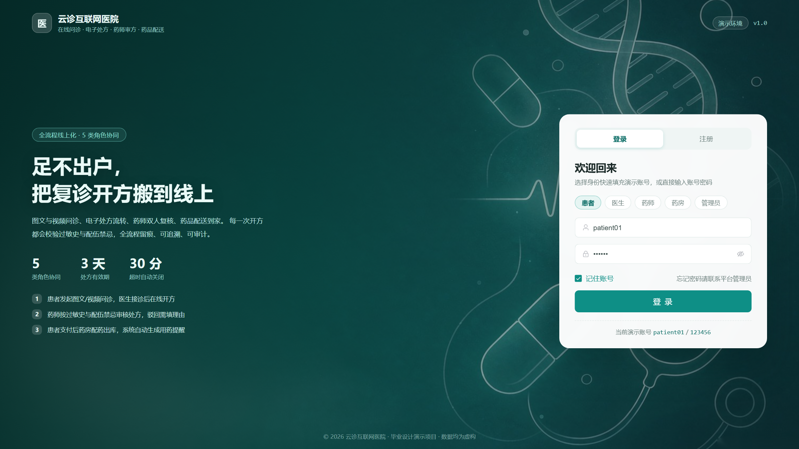

预览来自项目包内的界面截图，不代表所有功能均已完成运行验证。

### 演示视频

原项目包含演示视频。联系时发送「领取项目 NEW-001」，可一并询问对应视频。

**免费领取：** 按[领取说明](../GET-PROJECT.md)联系，发送「领取项目 NEW-001」。

[返回总目录](../CATALOG.md)

---

## NEW-002 · 基于SpringBoot+Vue的社区家庭医生签约与随访管理系统

**技术方向：** Spring Boot / Vue / MySQL  
**材料概况：** 功能说明 / 界面预览 / 演示视频（按需领取）

### 项目简介

把签约、服务包、随访、转诊、考核串成一条线：居民在线签约并选择服务包，医生按计划随访并留痕，异常指标自动预警，管理端可按团队统计签约率与服务完成率。

### 功能要点

- 居民签约

- 随访执行

- 转诊闭环

- 考核统计

### 界面预览

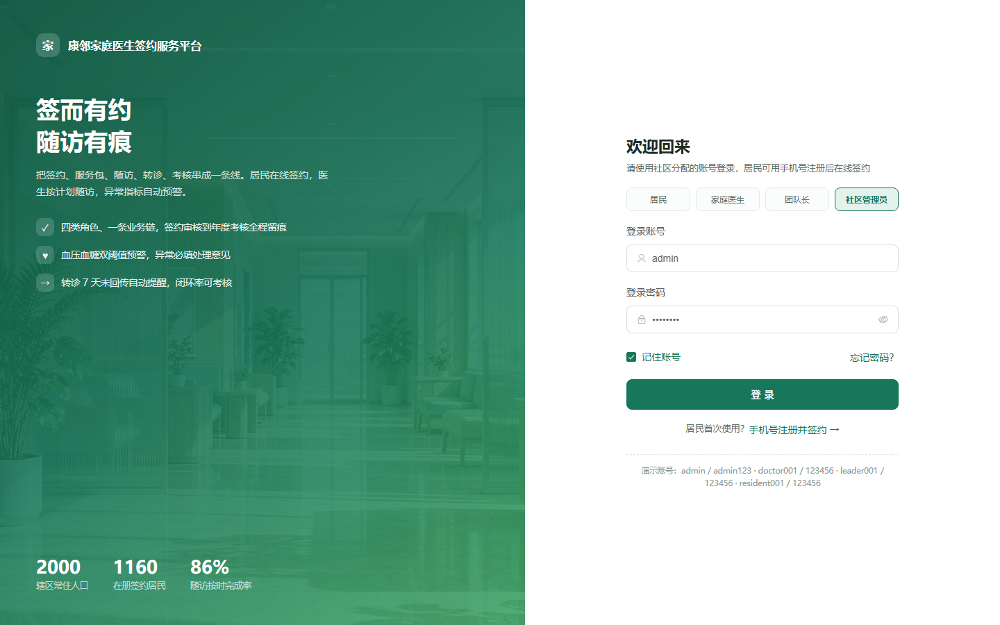

预览来自项目包内的界面截图，不代表所有功能均已完成运行验证。

### 演示视频

原项目包含演示视频。联系时发送「领取项目 NEW-002」，可一并询问对应视频。

**免费领取：** 按[领取说明](../GET-PROJECT.md)联系，发送「领取项目 NEW-002」。

[返回总目录](../CATALOG.md)

---

## NEW-003 · 基于SpringBoot+Vue的康复训练计划与效果评估系统

**技术方向：** Spring Boot / Vue / MySQL  
**材料概况：** 功能说明 / 界面预览 / 演示视频（按需领取）

### 项目简介

把康复计划拆成可执行的每日训练项，患者在手机上跟着视频练并打卡，治疗师按周评估并调整强度，系统自动汇总完成率与关节活动度等指标，形成可视化康复曲线。

### 功能要点

- 计划制定

- 居家训练

- 评估与报告

### 界面预览

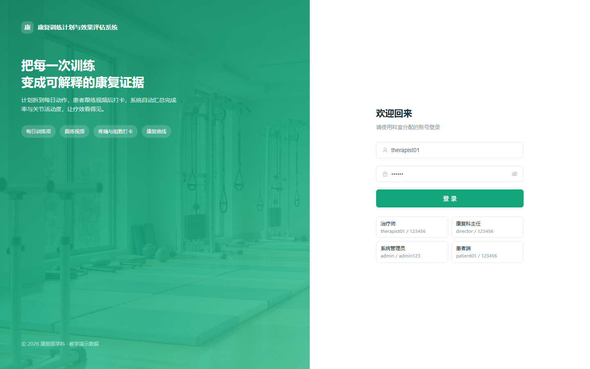

预览来自项目包内的界面截图，不代表所有功能均已完成运行验证。

### 演示视频

原项目包含演示视频。联系时发送「领取项目 NEW-003」，可一并询问对应视频。

**免费领取：** 按[领取说明](../GET-PROJECT.md)联系，发送「领取项目 NEW-003」。

[返回总目录](../CATALOG.md)

---

## NEW-004 · 基于SpringBoot+Vue的中医理疗馆预约与疗程管理系统

**技术方向：** Spring Boot / Vue / MySQL  
**材料概况：** 功能说明 / 界面预览 / 演示视频（按需领取）

### 项目简介

把项目、技师、排班、预约、疗程卡、到店核销连成一体：顾客在线选项目与技师时段，到店扫码核销扣次，卡余额与到期日实时可查，馆方可按技师与项目统计上座率。

### 功能要点

- 项目与技师

- 顾客预约

- 到店核销

- 经营统计

### 界面预览

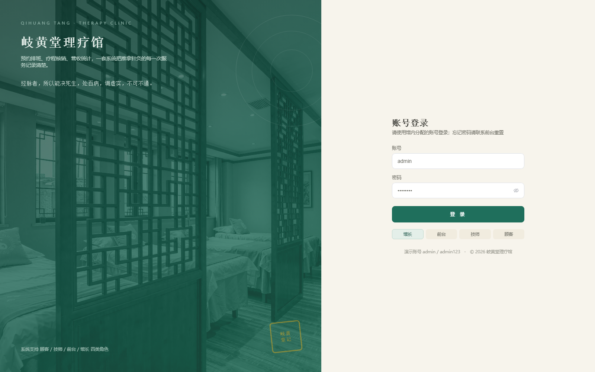

预览来自项目包内的界面截图，不代表所有功能均已完成运行验证。

### 演示视频

原项目包含演示视频。联系时发送「领取项目 NEW-004」，可一并询问对应视频。

**免费领取：** 按[领取说明](../GET-PROJECT.md)联系，发送「领取项目 NEW-004」。

[返回总目录](../CATALOG.md)

---

## NEW-005 · 基于SpringBoot+Vue的口腔诊所诊疗与复诊提醒系统

**技术方向：** Spring Boot / Vue / MySQL  
**材料概况：** 功能说明 / 界面预览 / 演示视频（按需领取）

### 项目简介

以「患者—治疗方案—分次执行」为主线管理诊疗过程：首诊建档并出具方案与报价，每次治疗上传影像与病历，系统按方案自动生成复诊计划并提前推送，患者可在线改约。

### 功能要点

- 建档与方案

- 诊疗执行

- 复诊提醒

- 经营统计

### 界面预览

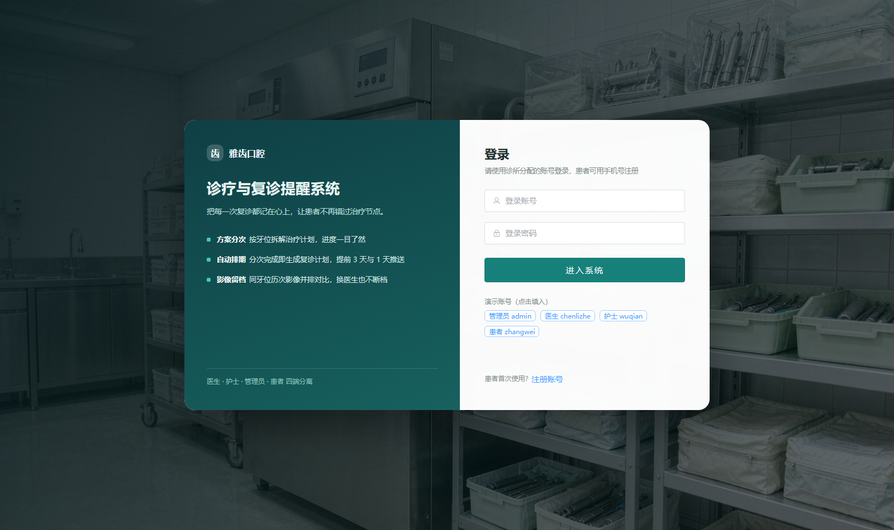

预览来自项目包内的界面截图，不代表所有功能均已完成运行验证。

### 演示视频

原项目包含演示视频。联系时发送「领取项目 NEW-005」，可一并询问对应视频。

**免费领取：** 按[领取说明](../GET-PROJECT.md)联系，发送「领取项目 NEW-005」。

[返回总目录](../CATALOG.md)

---

## NEW-006 · 基于SpringBoot+Vue的体检报告解读与健康风险预警系统

**技术方向：** Spring Boot / Vue / MySQL  
**材料概况：** 功能说明 / 界面预览 / 演示视频（按需领取）

### 项目简介

把体检报告结构化：上传后自动解析指标，按参考区间标注异常等级，生成通俗解读与复查建议，对高危指标触发预警并安排随访，形成历年指标对比曲线。

### 功能要点

- 报告导入与解析

- 受检人查看

- 风险跟进

- 统计

### 界面预览

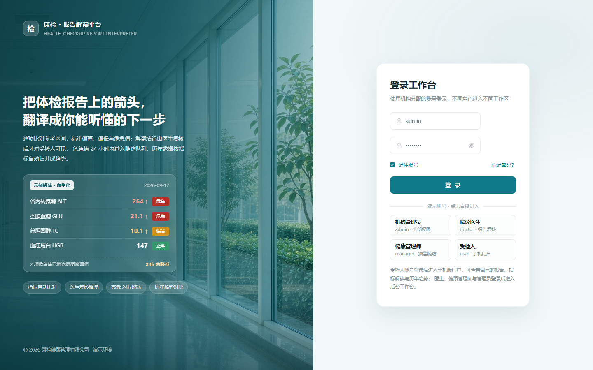

预览来自项目包内的界面截图，不代表所有功能均已完成运行验证。

### 演示视频

原项目包含演示视频。联系时发送「领取项目 NEW-006」，可一并询问对应视频。

**免费领取：** 按[领取说明](../GET-PROJECT.md)联系，发送「领取项目 NEW-006」。

[返回总目录](../CATALOG.md)

---

## NEW-007 · 基于SpringBoot+Vue的疫苗预约与接种追溯系统

**技术方向：** Spring Boot / Vue / MySQL  
**材料概况：** 功能说明 / 界面预览 / 演示视频（按需领取）

### 项目简介

提供疫苗信息公示、分时段预约、接种登记、电子接种证与不良反应上报，按疫苗剂次自动计算下一针时间并提醒，实现一人一档、全程可追溯。

### 功能要点

- 疫苗与号源

- 预约接种

- 接种登记

- 查询统计

### 界面预览

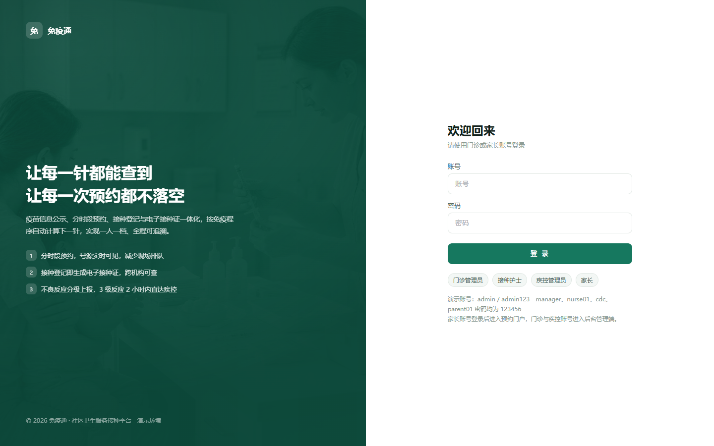

预览来自项目包内的界面截图，不代表所有功能均已完成运行验证。

### 演示视频

原项目包含演示视频。联系时发送「领取项目 NEW-007」，可一并询问对应视频。

**免费领取：** 按[领取说明](../GET-PROJECT.md)联系，发送「领取项目 NEW-007」。

[返回总目录](../CATALOG.md)

---

## NEW-008 · 基于SpringBoot+Vue的安宁疗护志愿者服务管理系统

**技术方向：** Spring Boot / Vue / MySQL  
**材料概况：** 功能说明 / 界面预览 / 演示视频（按需领取）

### 项目简介

建立志愿者档案与技能标签，按患者需求匹配排班，服务后填写记录与家属反馈，自动累计服务时长并生成证明，同时提供志愿者心理支持与督导记录。

### 功能要点

- 志愿者管理

- 需求与派单

- 服务与反馈

- 统计与证明

### 界面预览

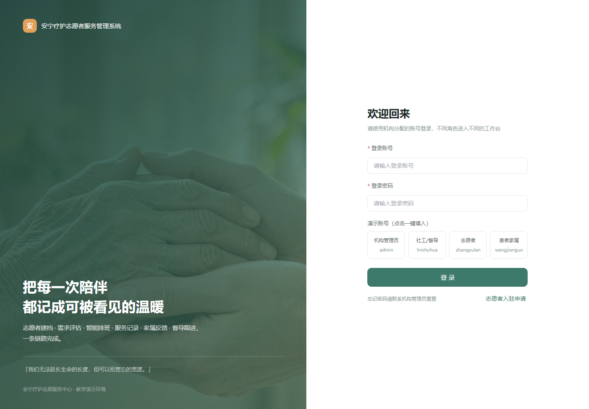

预览来自项目包内的界面截图，不代表所有功能均已完成运行验证。

### 演示视频

原项目包含演示视频。联系时发送「领取项目 NEW-008」，可一并询问对应视频。

**免费领取：** 按[领取说明](../GET-PROJECT.md)联系，发送「领取项目 NEW-008」。

[返回总目录](../CATALOG.md)

---

## NEW-009 · 基于SpringBoot+Vue的母婴护理月嫂派单与评价系统

**技术方向：** Spring Boot / Vue / MySQL  
**材料概况：** 功能说明 / 界面预览 / 演示视频（按需领取）

### 项目简介

建立月嫂档案与档期管理，客户线上下单并匹配月嫂，上户后每日填写护理日志，服务结束由客户评价，机构按月嫂星级与订单量结算，全过程可追溯。

### 功能要点

- 月嫂管理

- 客户下单

- 上户服务

- 结算与统计

### 界面预览

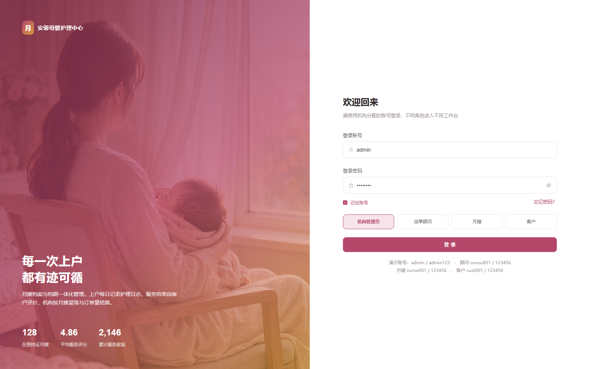

预览来自项目包内的界面截图，不代表所有功能均已完成运行验证。

### 演示视频

原项目包含演示视频。联系时发送「领取项目 NEW-009」，可一并询问对应视频。

**免费领取：** 按[领取说明](../GET-PROJECT.md)联系，发送「领取项目 NEW-009」。

[返回总目录](../CATALOG.md)

---

## NEW-010 · 基于SpringBoot+Vue的慢病用药提醒与依从性分析系统

**技术方向：** Spring Boot / Vue / MySQL  
**材料概况：** 功能说明 / 界面预览 / 演示视频（按需领取）

### 项目简介

为患者建立用药计划，按时间推送提醒并记录服药打卡，计算依从率与漏服规律，医生端可查看依从性报告并针对性干预，形成「计划—提醒—打卡—分析—干预」闭环。

### 功能要点

- 用药计划

- 提醒与打卡

- 依从性分析

- 干预闭环

### 界面预览

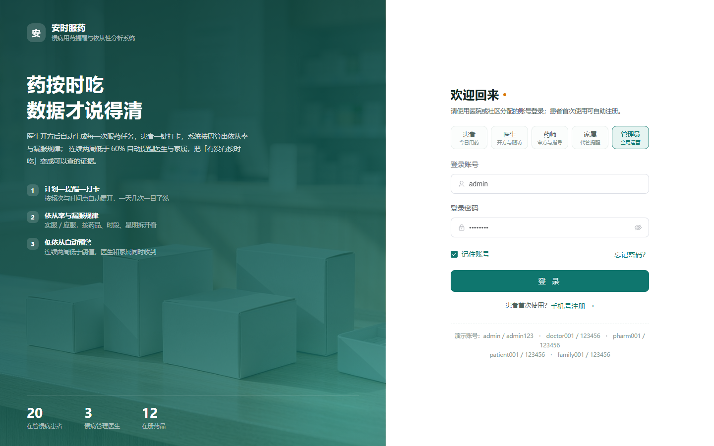

预览来自项目包内的界面截图，不代表所有功能均已完成运行验证。

### 演示视频

原项目包含演示视频。联系时发送「领取项目 NEW-010」，可一并询问对应视频。

**免费领取：** 按[领取说明](../GET-PROJECT.md)联系，发送「领取项目 NEW-010」。

[返回总目录](../CATALOG.md)

---

## NEW-011 · 基于SpringBoot+Vue的研学旅行课程与安全保障管理系统

**技术方向：** Spring Boot / Vue / MySQL  
**材料概况：** 功能说明 / 界面预览 / 演示视频（按需领取）

### 项目简介

把研学课程、行程、报名、缴费、保险、随队报备、应急事件串成闭环，带队老师用手机即可点名与上报，管理端随时掌握每支队伍的实时状态。

### 功能要点

- 课程与报名

- 行程执行

- 安全保障

### 界面预览

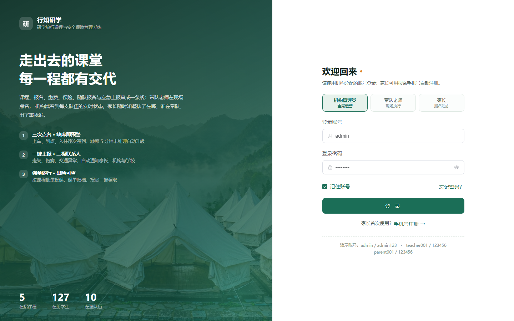

预览来自项目包内的界面截图，不代表所有功能均已完成运行验证。

### 演示视频

原项目包含演示视频。联系时发送「领取项目 NEW-011」，可一并询问对应视频。

**免费领取：** 按[领取说明](../GET-PROJECT.md)联系，发送「领取项目 NEW-011」。

[返回总目录](../CATALOG.md)

---

## NEW-012 · 基于SpringBoot+Vue的幼儿园家园共育与成长档案系统

**技术方向：** Spring Boot / Vue / MySQL  
**材料概况：** 功能说明 / 界面预览 / 演示视频（按需领取）

### 项目简介

以幼儿为单位建立成长档案：每日记录饮食、睡眠、情绪与活动照片，家长可查看并互动；按五大领域记录发展观察，学期末自动汇总成成长报告。

### 功能要点

- 每日动态

- 成长档案

- 园务管理

### 界面预览

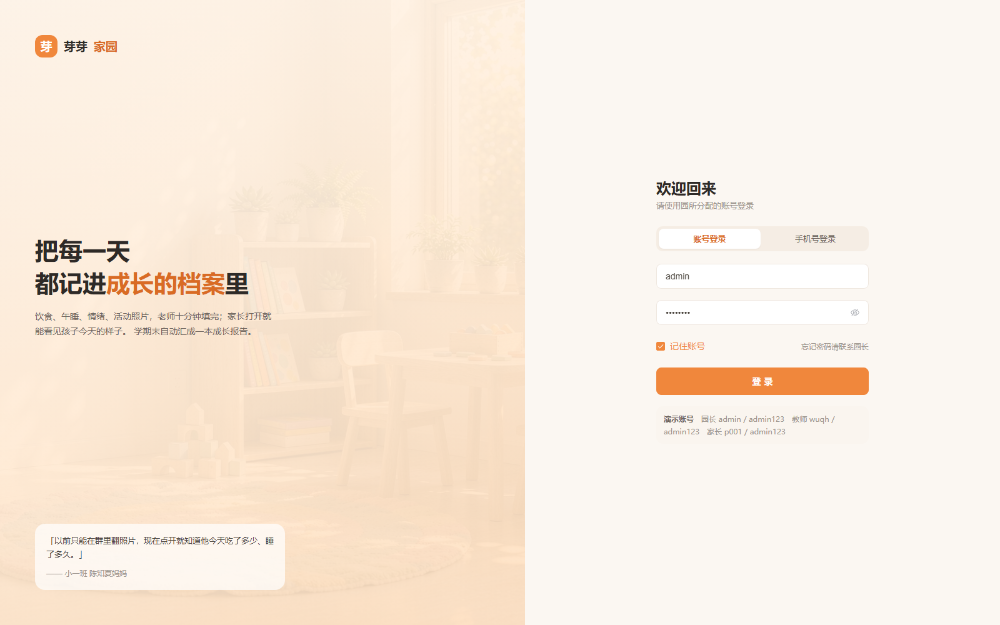

预览来自项目包内的界面截图，不代表所有功能均已完成运行验证。

### 演示视频

原项目包含演示视频。联系时发送「领取项目 NEW-012」，可一并询问对应视频。

**免费领取：** 按[领取说明](../GET-PROJECT.md)联系，发送「领取项目 NEW-012」。

[返回总目录](../CATALOG.md)

---

## NEW-013 · 基于SpringBoot+Vue的素质教育机构排课与消课系统

**技术方向：** Spring Boot / Vue / MySQL  
**材料概况：** 功能说明 / 界面预览 / 演示视频（按需领取）

### 项目简介

把教师档期、教室资源、学员课时包统一到一张课表上，排课自动避冲突，上课扫码签到自动消课，家长随时可见剩余课时与上课记录。

### 功能要点

- 排课管理

- 课时账户

- 家校互动

### 界面预览

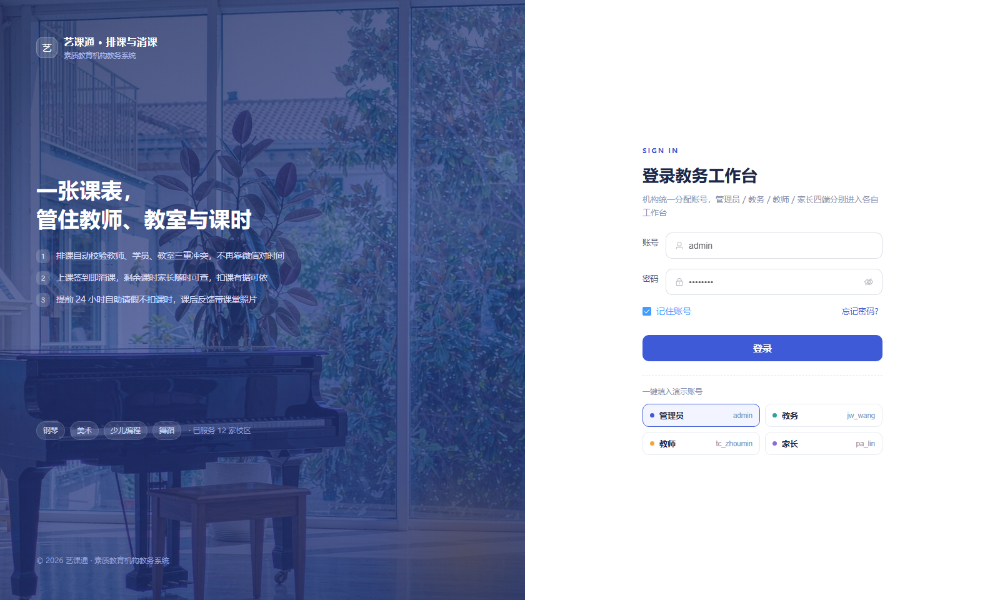

预览来自项目包内的界面截图，不代表所有功能均已完成运行验证。

### 演示视频

原项目包含演示视频。联系时发送「领取项目 NEW-013」，可一并询问对应视频。

**免费领取：** 按[领取说明](../GET-PROJECT.md)联系，发送「领取项目 NEW-013」。

[返回总目录](../CATALOG.md)

---

## NEW-014 · 基于SpringBoot+Vue的职业资格考证报名与题库训练系统

**技术方向：** Spring Boot / Vue / MySQL  
**材料概况：** 功能说明 / 界面预览 / 演示视频（按需领取）

### 项目简介

把报名审核、缴费、准考证、题库练习、模拟考试、成绩查询串起来，机构可按班级追踪学习进度与通过率，考生在一个入口完成全流程。

### 功能要点

- 报名审核

- 题库训练

- 成绩与统计

### 界面预览

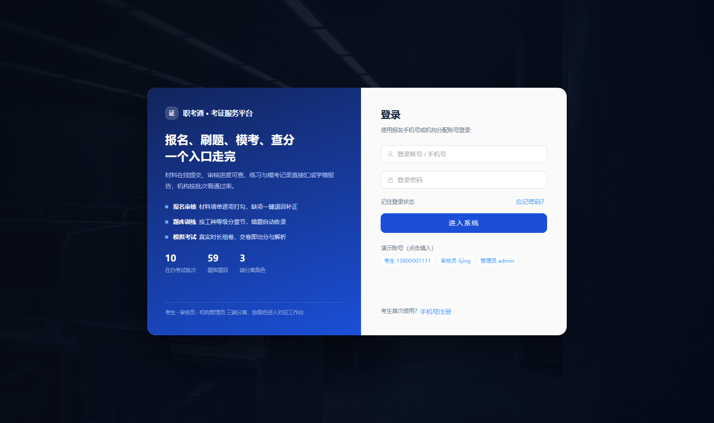

预览来自项目包内的界面截图，不代表所有功能均已完成运行验证。

### 演示视频

原项目包含演示视频。联系时发送「领取项目 NEW-014」，可一并询问对应视频。

**免费领取：** 按[领取说明](../GET-PROJECT.md)联系，发送「领取项目 NEW-014」。

[返回总目录](../CATALOG.md)

---

## NEW-015 · 基于SpringBoot+Vue的校企合作实习管理与过程考核系统

**技术方向：** Spring Boot / Vue / MySQL  
**材料概况：** 功能说明 / 界面预览 / 演示视频（按需领取）

### 项目简介

以三方协议为起点，管理岗位发布、学生投递、企业录用、在岗打卡、周报批阅、企业评价与学分认定，让实习过程可监控、材料可归档。

### 功能要点

- 岗位与协议

- 过程管理

- 考核与归档

### 界面预览

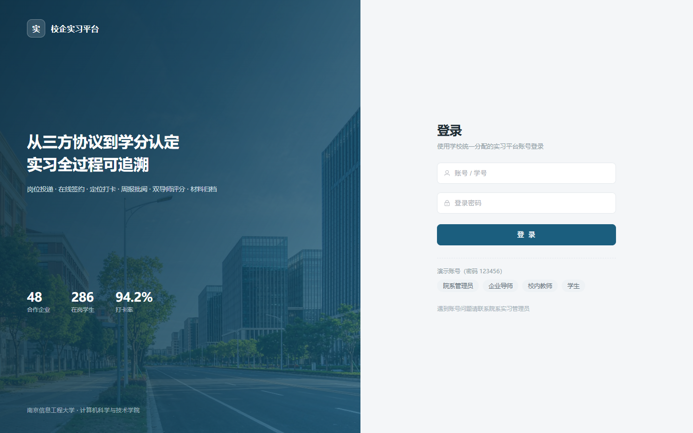

预览来自项目包内的界面截图，不代表所有功能均已完成运行验证。

### 演示视频

原项目包含演示视频。联系时发送「领取项目 NEW-015」，可一并询问对应视频。

**免费领取：** 按[领取说明](../GET-PROJECT.md)联系，发送「领取项目 NEW-015」。

[返回总目录](../CATALOG.md)

---

## NEW-016 · 基于SpringBoot+Vue的高校实验室安全准入与危化品管理系统

**技术方向：** Spring Boot / Vue / MySQL  
**材料概况：** 功能说明 / 界面预览 / 演示视频（按需领取）

### 项目简介

建立实验室—房间—设备—危化品的层级台账，学生需通过安全考试获得准入资格，危化品从入库、领用、使用到废弃全程留痕，库存与存放位置实时可查，超期与超量自动预警。

### 功能要点

- 准入管理

- 危化品台账

- 巡检与整改

### 界面预览

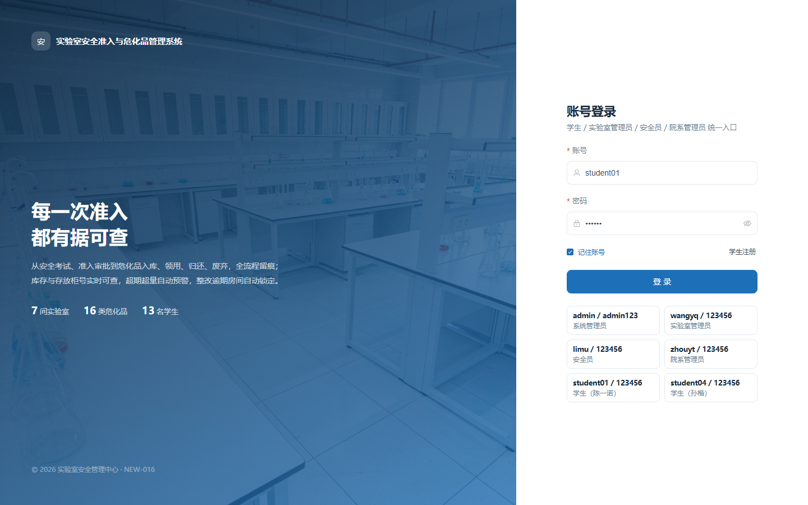

预览来自项目包内的界面截图，不代表所有功能均已完成运行验证。

### 演示视频

原项目包含演示视频。联系时发送「领取项目 NEW-016」，可一并询问对应视频。

**免费领取：** 按[领取说明](../GET-PROJECT.md)联系，发送「领取项目 NEW-016」。

[返回总目录](../CATALOG.md)

---

## NEW-017 · 基于SpringBoot+Vue的中小学课后服务选课与经费管理系统

**技术方向：** Spring Boot / Vue / MySQL  
**材料概况：** 功能说明 / 界面预览 / 演示视频（按需领取）

### 项目简介

提供课程发布、学生选课、名额控制、课时统计与经费结算，支持减免政策与家长线上缴费，学期末自动生成课时费结算表。

### 功能要点

- 课程与选课

- 上课与考勤

- 经费与减免

### 界面预览

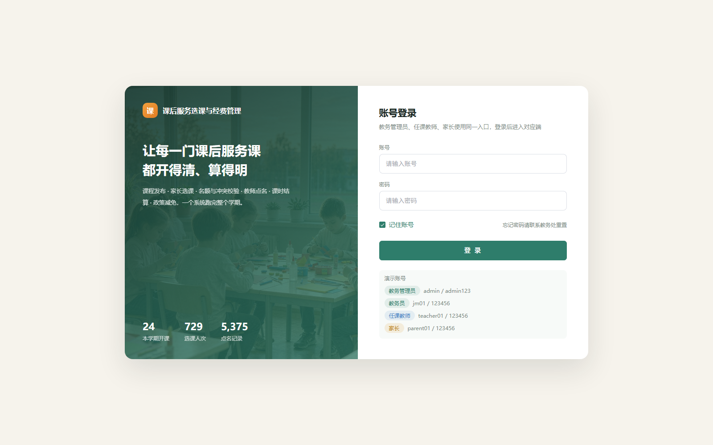

预览来自项目包内的界面截图，不代表所有功能均已完成运行验证。

### 演示视频

原项目包含演示视频。联系时发送「领取项目 NEW-017」，可一并询问对应视频。

**免费领取：** 按[领取说明](../GET-PROJECT.md)联系，发送「领取项目 NEW-017」。

[返回总目录](../CATALOG.md)

---

## NEW-018 · 基于SpringBoot+Vue的在线一对一辅导匹配与课堂质量监控系统

**技术方向：** Spring Boot / Vue / MySQL  
**材料概况：** 功能说明 / 界面预览 / 演示视频（按需领取）

### 项目简介

建立教师画像与学员需求画像，按学科、年级、风格匹配并支持试听，课堂全程录制并抽检，结合出勤、作业完成、家长评分形成教师质量分。

### 功能要点

- 匹配派单

- 课堂管理

- 质量监控

### 界面预览

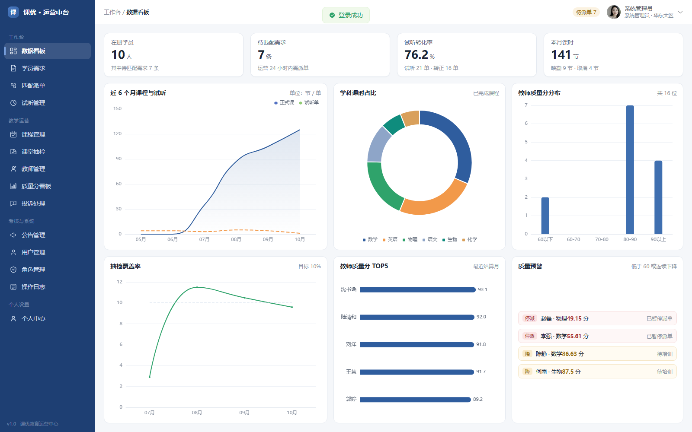

预览来自项目包内的界面截图，不代表所有功能均已完成运行验证。

### 演示视频

原项目包含演示视频。联系时发送「领取项目 NEW-018」，可一并询问对应视频。

**免费领取：** 按[领取说明](../GET-PROJECT.md)联系，发送「领取项目 NEW-018」。

[返回总目录](../CATALOG.md)

---

## NEW-019 · 基于SpringBoot+Vue的教师职称评审材料流转与打分系统

**技术方向：** Spring Boot / Vue / MySQL  
**材料概况：** 功能说明 / 界面预览 / 演示视频（按需领取）

### 项目简介

实现材料在线上传、学院初审、学校复审、专家盲审打分、结果公示的全流程，自动校验申报资格与材料完整性，专家随机抽取并回避本单位，分数自动汇总排名。

### 功能要点

- 申报管理

- 审核流转

- 专家评审

### 界面预览

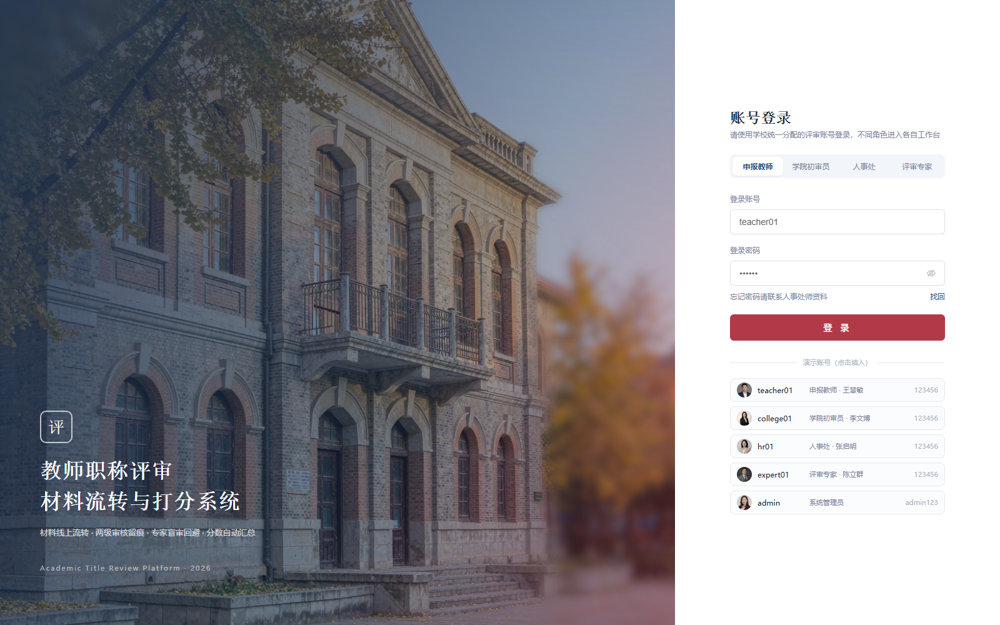

预览来自项目包内的界面截图，不代表所有功能均已完成运行验证。

### 演示视频

原项目包含演示视频。联系时发送「领取项目 NEW-019」，可一并询问对应视频。

**免费领取：** 按[领取说明](../GET-PROJECT.md)联系，发送「领取项目 NEW-019」。

[返回总目录](../CATALOG.md)

---

## NEW-020 · 基于SpringBoot+Vue的校园心理预警与危机干预系统

**技术方向：** Spring Boot / Vue / MySQL  
**材料概况：** 功能说明 / 界面预览 / 演示视频（按需领取）

### 项目简介

把心理测评、风险分级、日常观察、预约咨询、危机干预串成闭环，测评异常自动分级并推送对应责任人，干预全过程留痕且严格按权限可见。

### 功能要点

- 测评管理

- 预警跟进

- 危机干预

### 界面预览

预览来自项目包内的界面截图，不代表所有功能均已完成运行验证。

### 演示视频

原项目包含演示视频。联系时发送「领取项目 NEW-020」，可一并询问对应视频。

**免费领取：** 按[领取说明](../GET-PROJECT.md)联系，发送「领取项目 NEW-020」。

[返回总目录](../CATALOG.md)

---

## NEW-021 · 基于SpringBoot+Vue的即时零售门店拣货与骑手调度系统

**技术方向：** Spring Boot / Vue / MySQL  
**材料概况：** 功能说明 / 演示视频（按需领取）

### 项目简介

把订单接入、智能分单、拣货波次、打包复核、骑手指派与轨迹跟踪打通，按承诺时效倒排优先级，超时风险订单提前预警，门店与骑手在一个界面对齐。

### 功能要点

- 分单与派单

- 拣货作业

- 配送监控

### 演示视频

原项目包含演示视频。联系时发送「领取项目 NEW-021」，可一并询问对应视频。

**免费领取：** 按[领取说明](../GET-PROJECT.md)联系，发送「领取项目 NEW-021」。

[返回总目录](../CATALOG.md)

---

## NEW-022 · 基于SpringBoot+Vue的社区团购团长管理与分佣结算系统

**技术方向：** Spring Boot / Vue / MySQL  
**材料概况：** 功能说明 / 界面预览 / 演示视频（按需领取）

### 项目简介

建立团长分级体系与绑定关系，订单自动归属到团长并计算多级佣金，支持提现审批与对账单，运营可按小区、按品类分析团长的产出。

### 功能要点

- 团长运营

- 团购与订单

- 佣金结算

### 界面预览

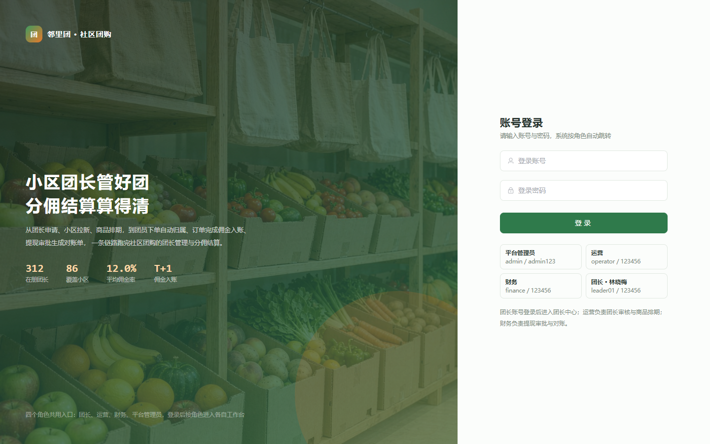

预览来自项目包内的界面截图，不代表所有功能均已完成运行验证。

### 演示视频

原项目包含演示视频。联系时发送「领取项目 NEW-022」，可一并询问对应视频。

**免费领取：** 按[领取说明](../GET-PROJECT.md)联系，发送「领取项目 NEW-022」。

[返回总目录](../CATALOG.md)

---

## NEW-023 · 基于SpringBoot+Vue的预制菜订购与冷链配送追溯系统

**技术方向：** Spring Boot / Vue / MySQL  
**材料概况：** 功能说明 / 界面预览 / 演示视频（按需领取）

### 项目简介

实现商品批次管理、冷链温控记录、订单配送追溯与召回，消费者扫码可查生产批次与全程温度，B 端客户可批量下单并对账。

### 功能要点

- 批次管理

- 冷链监控

- 追溯与召回

### 界面预览

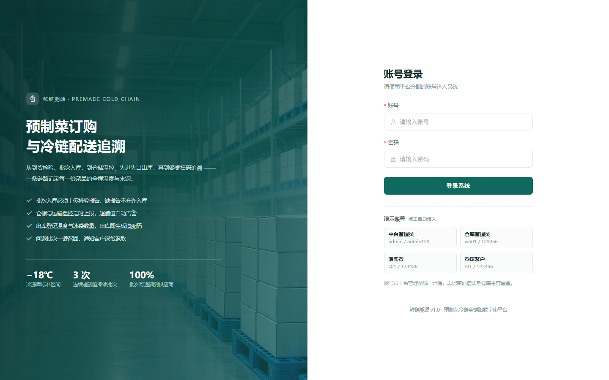

预览来自项目包内的界面截图，不代表所有功能均已完成运行验证。

### 演示视频

原项目包含演示视频。联系时发送「领取项目 NEW-023」，可一并询问对应视频。

**免费领取：** 按[领取说明](../GET-PROJECT.md)联系，发送「领取项目 NEW-023」。

[返回总目录](../CATALOG.md)

---

## NEW-024 · 基于SpringBoot+Vue的二手奢侈品鉴定与寄售交易系统

**技术方向：** Spring Boot / Vue / MySQL  
**材料概况：** 功能说明 / 界面预览 / 演示视频（按需领取）

### 项目简介

建立「寄售申请—收货验货—鉴定出报告—定价上架—成交结算」的链路，鉴定报告结构化留档并随商品展示，成交后按比例结算给卖家，支持争议复检。

### 功能要点

- 寄售流程

- 交易与结算

- 争议处理

### 界面预览

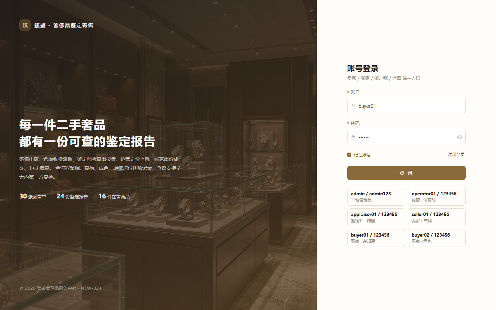

预览来自项目包内的界面截图，不代表所有功能均已完成运行验证。

### 演示视频

原项目包含演示视频。联系时发送「领取项目 NEW-024」，可一并询问对应视频。

**免费领取：** 按[领取说明](../GET-PROJECT.md)联系，发送「领取项目 NEW-024」。

[返回总目录](../CATALOG.md)

---

## NEW-025 · 基于SpringBoot+Vue的潮玩盲盒抽盒与库存盲池管理系统

**技术方向：** Spring Boot / Vue / MySQL  
**材料概况：** 功能说明 / 界面预览 / 演示视频（按需领取）

### 项目简介

建立盲池库存与概率公示机制，用户在线抽盒即时出结果并锁定库存，支持重复款兑换、端盒购买与集卡成就，全流程概率可查、库存可对。

### 功能要点

- 盲池配置

- 抽盒体验

- 兑换与集卡

### 界面预览

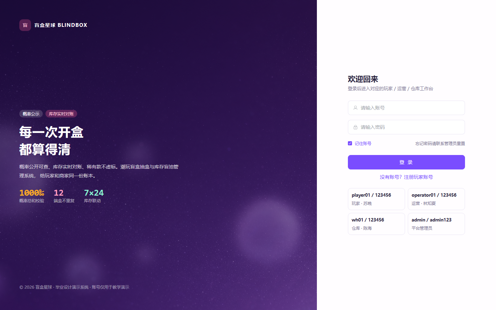

预览来自项目包内的界面截图，不代表所有功能均已完成运行验证。

### 演示视频

原项目包含演示视频。联系时发送「领取项目 NEW-025」，可一并询问对应视频。

**免费领取：** 按[领取说明](../GET-PROJECT.md)联系，发送「领取项目 NEW-025」。

[返回总目录](../CATALOG.md)

---

## NEW-026 · 基于SpringBoot+Vue的直播电商选品与达人合作管理系统

**技术方向：** Spring Boot / Vue / MySQL  
**材料概况：** 功能说明 / 界面预览 / 演示视频（按需领取）

### 项目简介

把商品库、达人库、合作洽谈、直播场次、销售归因、佣金结算放到一套系统里，选品按历史转化率排序，直播后自动归因销售额并计算佣金。

### 功能要点

- 选品

- 合作与场次

- 归因与结算

### 界面预览

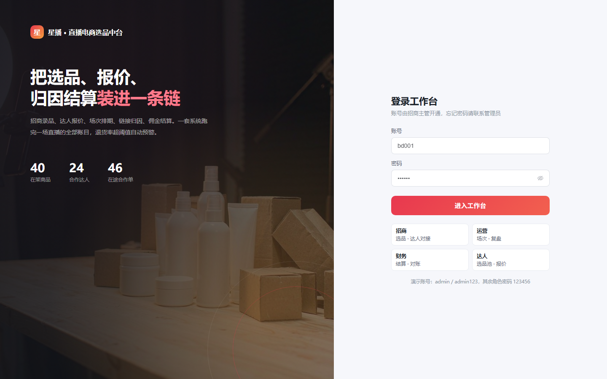

预览来自项目包内的界面截图，不代表所有功能均已完成运行验证。

### 演示视频

原项目包含演示视频。联系时发送「领取项目 NEW-026」，可一并询问对应视频。

**免费领取：** 按[领取说明](../GET-PROJECT.md)联系，发送「领取项目 NEW-026」。

[返回总目录](../CATALOG.md)

---

## NEW-027 · 基于SpringBoot+Vue的跨境电商多店铺订单与报关管理系统

**技术方向：** Spring Boot / Vue / MySQL  
**材料概况：** 功能说明 / 界面预览 / 演示视频（按需领取）

### 项目简介

聚合多平台订单，统一处理发货、退款与客服工单，按目的国规则自动生成报关资料，物流轨迹统一回传，汇率与成本自动核算毛利。

### 功能要点

- 多店订单

- 报关管理

- 客服与财务

### 界面预览

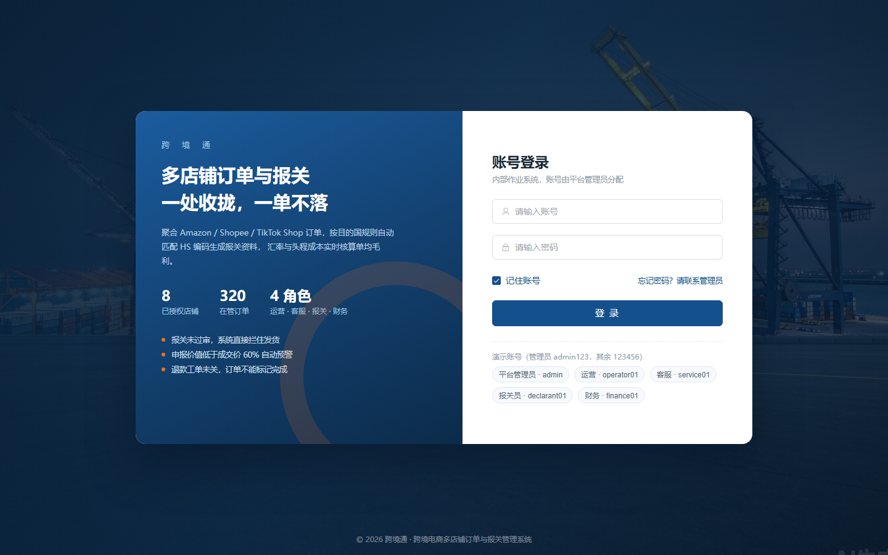

预览来自项目包内的界面截图，不代表所有功能均已完成运行验证。

### 演示视频

原项目包含演示视频。联系时发送「领取项目 NEW-027」，可一并询问对应视频。

**免费领取：** 按[领取说明](../GET-PROJECT.md)联系，发送「领取项目 NEW-027」。

[返回总目录](../CATALOG.md)

---

## NEW-028 · 基于SpringBoot+Vue的生鲜门店损耗管理与智能补货系统

**技术方向：** Spring Boot / Vue / MySQL  
**材料概况：** 功能说明 / 界面预览 / 演示视频（按需领取）

### 项目简介

通过每日盘点记录损耗，结合历史销量、天气与促销预测未来需求，给出补货建议并跟踪执行，临期商品自动打折清货，把损耗率压到可控范围。

### 功能要点

- 盘点与损耗

- 智能补货

- 临期处理

### 界面预览

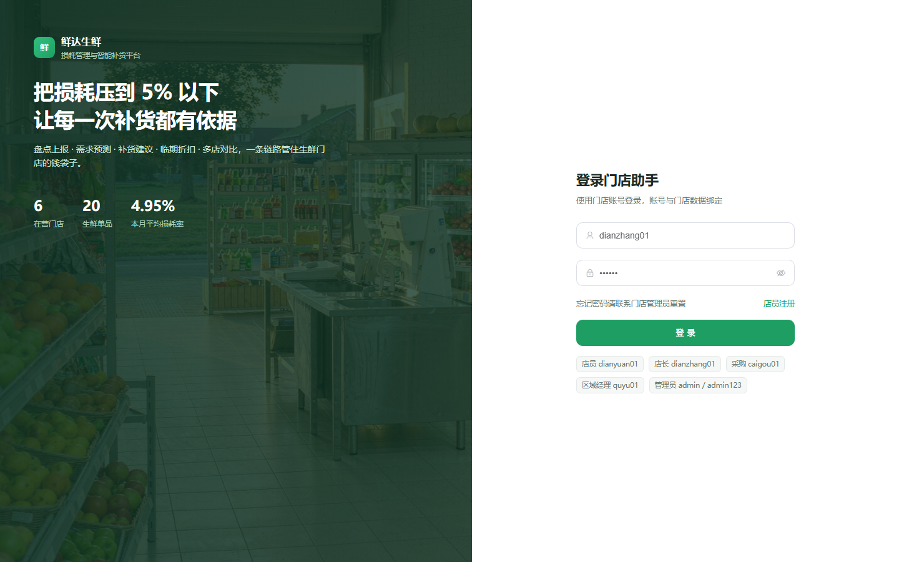

预览来自项目包内的界面截图，不代表所有功能均已完成运行验证。

### 演示视频

原项目包含演示视频。联系时发送「领取项目 NEW-028」，可一并询问对应视频。

**免费领取：** 按[领取说明](../GET-PROJECT.md)联系，发送「领取项目 NEW-028」。

[返回总目录](../CATALOG.md)

---

## NEW-029 · 基于SpringBoot+Vue的会员储值与积分营销系统

**技术方向：** Spring Boot / Vue / MySQL  
**材料概况：** 功能说明 / 界面预览 / 演示视频（按需领取）

### 项目简介

建立统一的会员账户体系，储值、消费、积分、等级、优惠券联动，支持充值赠送规则、积分兑换、等级权益与沉睡会员唤醒。

### 功能要点

- 储值账户

- 等级与积分

- 营销

### 界面预览

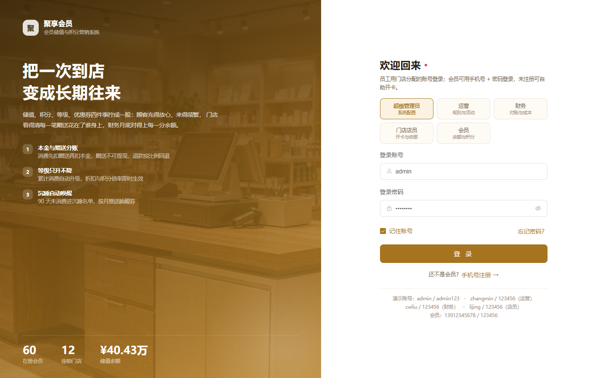

预览来自项目包内的界面截图，不代表所有功能均已完成运行验证。

### 演示视频

原项目包含演示视频。联系时发送「领取项目 NEW-029」，可一并询问对应视频。

**免费领取：** 按[领取说明](../GET-PROJECT.md)联系，发送「领取项目 NEW-029」。

[返回总目录](../CATALOG.md)

---

## NEW-030 · 基于SpringBoot+Vue的退货换货逆向物流管理系统

**技术方向：** Spring Boot / Vue / MySQL  
**材料概况：** 功能说明 / 界面预览 / 演示视频（按需领取）

### 项目简介

把退货申请、审核、寄回、收货质检、退款/换货、责任判定串成闭环，每个节点有状态和时间戳，质检结果决定责任归属，数据回流到商品质量分析。

### 功能要点

- 申请与审核

- 逆向物流

- 质检与定责

### 界面预览

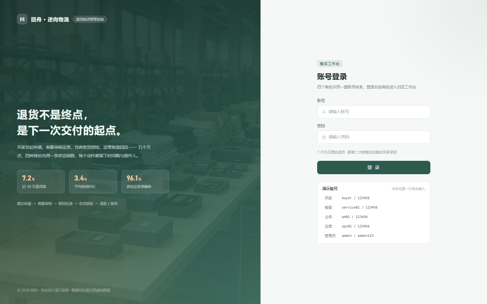

预览来自项目包内的界面截图，不代表所有功能均已完成运行验证。

### 演示视频

原项目包含演示视频。联系时发送「领取项目 NEW-030」，可一并询问对应视频。

**免费领取：** 按[领取说明](../GET-PROJECT.md)联系，发送「领取项目 NEW-030」。

[返回总目录](../CATALOG.md)

---
