# 专题项目 · 第 2 页

[返回总目录](../CATALOG.md) · [免费领取说明](../GET-PROJECT.md)

> 功能摘录来自项目附带文档，描述的是案例范围与设计目标；具体实现、运行环境和可领取材料以对应版本为准。

| 项目编号 | 项目名称 |
|---|---|
| NEW-031 | [基于SpringBoot+Vue的家政服务派单与人员信用管理系统](#p-new-031) |
| NEW-032 | [基于SpringBoot+Vue的上门维修工单与备件管理系统](#p-new-032) |
| NEW-033 | [基于SpringBoot+Vue的干洗连锁收衣取衣与洗涤追溯系统](#p-new-033) |
| NEW-034 | [基于SpringBoot+Vue的宠物殡葬与纪念服务管理系统](#p-new-034) |
| NEW-035 | [基于SpringBoot+Vue的婚庆策划流程与供应商协同系统](#p-new-035) |
| NEW-036 | [基于SpringBoot+Vue的旅拍预约与修片交付管理系统](#p-new-036) |
| NEW-037 | [基于SpringBoot+Vue的露营营地预订与装备租赁系统](#p-new-037) |
| NEW-038 | [基于SpringBoot+Vue的房车租赁与营地水电桩管理系统](#p-new-038) |
| NEW-039 | [基于SpringBoot+Vue的代驾订单调度与司机安全管理系统](#p-new-039) |
| NEW-040 | [基于SpringBoot+Vue的汽车美容连锁会员与工位预约系统](#p-new-040) |
| NEW-041 | [基于SpringBoot+Vue的非遗手工艺体验课程与作品展销系统](#p-new-041) |
| NEW-042 | [基于SpringBoot+Vue的红色旅游研学路线与讲解预约系统](#p-new-042) |
| NEW-043 | [基于SpringBoot+Vue的博物馆数字藏品与线上展厅系统](#p-new-043) |
| NEW-044 | [基于SpringBoot+Vue的景区智慧导览与语音讲解系统](#p-new-044) |
| NEW-045 | [基于SpringBoot+Vue的民宿房态与周边玩乐推荐系统](#p-new-045) |
| NEW-046 | [基于SpringBoot+Vue的演出票务实名核销与入场检票系统](#p-new-046) |
| NEW-047 | [基于SpringBoot+Vue的茶文化旅游体验与茶园认养系统](#p-new-047) |
| NEW-048 | [基于SpringBoot+Vue的乡村民宿联盟分销与结算系统](#p-new-048) |
| NEW-049 | [基于SpringBoot+Vue的城市漫步路线共创与打卡系统](#p-new-049) |
| NEW-050 | [基于SpringBoot+Vue的旅拍素材版权登记与授权系统](#p-new-050) |
| NEW-051 | [基于SpringBoot+Vue的健身房私教课程与体测档案系统](#p-new-051) |
| NEW-052 | [基于SpringBoot+Vue的瑜伽馆约课与会员卡管理系统](#p-new-052) |
| NEW-053 | [基于SpringBoot+Vue的飞盘俱乐部活动组织与组队系统](#p-new-053) |
| NEW-054 | [基于SpringBoot+Vue的骑行俱乐部路线规划与安全打卡系统](#p-new-054) |
| NEW-055 | [基于SpringBoot+Vue的马拉松赛事报名与成绩证书系统](#p-new-055) |
| NEW-056 | [基于SpringBoot+Vue的滑雪场雪票与装备租赁系统](#p-new-056) |
| NEW-058 | [基于SpringBoot+Vue的青少年体育培训考级与成长档案系统](#p-new-058) |
| NEW-059 | [基于SpringBoot+Vue的电竞馆机位预约与赛事组织系统](#p-new-059) |
| NEW-061 | [基于SpringBoot+Vue的企业费用报销与预算控制系统](#p-new-061) |

## NEW-031 · 基于SpringBoot+Vue的家政服务派单与人员信用管理系统

**技术方向：** Spring Boot / Vue / MySQL  
**材料概况：** 功能说明 / 界面预览 / 演示视频（按需领取）

### 项目简介

建立阿姨档案与信用分体系，按技能、档期、距离派单，服务后双向评价，信用分影响派单优先级，投诉与爽约自动扣分并留痕。

### 功能要点

- 派单

- 履约

- 信用体系

### 界面预览

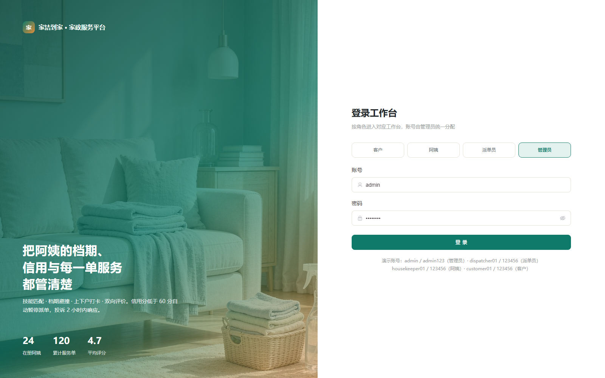

预览来自项目包内的界面截图，不代表所有功能均已完成运行验证。

### 演示视频

原项目包含演示视频。联系时发送「领取项目 NEW-031」，可一并询问对应视频。

**免费领取：** 按[领取说明](../GET-PROJECT.md)联系，发送「领取项目 NEW-031」。

[返回总目录](../CATALOG.md)

---

## NEW-032 · 基于SpringBoot+Vue的上门维修工单与备件管理系统

**技术方向：** Spring Boot / Vue / MySQL  
**材料概况：** 功能说明 / 界面预览 / 演示视频（按需领取）

### 项目简介

报修、派单、上门、检测、报价、维修、收费、回访全流程线上化，师傅接单时可见历史故障与常用备件，备件库存与工单联动扣减。

### 功能要点

- 报修与派单

- 现场作业

- 备件与回访

### 界面预览

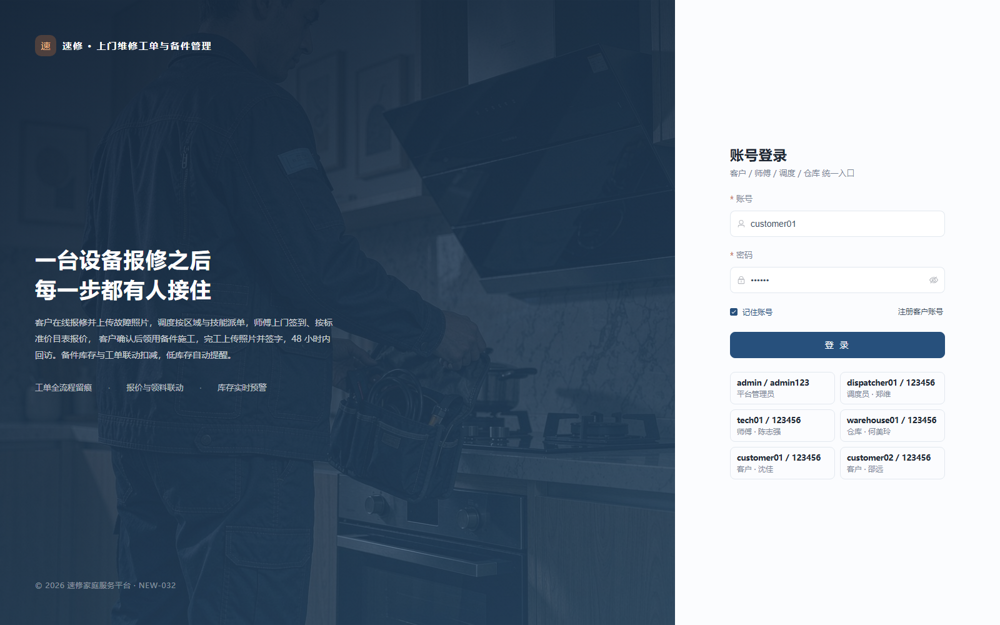

预览来自项目包内的界面截图，不代表所有功能均已完成运行验证。

### 演示视频

原项目包含演示视频。联系时发送「领取项目 NEW-032」，可一并询问对应视频。

**免费领取：** 按[领取说明](../GET-PROJECT.md)联系，发送「领取项目 NEW-032」。

[返回总目录](../CATALOG.md)

---

## NEW-033 · 基于SpringBoot+Vue的干洗连锁收衣取衣与洗涤追溯系统

**技术方向：** Spring Boot / Vue / MySQL  
**材料概况：** 功能说明 / 界面预览 / 演示视频（按需领取）

### 项目简介

每件衣物一码到底：收衣拍照记瑕疵、工序节点扫码流转、洗后质检、取衣核销，客户可查每件衣服当前在哪个环节，出问题有据可依。

### 功能要点

- 收衣

- 洗涤流转

- 取衣与赔付

### 界面预览

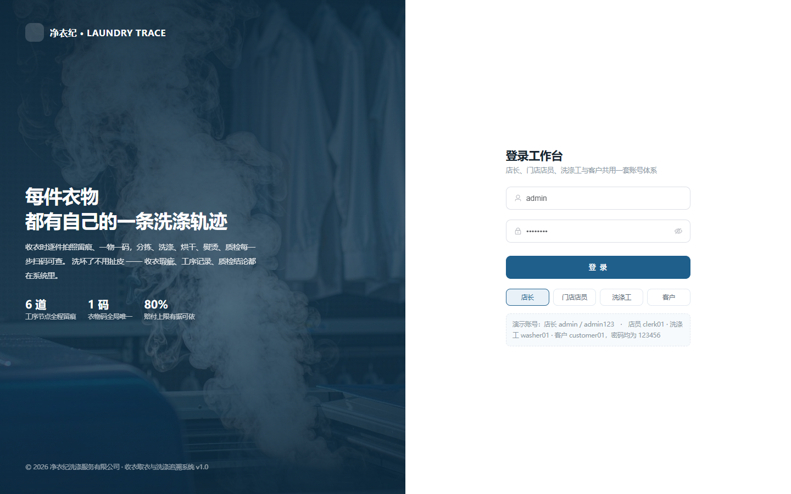

预览来自项目包内的界面截图，不代表所有功能均已完成运行验证。

### 演示视频

原项目包含演示视频。联系时发送「领取项目 NEW-033」，可一并询问对应视频。

**免费领取：** 按[领取说明](../GET-PROJECT.md)联系，发送「领取项目 NEW-033」。

[返回总目录](../CATALOG.md)

---

## NEW-034 · 基于SpringBoot+Vue的宠物殡葬与纪念服务管理系统

**技术方向：** Spring Boot / Vue / MySQL  
**材料概况：** 功能说明 / 界面预览 / 演示视频（按需领取）

### 项目简介

提供预约、上门接送、单独/集体火化、骨灰寄存与纪念品定制，全程节点可查，生成专属纪念页面（照片、寄语、纪念日提醒）。

### 功能要点

- 预约与接送

- 火化与骨灰

- 纪念服务

### 界面预览

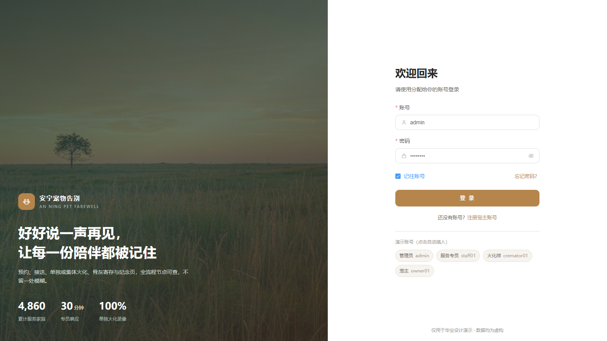

预览来自项目包内的界面截图，不代表所有功能均已完成运行验证。

### 演示视频

原项目包含演示视频。联系时发送「领取项目 NEW-034」，可一并询问对应视频。

**免费领取：** 按[领取说明](../GET-PROJECT.md)联系，发送「领取项目 NEW-034」。

[返回总目录](../CATALOG.md)

---

## NEW-035 · 基于SpringBoot+Vue的婚庆策划流程与供应商协同系统

**技术方向：** Spring Boot / Vue / MySQL  
**材料概况：** 功能说明 / 界面预览 / 演示视频（按需领取）

### 项目简介

以婚礼项目为主线，管理筹备节点、供应商档期与合同、预算与付款、当天流程单，供应商在线确认档期，预算超支自动预警。

### 功能要点

- 项目与节点

- 供应商协同

- 预算与执行

### 界面预览

预览来自项目包内的界面截图，不代表所有功能均已完成运行验证。

### 演示视频

原项目包含演示视频。联系时发送「领取项目 NEW-035」，可一并询问对应视频。

**免费领取：** 按[领取说明](../GET-PROJECT.md)联系，发送「领取项目 NEW-035」。

[返回总目录](../CATALOG.md)

---

## NEW-036 · 基于SpringBoot+Vue的旅拍预约与修片交付管理系统

**技术方向：** Spring Boot / Vue / MySQL  
**材料概况：** 功能说明 / 界面预览 / 演示视频（按需领取）

### 项目简介

把套餐、档期、订单、选片、修片任务、交付串成流水线，客户可实时看到修片进度，交付支持在线预览与水印保护，返工有次数限制。

### 功能要点

- 预约与档期

- 选片与修片

- 交付与售后

### 界面预览

预览来自项目包内的界面截图，不代表所有功能均已完成运行验证。

### 演示视频

原项目包含演示视频。联系时发送「领取项目 NEW-036」，可一并询问对应视频。

**免费领取：** 按[领取说明](../GET-PROJECT.md)联系，发送「领取项目 NEW-036」。

[返回总目录](../CATALOG.md)

---

## NEW-037 · 基于SpringBoot+Vue的露营营地预订与装备租赁系统

**技术方向：** Spring Boot / Vue / MySQL  
**材料概况：** 功能说明 / 界面预览 / 演示视频（按需领取）

### 项目简介

营位与装备统一库存管理，按日期分时段预订，套餐组合销售，结合天气预警支持无损改期，装备押金与损坏赔偿线上化。

### 功能要点

- 营位与价格

- 预订与装备

- 天气与退改

### 界面预览

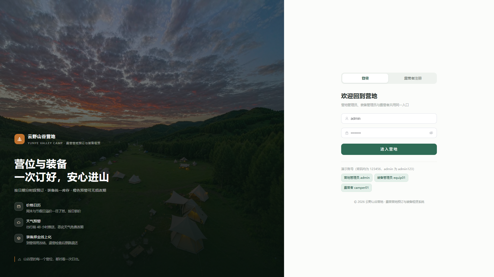

预览来自项目包内的界面截图，不代表所有功能均已完成运行验证。

### 演示视频

原项目包含演示视频。联系时发送「领取项目 NEW-037」，可一并询问对应视频。

**免费领取：** 按[领取说明](../GET-PROJECT.md)联系，发送「领取项目 NEW-037」。

[返回总目录](../CATALOG.md)

---

## NEW-038 · 基于SpringBoot+Vue的房车租赁与营地水电桩管理系统

**技术方向：** Spring Boot / Vue / MySQL  
**材料概况：** 功能说明 / 界面预览 / 演示视频（按需领取）

### 项目简介

车辆档期与订单联动，取还车检查留证，营地桩位实时状态可查并按时计费，违章押金按周期释放，全程合同与保险线上化。

### 功能要点

- 车辆与订单

- 取还车

- 营地桩位

### 界面预览

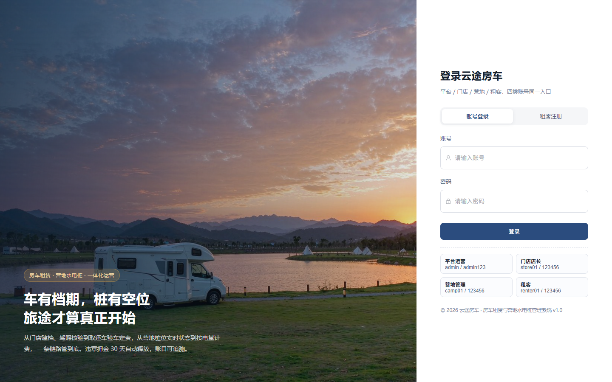

预览来自项目包内的界面截图，不代表所有功能均已完成运行验证。

### 演示视频

原项目包含演示视频。联系时发送「领取项目 NEW-038」，可一并询问对应视频。

**免费领取：** 按[领取说明](../GET-PROJECT.md)联系，发送「领取项目 NEW-038」。

[返回总目录](../CATALOG.md)

---

## NEW-039 · 基于SpringBoot+Vue的代驾订单调度与司机安全管理系统

**技术方向：** Spring Boot / Vue / MySQL  
**材料概况：** 功能说明 / 界面预览 / 演示视频（按需领取）

### 项目简介

订单按距离派单，行程全程分享给紧急联系人，司机需通过背景审核与培训，异常停留与偏航自动预警，结束后自动计费与评价。

### 功能要点

- 派单与接单

- 安全监控

- 司机管理

### 界面预览

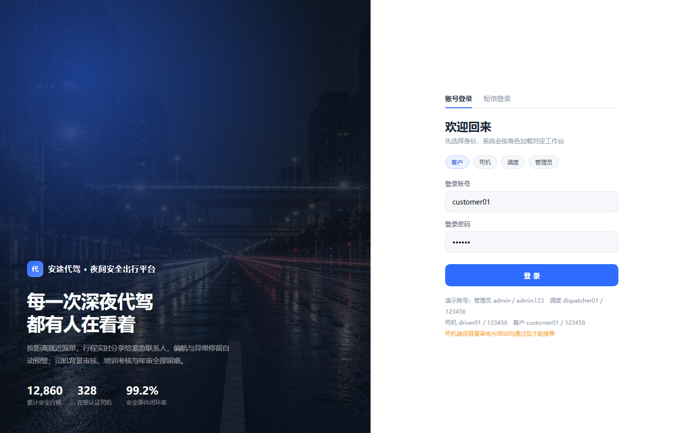

预览来自项目包内的界面截图，不代表所有功能均已完成运行验证。

### 演示视频

原项目包含演示视频。联系时发送「领取项目 NEW-039」，可一并询问对应视频。

**免费领取：** 按[领取说明](../GET-PROJECT.md)联系，发送「领取项目 NEW-039」。

[返回总目录](../CATALOG.md)

---

## NEW-040 · 基于SpringBoot+Vue的汽车美容连锁会员与工位预约系统

**技术方向：** Spring Boot / Vue / MySQL  
**材料概况：** 功能说明 / 界面预览 / 演示视频（按需领取）

### 项目简介

多门店统一会员与储值，工位按时段预约，服务项目标准化计时，跨店消费自动分账，会员等级享不同折扣。

### 功能要点

- 预约与工位

- 会员与储值

- 分账与对账

### 界面预览

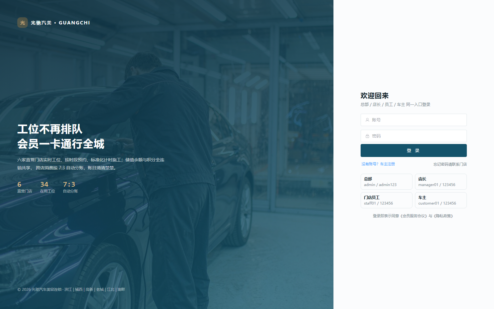

预览来自项目包内的界面截图，不代表所有功能均已完成运行验证。

### 演示视频

原项目包含演示视频。联系时发送「领取项目 NEW-040」，可一并询问对应视频。

**免费领取：** 按[领取说明](../GET-PROJECT.md)联系，发送「领取项目 NEW-040」。

[返回总目录](../CATALOG.md)

---

## NEW-041 · 基于SpringBoot+Vue的非遗手工艺体验课程与作品展销系统

**技术方向：** Spring Boot / Vue / MySQL  
**材料概况：** 功能说明 / 界面预览 / 演示视频（按需领取）

### 项目简介

把体验课程、传承人排期、材料包、作品展销与定制订单打通，学员在线约课、课上作品可上传展销，工坊按课程与作品双线获得收入。

### 功能要点

- 课程约课

- 作品展销

- 运营与结算

### 界面预览

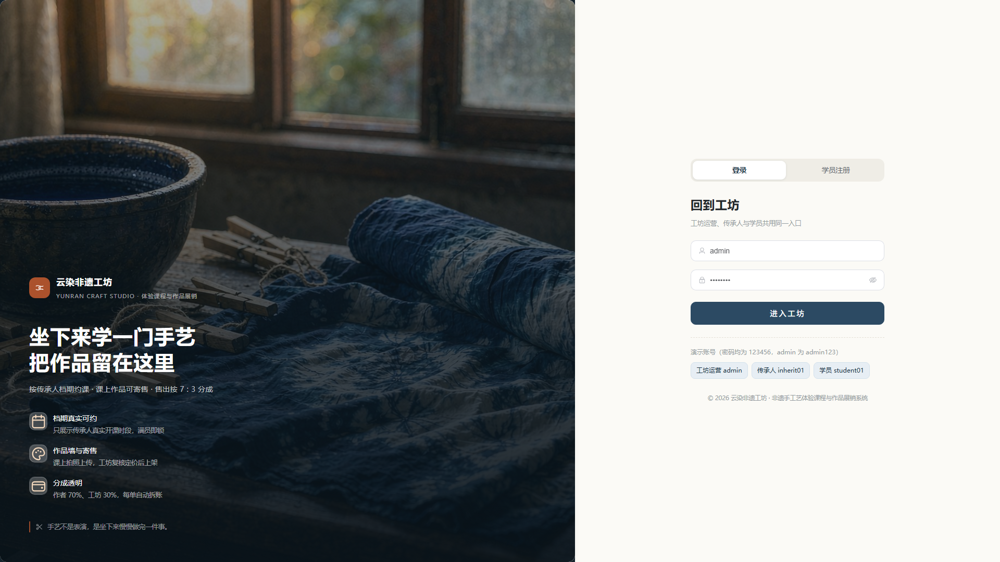

预览来自项目包内的界面截图，不代表所有功能均已完成运行验证。

### 演示视频

原项目包含演示视频。联系时发送「领取项目 NEW-041」，可一并询问对应视频。

**免费领取：** 按[领取说明](../GET-PROJECT.md)联系，发送「领取项目 NEW-041」。

[返回总目录](../CATALOG.md)

---

## NEW-042 · 基于SpringBoot+Vue的红色旅游研学路线与讲解预约系统

**技术方向：** Spring Boot / Vue / MySQL  
**材料概况：** 功能说明 / 界面预览 / 演示视频（按需领取）

### 项目简介

提供路线发布、讲解员排班与预约、团体报名、讲解评价与研学证书，路线按主题与时长分级，支持学校批量预约与开票。

### 功能要点

- 路线与预约

- 讲解执行

- 场馆运营

### 界面预览

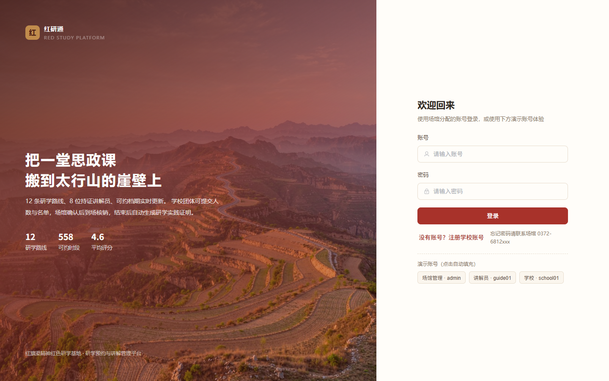

预览来自项目包内的界面截图，不代表所有功能均已完成运行验证。

### 演示视频

原项目包含演示视频。联系时发送「领取项目 NEW-042」，可一并询问对应视频。

**免费领取：** 按[领取说明](../GET-PROJECT.md)联系，发送「领取项目 NEW-042」。

[返回总目录](../CATALOG.md)

---

## NEW-043 · 基于SpringBoot+Vue的博物馆数字藏品与线上展厅系统

**技术方向：** Spring Boot / Vue / MySQL  
**材料概况：** 功能说明 / 界面预览 / 演示视频（按需领取）

### 项目简介

建立文物数字档案（多角度影像、三维模型、年代与工艺信息），按主题组织线上展厅，支持按年代、材质、出土地检索，并可生成分享卡片。

### 功能要点

- 文物档案

- 展厅编排

- 观众端

### 界面预览

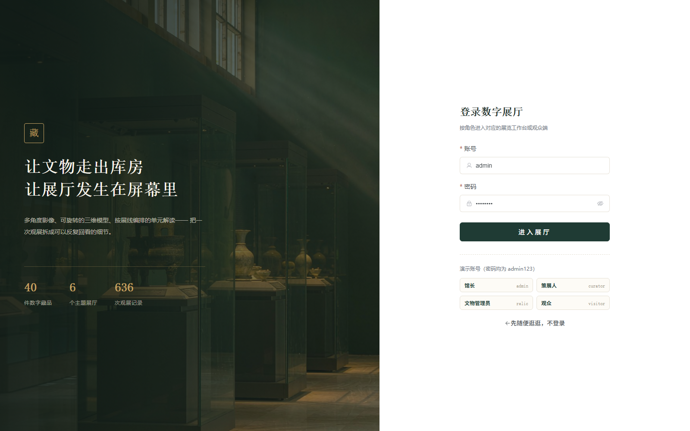

预览来自项目包内的界面截图，不代表所有功能均已完成运行验证。

### 演示视频

原项目包含演示视频。联系时发送「领取项目 NEW-043」，可一并询问对应视频。

**免费领取：** 按[领取说明](../GET-PROJECT.md)联系，发送「领取项目 NEW-043」。

[返回总目录](../CATALOG.md)

---

## NEW-044 · 基于SpringBoot+Vue的景区智慧导览与语音讲解系统

**技术方向：** Spring Boot / Vue / MySQL  
**材料概况：** 功能说明 / 界面预览 / 演示视频（按需领取）

### 项目简介

提供电子地图、POI 讲解、推荐路线与实时公告，游客扫码或靠近自动播放讲解，景区可按位置推送临时通知，后台统计各点位热度。

### 功能要点

- 地图导览

- 内容管理

- 数据统计

### 界面预览

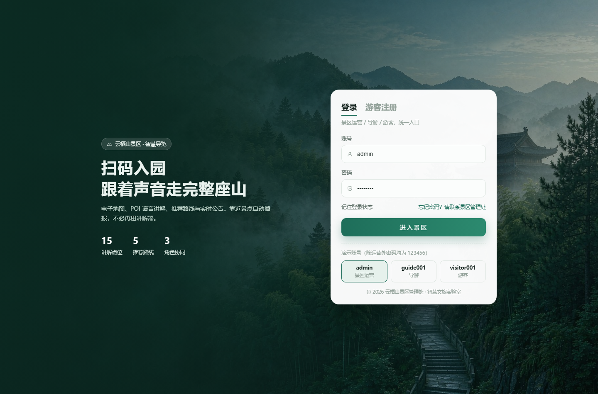

预览来自项目包内的界面截图，不代表所有功能均已完成运行验证。

### 演示视频

原项目包含演示视频。联系时发送「领取项目 NEW-044」，可一并询问对应视频。

**免费领取：** 按[领取说明](../GET-PROJECT.md)联系，发送「领取项目 NEW-044」。

[返回总目录](../CATALOG.md)

---

## NEW-045 · 基于SpringBoot+Vue的民宿房态与周边玩乐推荐系统

**技术方向：** Spring Boot / Vue / MySQL  
**材料概况：** 功能说明 / 界面预览 / 演示视频（按需领取）

### 项目简介

统一房态日历防超售，支持多平台库存同步，把周边玩乐（采摘、徒步、手作）打包成套餐，客人下单时可加购，民宿按核销分成。

### 功能要点

- 房态管理

- 预订

- 玩乐与结算

### 界面预览

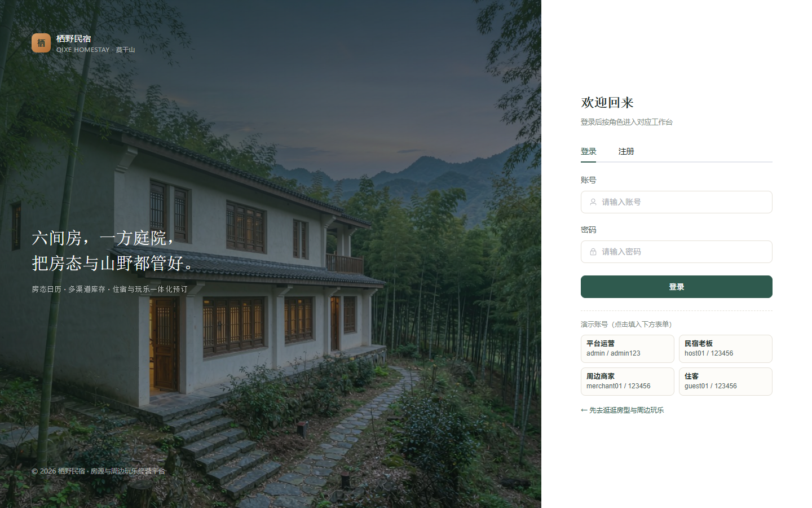

预览来自项目包内的界面截图，不代表所有功能均已完成运行验证。

### 演示视频

原项目包含演示视频。联系时发送「领取项目 NEW-045」，可一并询问对应视频。

**免费领取：** 按[领取说明](../GET-PROJECT.md)联系，发送「领取项目 NEW-045」。

[返回总目录](../CATALOG.md)

---

## NEW-046 · 基于SpringBoot+Vue的演出票务实名核销与入场检票系统

**技术方向：** Spring Boot / Vue / MySQL  
**材料概况：** 功能说明 / 界面预览 / 演示视频（按需领取）

### 项目简介

实名购票、一证一票、动态二维码检票，闸机或人工扫码 2 秒通行，支持退票改签与座位锁定，实时统计入场人数。

### 功能要点

- 选座购票

- 检票入场

- 票务运营

### 界面预览

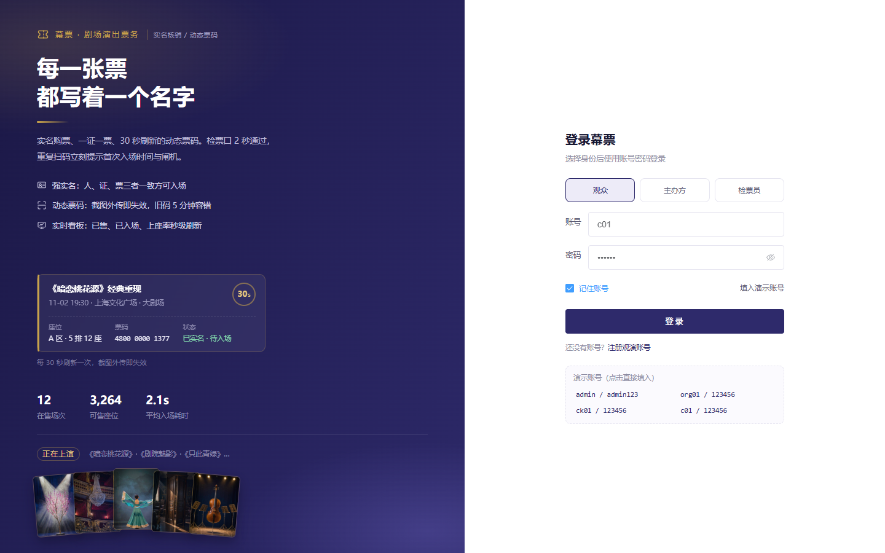

预览来自项目包内的界面截图，不代表所有功能均已完成运行验证。

### 演示视频

原项目包含演示视频。联系时发送「领取项目 NEW-046」，可一并询问对应视频。

**免费领取：** 按[领取说明](../GET-PROJECT.md)联系，发送「领取项目 NEW-046」。

[返回总目录](../CATALOG.md)

---

## NEW-047 · 基于SpringBoot+Vue的茶文化旅游体验与茶园认养系统

**技术方向：** Spring Boot / Vue / MySQL  
**材料概况：** 功能说明 / 界面预览 / 演示视频（按需领取）

### 项目简介

把采茶季、体验课程、茶园认养结合：认养一块地，全年收到生长照片与采制记录，茶叶按季寄送到家，可预约到园体验。

### 功能要点

- 体验预约

- 茶园认养

- 生长记录

### 界面预览

预览来自项目包内的界面截图，不代表所有功能均已完成运行验证。

### 演示视频

原项目包含演示视频。联系时发送「领取项目 NEW-047」，可一并询问对应视频。

**免费领取：** 按[领取说明](../GET-PROJECT.md)联系，发送「领取项目 NEW-047」。

[返回总目录](../CATALOG.md)

---

## NEW-048 · 基于SpringBoot+Vue的乡村民宿联盟分销与结算系统

**技术方向：** Spring Boot / Vue / MySQL  
**材料概况：** 功能说明 / 界面预览 / 演示视频（按需领取）

### 项目简介

联盟统一房源与订单池，按规则自动分配房源与归因分销，订单完成后自动生成各民宿与分销员的对账单，支持提现与争议处理。

### 功能要点

- 房源与订单

- 分销

- 结算与争议

### 界面预览

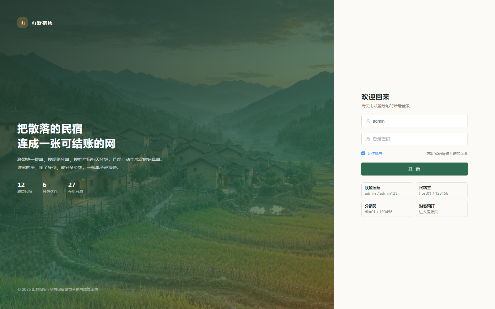

预览来自项目包内的界面截图，不代表所有功能均已完成运行验证。

### 演示视频

原项目包含演示视频。联系时发送「领取项目 NEW-048」，可一并询问对应视频。

**免费领取：** 按[领取说明](../GET-PROJECT.md)联系，发送「领取项目 NEW-048」。

[返回总目录](../CATALOG.md)

---

## NEW-049 · 基于SpringBoot+Vue的城市漫步路线共创与打卡系统

**技术方向：** Spring Boot / Vue / MySQL  
**材料概况：** 功能说明 / 界面预览 / 演示视频（按需领取）

### 项目简介

让用户共创路线（标点、写解读、传照片），审核后上线，其他人可跟着走并打卡集章，沿线商户可认领点位做优惠，形成内容与商业的闭环。

### 功能要点

- 路线共创

- 跟走打卡

- 商户权益

### 界面预览

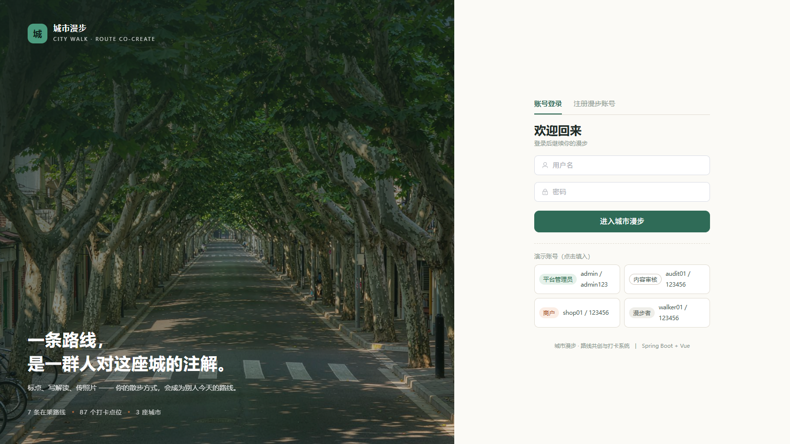

预览来自项目包内的界面截图，不代表所有功能均已完成运行验证。

### 演示视频

原项目包含演示视频。联系时发送「领取项目 NEW-049」，可一并询问对应视频。

**免费领取：** 按[领取说明](../GET-PROJECT.md)联系，发送「领取项目 NEW-049」。

[返回总目录](../CATALOG.md)

---

## NEW-050 · 基于SpringBoot+Vue的旅拍素材版权登记与授权系统

**技术方向：** Spring Boot / Vue / MySQL  
**材料概况：** 功能说明 / 界面预览 / 演示视频（按需领取）

### 项目简介

摄影师上传作品并登记版权（哈希存证），平台生成可检索的作品库，商用方按用途购买授权，授权书线上生成，侵权可举证。

### 功能要点

- 版权登记

- 授权交易

- 维权与结算

### 界面预览

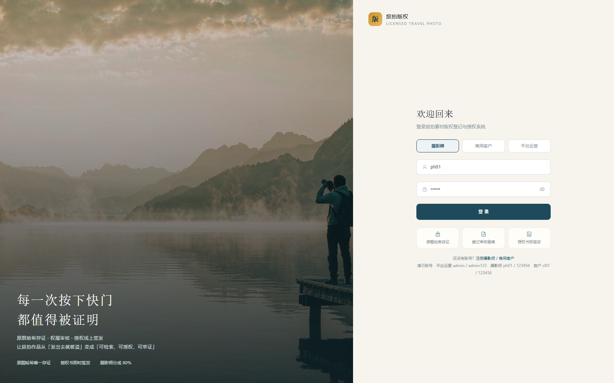

预览来自项目包内的界面截图，不代表所有功能均已完成运行验证。

### 演示视频

原项目包含演示视频。联系时发送「领取项目 NEW-050」，可一并询问对应视频。

**免费领取：** 按[领取说明](../GET-PROJECT.md)联系，发送「领取项目 NEW-050」。

[返回总目录](../CATALOG.md)

---

## NEW-051 · 基于SpringBoot+Vue的健身房私教课程与体测档案系统

**技术方向：** Spring Boot / Vue / MySQL  
**材料概况：** 功能说明 / 界面预览 / 演示视频（按需领取）

### 项目简介

把会员体测档案、私教课包、约课消课、训练计划、效果对比串起来，每次体测自动生成对比图，教练按目标制定计划，续课有数据支撑。

### 功能要点

- 体测与档案

- 课包与约课

- 训练计划

### 界面预览

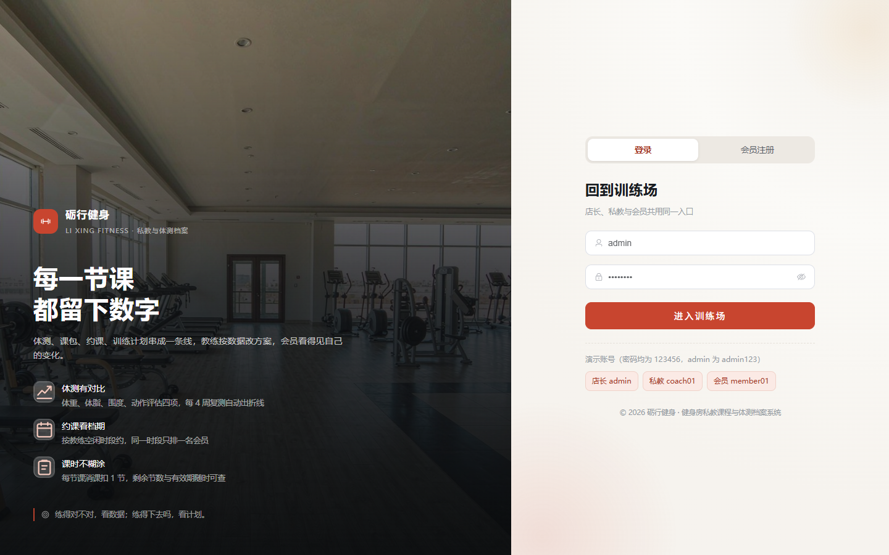

预览来自项目包内的界面截图，不代表所有功能均已完成运行验证。

### 演示视频

原项目包含演示视频。联系时发送「领取项目 NEW-051」，可一并询问对应视频。

**免费领取：** 按[领取说明](../GET-PROJECT.md)联系，发送「领取项目 NEW-051」。

[返回总目录](../CATALOG.md)

---

## NEW-052 · 基于SpringBoot+Vue的瑜伽馆约课与会员卡管理系统

**技术方向：** Spring Boot / Vue / MySQL  
**材料概况：** 功能说明 / 界面预览 / 演示视频（按需领取）

### 项目简介

团课按容量开放约位，会员卡按类型限制可约课程与次数，候补队列自动补位，到期与余次提醒，减少前台沟通成本。

### 功能要点

- 排课

- 约课与候补

- 会员卡

### 界面预览

预览来自项目包内的界面截图，不代表所有功能均已完成运行验证。

### 演示视频

原项目包含演示视频。联系时发送「领取项目 NEW-052」，可一并询问对应视频。

**免费领取：** 按[领取说明](../GET-PROJECT.md)联系，发送「领取项目 NEW-052」。

[返回总目录](../CATALOG.md)

---

## NEW-053 · 基于SpringBoot+Vue的飞盘俱乐部活动组织与组队系统

**技术方向：** Spring Boot / Vue / MySQL  
**材料概况：** 功能说明 / 界面预览 / 演示视频（按需领取）

### 项目简介

活动发布与报名、水平分级、自动分队、费用 AA 与场地分摊，新人可报名新手场，活动后互评形成水平标签。

### 功能要点

- 活动与报名

- 自动分队

- 费用与互评

### 界面预览

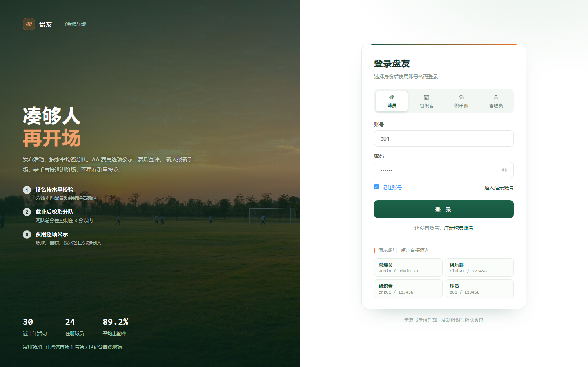

预览来自项目包内的界面截图，不代表所有功能均已完成运行验证。

### 演示视频

原项目包含演示视频。联系时发送「领取项目 NEW-053」，可一并询问对应视频。

**免费领取：** 按[领取说明](../GET-PROJECT.md)联系，发送「领取项目 NEW-053」。

[返回总目录](../CATALOG.md)

---

## NEW-054 · 基于SpringBoot+Vue的骑行俱乐部路线规划与安全打卡系统

**技术方向：** Spring Boot / Vue / MySQL  
**材料概况：** 功能说明 / 演示视频（按需领取）

### 项目简介

路线在线规划与分享、活动报名、途中安全打卡、掉队预警与紧急联系人，骑行数据（里程、爬升、均速）自动记录并生成轨迹海报。

### 功能要点

- 路线规划

- 活动与安全

- 数据与海报

### 演示视频

原项目包含演示视频。联系时发送「领取项目 NEW-054」，可一并询问对应视频。

**免费领取：** 按[领取说明](../GET-PROJECT.md)联系，发送「领取项目 NEW-054」。

[返回总目录](../CATALOG.md)

---

## NEW-055 · 基于SpringBoot+Vue的马拉松赛事报名与成绩证书系统

**技术方向：** Spring Boot / Vue / MySQL  
**材料概况：** 功能说明 / 界面预览 / 演示视频（按需领取）

### 项目简介

报名—资格审核—抽签—缴费—参赛包领取—芯片计时—成绩排名—证书下载全流程线上，支持团体报名与成绩申诉。

### 功能要点

- 报名与抽签

- 赛前

- 赛后

### 界面预览

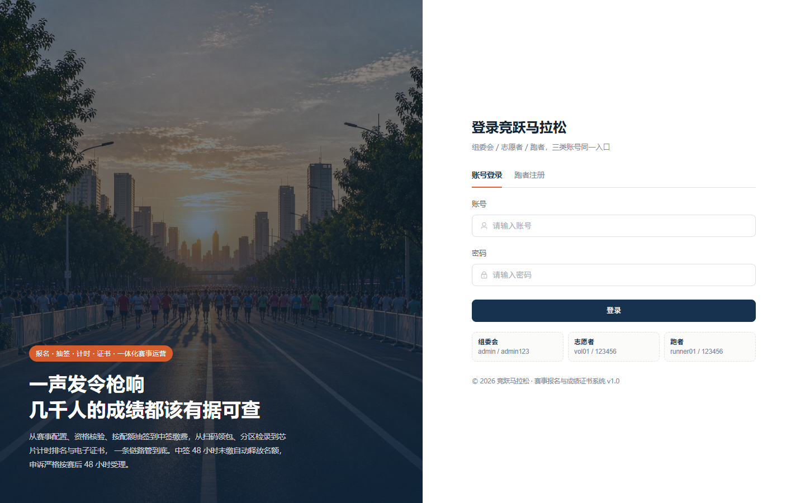

预览来自项目包内的界面截图，不代表所有功能均已完成运行验证。

### 演示视频

原项目包含演示视频。联系时发送「领取项目 NEW-055」，可一并询问对应视频。

**免费领取：** 按[领取说明](../GET-PROJECT.md)联系，发送「领取项目 NEW-055」。

[返回总目录](../CATALOG.md)

---

## NEW-056 · 基于SpringBoot+Vue的滑雪场雪票与装备租赁系统

**技术方向：** Spring Boot / Vue / MySQL  
**材料概况：** 功能说明 / 界面预览 / 演示视频（按需领取）

### 项目简介

雪票分时预约、装备按尺码库存预订、押金线上冻结，到场扫码取装备，归还检查自动退押金，实时展示各雪道拥挤度。

### 功能要点

- 票务

- 装备租赁

- 运营

### 界面预览

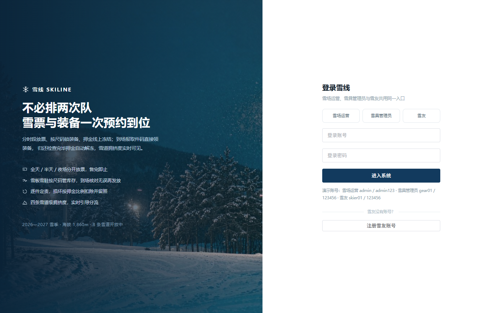

预览来自项目包内的界面截图，不代表所有功能均已完成运行验证。

### 演示视频

原项目包含演示视频。联系时发送「领取项目 NEW-056」，可一并询问对应视频。

**免费领取：** 按[领取说明](../GET-PROJECT.md)联系，发送「领取项目 NEW-056」。

[返回总目录](../CATALOG.md)

---

## NEW-058 · 基于SpringBoot+Vue的青少年体育培训考级与成长档案系统

**技术方向：** Spring Boot / Vue / MySQL  
**材料概况：** 功能说明 / 界面预览 / 演示视频（按需领取）

### 项目简介

按项目建立考级标准与课程体系，学员上课打卡积累课时，达标后报名考级，成绩与证书归档，生成可视化成长档案。

### 功能要点

- 教学与档案

- 考级

- 机构管理

### 界面预览

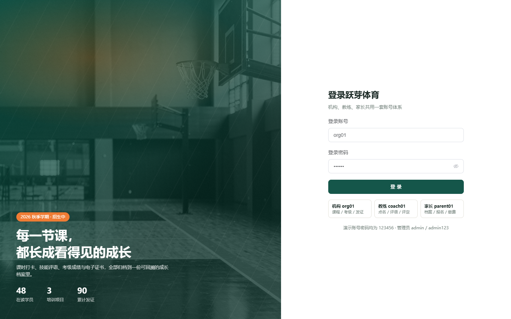

预览来自项目包内的界面截图，不代表所有功能均已完成运行验证。

### 演示视频

原项目包含演示视频。联系时发送「领取项目 NEW-058」，可一并询问对应视频。

**免费领取：** 按[领取说明](../GET-PROJECT.md)联系，发送「领取项目 NEW-058」。

[返回总目录](../CATALOG.md)

---

## NEW-059 · 基于SpringBoot+Vue的电竞馆机位预约与赛事组织系统

**技术方向：** Spring Boot / Vue / MySQL  
**材料概况：** 功能说明 / 界面预览 / 演示视频（按需领取）

### 项目简介

机位分区定价、在线预约与开机核销，赛事报名与自动编排赛程，支持包场与会员时长卡，实时展示机位状态。

### 功能要点

- 机位

- 赛事

- 运营

### 界面预览

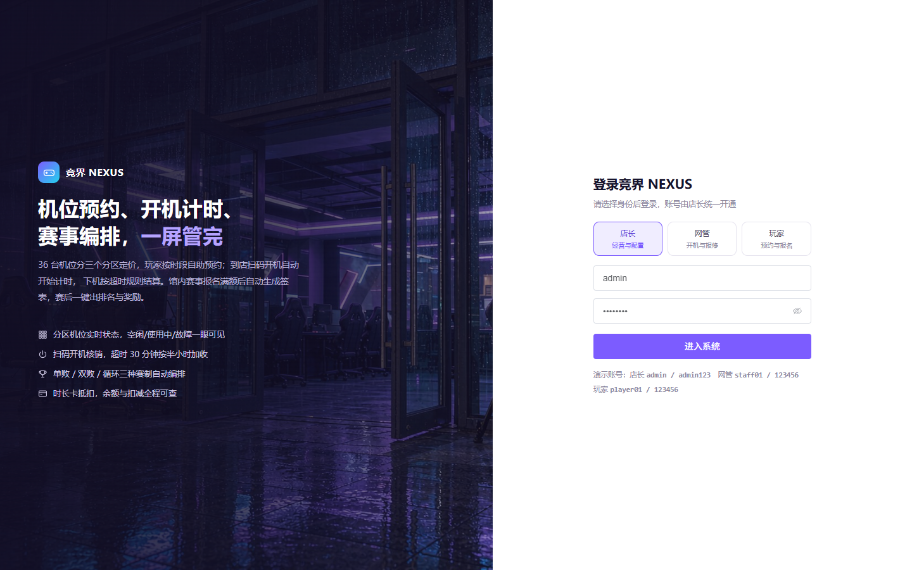

预览来自项目包内的界面截图，不代表所有功能均已完成运行验证。

### 演示视频

原项目包含演示视频。联系时发送「领取项目 NEW-059」，可一并询问对应视频。

**免费领取：** 按[领取说明](../GET-PROJECT.md)联系，发送「领取项目 NEW-059」。

[返回总目录](../CATALOG.md)

---

## NEW-061 · 基于SpringBoot+Vue的企业费用报销与预算控制系统

**技术方向：** Spring Boot / Vue / MySQL  
**材料概况：** 功能说明 / 界面预览 / 演示视频（按需领取）

### 项目简介

报销单在线提交与多级审批，费用科目自动归集，申请时占用预算、报销时冲销，预算使用率实时可见，超标自动拦截并走特批。

### 功能要点

- 报销申请

- 审批

- 预算与报表

### 界面预览

预览来自项目包内的界面截图，不代表所有功能均已完成运行验证。

### 演示视频

原项目包含演示视频。联系时发送「领取项目 NEW-061」，可一并询问对应视频。

**免费领取：** 按[领取说明](../GET-PROJECT.md)联系，发送「领取项目 NEW-061」。

[返回总目录](../CATALOG.md)

---
